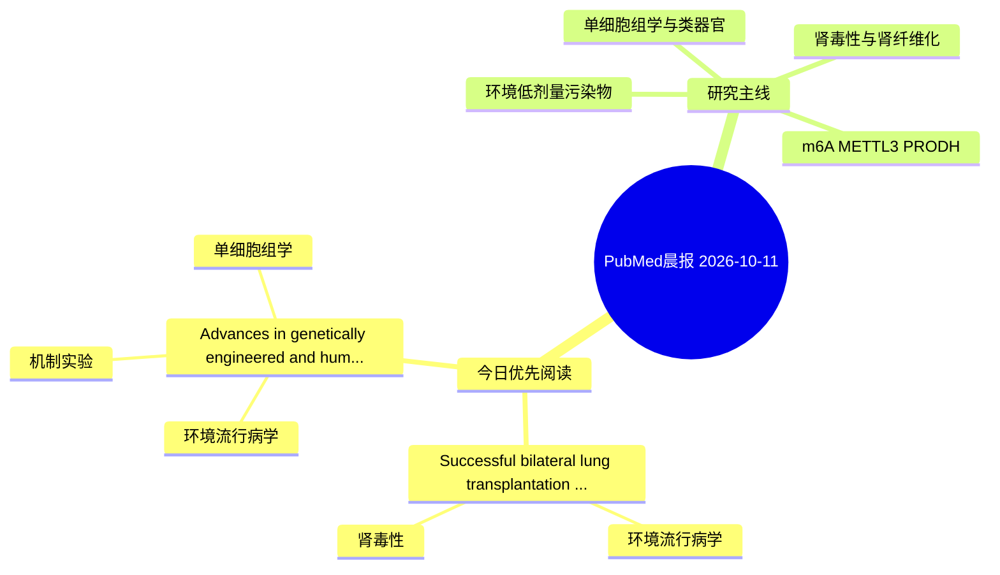

# PubMed 文献晨报｜2026-10-11

- 生成日期：2026-10-11 UTC
- 检索窗口：近 24 小时
- 高质量阈值：规则评分 ≥ 7
- 近 24 小时原始命中数：3

## 今日总体判断

今日筛选出 2 篇优先阅读文献，主要集中在：环境流行病学、肾毒性、机制实验。

## 今日最值得读的 5 篇文章

### 1. Successful bilateral lung transplantation in a patient with severe pulmonary blastomycosis.

- 题目：Successful bilateral lung transplantation in a patient with severe pulmonary blastomycosis.
- 期刊：American journal of transplantation : official journal of the American Society of Transplantation and the American Society of Transplant Surgeons
- 年份：2026
- PMID：[42858774](https://pubmed.ncbi.nlm.nih.gov/42858774/)
- DOI：[10.1016/j.ajt.2026.10.008](https://doi.org/10.1016/j.ajt.2026.10.008)
- 分类：环境流行病学、肾毒性
- 规则评分：12
- 研究对象：患者样本或临床数据
- 核心方法：基于题名/摘要的常规实验或文献分析，需阅读全文确认
- 主要发现：摘要提示研究重点涉及环境污染物暴露、肾毒性/肾损伤；结论线索为：This case suggests that concern for invasive fungal infection persistence should not automatically preclude lung transplantation as a means of survival for irreversible lung injury when assessment supports favorable microbiologic control.
- 为什么值得读：与肾毒性/肾损伤主线直接相关；关键词匹配度较高

### 2. Advances in genetically engineered and humanized mouse models for dissecting sepsis mechanisms and therapeutic response.

- 题目：Advances in genetically engineered and humanized mouse models for dissecting sepsis mechanisms and therapeutic response.
- 期刊：Clinical immunology (Orlando, Fla.)
- 年份：2026
- PMID：[42858833](https://pubmed.ncbi.nlm.nih.gov/42858833/)
- DOI：[10.1016/j.clim.2026.110782](https://doi.org/10.1016/j.clim.2026.110782)
- 分类：环境流行病学、机制实验、单细胞组学
- 规则评分：10
- 研究对象：人群/队列或环境暴露人群
- 核心方法：单细胞或空间组学；细胞与动物机制实验
- 主要发现：摘要提示研究重点涉及环境污染物暴露、单细胞或空间组学；结论线索为：Coupling these platforms with single-cell multi-omics and endotype stratification can link genotype-to-phenotype mechanisms with biomarker-informed therapeutic testing.
- 为什么值得读：同时连接环境暴露与机制线索；可帮助寻找细胞类型特异性机制

## 分类归档

### 环境流行病学
- [Successful bilateral lung transplantation in a patient with severe pulmonary blastomycosis.](https://pubmed.ncbi.nlm.nih.gov/42858774/)（PMID: 42858774）
- [Advances in genetically engineered and humanized mouse models for dissecting sepsis mechanisms and therapeutic response.](https://pubmed.ncbi.nlm.nih.gov/42858833/)（PMID: 42858833）

### 机制实验
- [Advances in genetically engineered and humanized mouse models for dissecting sepsis mechanisms and therapeutic response.](https://pubmed.ncbi.nlm.nih.gov/42858833/)（PMID: 42858833）

### 单细胞组学
- [Advances in genetically engineered and humanized mouse models for dissecting sepsis mechanisms and therapeutic response.](https://pubmed.ncbi.nlm.nih.gov/42858833/)（PMID: 42858833）

### 类器官
- 今日暂无高质量新文献。

### 肾毒性
- [Successful bilateral lung transplantation in a patient with severe pulmonary blastomycosis.](https://pubmed.ncbi.nlm.nih.gov/42858774/)（PMID: 42858774）

### m6A-METTL3-PRODH
- 今日暂无高质量新文献。

## 今日阅读优先级

1. Successful bilateral lung transplantation in a patient with severe pulmonary blastomycosis.（优先理由：与肾毒性/肾损伤主线直接相关；关键词匹配度较高）
2. Advances in genetically engineered and humanized mouse models for dissecting sepsis mechanisms and therapeutic response.（优先理由：同时连接环境暴露与机制线索；可帮助寻找细胞类型特异性机制）

## Mermaid 思维导图

