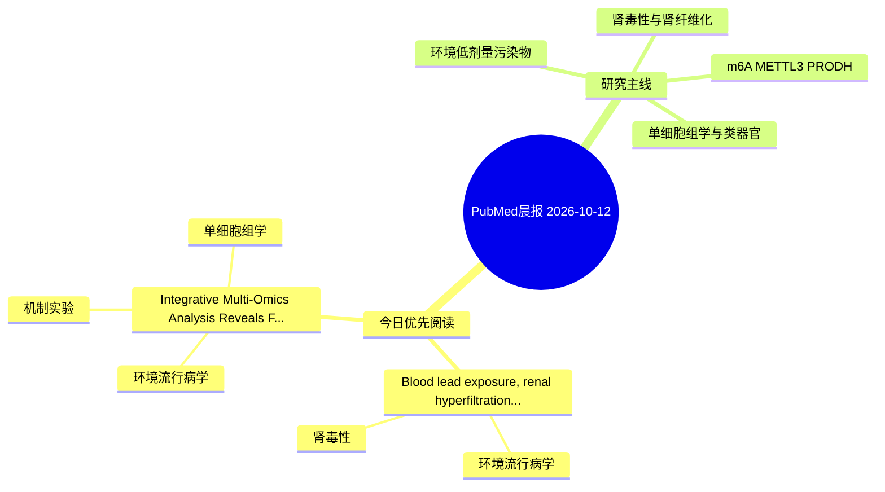

# PubMed 文献晨报｜2026-10-12

- 生成日期：2026-10-12 UTC
- 检索窗口：近 24 小时
- 高质量阈值：规则评分 ≥ 7
- 近 24 小时原始命中数：5

## 今日总体判断

今日筛选出 2 篇优先阅读文献，主要集中在：环境流行病学、肾毒性、机制实验。

## 今日最值得读的 5 篇文章

### 1. Blood lead exposure, renal hyperfiltration, and accelerated kidney function decline among people living with HIV in northern Tanzania: A longitudinal cohort study.

- 题目：Blood lead exposure, renal hyperfiltration, and accelerated kidney function decline among people living with HIV in northern Tanzania: A longitudinal cohort study.
- 期刊：Toxicology reports
- 年份：2026
- PMID：[42861259](https://pubmed.ncbi.nlm.nih.gov/42861259/)
- DOI：[10.1016/j.toxrep.2026.102348](https://doi.org/10.1016/j.toxrep.2026.102348)
- 分类：环境流行病学、肾毒性
- 规则评分：12
- 研究对象：人群/队列或环境暴露人群
- 核心方法：环境流行病学/队列或人群数据
- 主要发现：摘要提示研究重点涉及环境污染物暴露、肾毒性/肾损伤；结论线索为：CONCLUSION: Baseline renal hyperfiltration was strongly associated with subsequent kidney decline among people living with HIV, with greater declines observed among those with higher blood lead levels.
- 为什么值得读：与肾毒性/肾损伤主线直接相关；关键词匹配度较高

### 2. Integrative Multi-Omics Analysis Reveals FAAH and LIPE as Candidate Targets in OBS-Induced Spermatogenic and Fertility Impairment.

- 题目：Integrative Multi-Omics Analysis Reveals FAAH and LIPE as Candidate Targets in OBS-Induced Spermatogenic and Fertility Impairment.
- 期刊：Food and chemical toxicology : an international journal published for the British Industrial Biological Research Association
- 年份：2026
- PMID：[42860217](https://pubmed.ncbi.nlm.nih.gov/42860217/)
- DOI：[10.1016/j.fct.2026.116440](https://doi.org/10.1016/j.fct.2026.116440)
- 分类：环境流行病学、机制实验、单细胞组学
- 规则评分：10
- 研究对象：人群/队列或环境暴露人群
- 核心方法：单细胞或空间组学；细胞与动物机制实验
- 主要发现：摘要提示研究重点涉及环境污染物暴露、单细胞或空间组学；结论线索为：CONCLUSION: OBS exposure was associated with impaired spermatogenesis and reduced male reproductive performance in mice.
- 为什么值得读：同时连接环境暴露与机制线索；可帮助寻找细胞类型特异性机制

## 分类归档

### 环境流行病学
- [Blood lead exposure, renal hyperfiltration, and accelerated kidney function decline among people living with HIV in northern Tanzania: A longitudinal cohort study.](https://pubmed.ncbi.nlm.nih.gov/42861259/)（PMID: 42861259）
- [Integrative Multi-Omics Analysis Reveals FAAH and LIPE as Candidate Targets in OBS-Induced Spermatogenic and Fertility Impairment.](https://pubmed.ncbi.nlm.nih.gov/42860217/)（PMID: 42860217）

### 机制实验
- [Integrative Multi-Omics Analysis Reveals FAAH and LIPE as Candidate Targets in OBS-Induced Spermatogenic and Fertility Impairment.](https://pubmed.ncbi.nlm.nih.gov/42860217/)（PMID: 42860217）

### 单细胞组学
- [Integrative Multi-Omics Analysis Reveals FAAH and LIPE as Candidate Targets in OBS-Induced Spermatogenic and Fertility Impairment.](https://pubmed.ncbi.nlm.nih.gov/42860217/)（PMID: 42860217）

### 类器官
- 今日暂无高质量新文献。

### 肾毒性
- [Blood lead exposure, renal hyperfiltration, and accelerated kidney function decline among people living with HIV in northern Tanzania: A longitudinal cohort study.](https://pubmed.ncbi.nlm.nih.gov/42861259/)（PMID: 42861259）

### m6A-METTL3-PRODH
- 今日暂无高质量新文献。

## 今日阅读优先级

1. Blood lead exposure, renal hyperfiltration, and accelerated kidney function decline among people living with HIV in northern Tanzania: A longitudinal cohort study.（优先理由：与肾毒性/肾损伤主线直接相关；关键词匹配度较高）
2. Integrative Multi-Omics Analysis Reveals FAAH and LIPE as Candidate Targets in OBS-Induced Spermatogenic and Fertility Impairment.（优先理由：同时连接环境暴露与机制线索；可帮助寻找细胞类型特异性机制）

## Mermaid 思维导图

