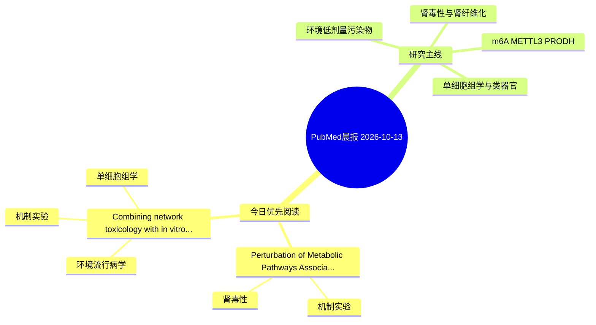

# PubMed 文献晨报｜2026-10-13

- 生成日期：2026-10-13 UTC
- 检索窗口：近 24 小时
- 高质量阈值：规则评分 ≥ 7
- 近 24 小时原始命中数：4

## 今日总体判断

今日筛选出 2 篇优先阅读文献，主要集中在：机制实验、肾毒性、环境流行病学。

## 今日最值得读的 5 篇文章

### 1. Perturbation of Metabolic Pathways Associated with Exposure of Human Renal Proximal Tubular Cells to Nephrotoxic Pollutants and Drugs.

- 题目：Perturbation of Metabolic Pathways Associated with Exposure of Human Renal Proximal Tubular Cells to Nephrotoxic Pollutants and Drugs.
- 期刊：Toxicology
- 年份：2026
- PMID：[42863561](https://pubmed.ncbi.nlm.nih.gov/42863561/)
- DOI：[10.1016/j.tox.2026.154614](https://doi.org/10.1016/j.tox.2026.154614)
- 分类：机制实验、肾毒性
- 规则评分：14
- 研究对象：人群/队列或环境暴露人群
- 核心方法：基于题名/摘要的常规实验或文献分析，需阅读全文确认
- 主要发现：摘要提示研究重点涉及肾毒性/肾损伤；结论线索为：Detection of these altered pathways can be used as indicators to identify renal injury and promote repair.
- 为什么值得读：与肾毒性/肾损伤主线直接相关；关键词匹配度较高

### 2. Combining network toxicology with in vitro and in vivo experimental validation to investigate the toxicological mechanisms of phthalate exposure in promoting osteosarcoma.

- 题目：Combining network toxicology with in vitro and in vivo experimental validation to investigate the toxicological mechanisms of phthalate exposure in promoting osteosarcoma.
- 期刊：Ecotoxicology and environmental safety
- 年份：2026
- PMID：[42863292](https://pubmed.ncbi.nlm.nih.gov/42863292/)
- DOI：[10.1016/j.ecoenv.2026.120914](https://doi.org/10.1016/j.ecoenv.2026.120914)
- 分类：环境流行病学、机制实验、单细胞组学
- 规则评分：14
- 研究对象：题名和摘要未明确，建议阅读全文确认
- 核心方法：单细胞或空间组学；细胞与动物机制实验
- 主要发现：摘要提示研究重点涉及环境污染物暴露、单细胞或空间组学；结论线索为：ssGSEA confirmed that COMT and SFPQ are significantly associated with the abundance of 11 dysregulated immune cell types in OS, and single-cell sequencing revealed that COMT and SFPQ are specifically enriched in key cell populations such as osteoblasts and...
- 为什么值得读：同时连接环境暴露与机制线索；可帮助寻找细胞类型特异性机制；关键词匹配度较高

## 分类归档

### 环境流行病学
- [Combining network toxicology with in vitro and in vivo experimental validation to investigate the toxicological mechanisms of phthalate exposure in promoting osteosarcoma.](https://pubmed.ncbi.nlm.nih.gov/42863292/)（PMID: 42863292）

### 机制实验
- [Perturbation of Metabolic Pathways Associated with Exposure of Human Renal Proximal Tubular Cells to Nephrotoxic Pollutants and Drugs.](https://pubmed.ncbi.nlm.nih.gov/42863561/)（PMID: 42863561）
- [Combining network toxicology with in vitro and in vivo experimental validation to investigate the toxicological mechanisms of phthalate exposure in promoting osteosarcoma.](https://pubmed.ncbi.nlm.nih.gov/42863292/)（PMID: 42863292）

### 单细胞组学
- [Combining network toxicology with in vitro and in vivo experimental validation to investigate the toxicological mechanisms of phthalate exposure in promoting osteosarcoma.](https://pubmed.ncbi.nlm.nih.gov/42863292/)（PMID: 42863292）

### 类器官
- 今日暂无高质量新文献。

### 肾毒性
- [Perturbation of Metabolic Pathways Associated with Exposure of Human Renal Proximal Tubular Cells to Nephrotoxic Pollutants and Drugs.](https://pubmed.ncbi.nlm.nih.gov/42863561/)（PMID: 42863561）

### m6A-METTL3-PRODH
- 今日暂无高质量新文献。

## 今日阅读优先级

1. Perturbation of Metabolic Pathways Associated with Exposure of Human Renal Proximal Tubular Cells to Nephrotoxic Pollutants and Drugs.（优先理由：与肾毒性/肾损伤主线直接相关；关键词匹配度较高）
2. Combining network toxicology with in vitro and in vivo experimental validation to investigate the toxicological mechanisms of phthalate exposure in promoting osteosarcoma.（优先理由：同时连接环境暴露与机制线索；可帮助寻找细胞类型特异性机制；关键词匹配度较高）

## Mermaid 思维导图

