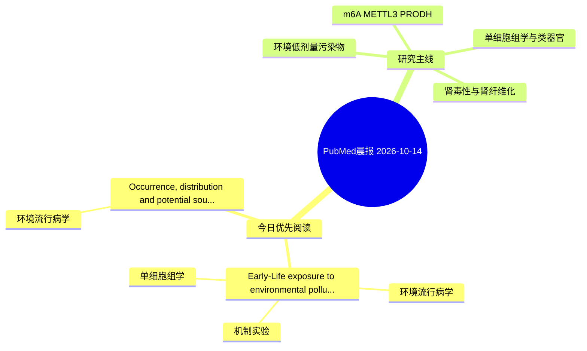

# PubMed 文献晨报｜2026-10-14

- 生成日期：2026-10-14 UTC
- 检索窗口：近 24 小时
- 高质量阈值：规则评分 ≥ 7
- 近 24 小时原始命中数：5

## 今日总体判断

今日筛选出 2 篇优先阅读文献，主要集中在：环境流行病学、机制实验、单细胞组学。

## 今日最值得读的 5 篇文章

### 1. Early-Life exposure to environmental pollutants and endocrine disruptors: emerging risks and mechanistic insights in maternal, fetal, and child health.

- 题目：Early-Life exposure to environmental pollutants and endocrine disruptors: emerging risks and mechanistic insights in maternal, fetal, and child health.
- 期刊：Environmental research
- 年份：2026
- PMID：[42869363](https://pubmed.ncbi.nlm.nih.gov/42869363/)
- DOI：[10.1016/j.envres.2026.125878](https://doi.org/10.1016/j.envres.2026.125878)
- 分类：环境流行病学、机制实验、单细胞组学
- 规则评分：9
- 研究对象：题名和摘要未明确，建议阅读全文确认
- 核心方法：环境流行病学/队列或人群数据；单细胞或空间组学
- 主要发现：摘要提示研究重点涉及环境污染物暴露、单细胞或空间组学；结论线索为：To identify important windows of susceptibility, improve risk assessment, and develop strategies to safeguard maternal and child health, exposomics in conjunction with systems biology and longitudinal epidemiological approaches will be essential.
- 为什么值得读：同时连接环境暴露与机制线索；可帮助寻找细胞类型特异性机制

### 2. Occurrence, distribution and potential sources of phthalate and non-phthalate plasticizers in maternal and fetal-related biological matrices.

- 题目：Occurrence, distribution and potential sources of phthalate and non-phthalate plasticizers in maternal and fetal-related biological matrices.
- 期刊：Environmental geochemistry and health
- 年份：2026
- PMID：[42867580](https://pubmed.ncbi.nlm.nih.gov/42867580/)
- DOI：[10.1007/s10653-026-03540-x](https://doi.org/10.1007/s10653-026-03540-x)
- 分类：环境流行病学
- 规则评分：9
- 研究对象：人群/队列或环境暴露人群
- 核心方法：环境流行病学/队列或人群数据
- 主要发现：摘要提示研究重点涉及本方向相关问题；结论线索为：the findings highlight a clear maternal-fetal exposure continuum to PEs and underline the need for improved exposure control, especially for vulnerable populations, and support further evaluation of both PEs and their substitutes.
- 为什么值得读：与检索主题有交集，可作为背景或线索文献扫读

## 分类归档

### 环境流行病学
- [Early-Life exposure to environmental pollutants and endocrine disruptors: emerging risks and mechanistic insights in maternal, fetal, and child health.](https://pubmed.ncbi.nlm.nih.gov/42869363/)（PMID: 42869363）
- [Occurrence, distribution and potential sources of phthalate and non-phthalate plasticizers in maternal and fetal-related biological matrices.](https://pubmed.ncbi.nlm.nih.gov/42867580/)（PMID: 42867580）

### 机制实验
- [Early-Life exposure to environmental pollutants and endocrine disruptors: emerging risks and mechanistic insights in maternal, fetal, and child health.](https://pubmed.ncbi.nlm.nih.gov/42869363/)（PMID: 42869363）

### 单细胞组学
- [Early-Life exposure to environmental pollutants and endocrine disruptors: emerging risks and mechanistic insights in maternal, fetal, and child health.](https://pubmed.ncbi.nlm.nih.gov/42869363/)（PMID: 42869363）

### 类器官
- 今日暂无高质量新文献。

### 肾毒性
- 今日暂无高质量新文献。

### m6A-METTL3-PRODH
- 今日暂无高质量新文献。

## 今日阅读优先级

1. Early-Life exposure to environmental pollutants and endocrine disruptors: emerging risks and mechanistic insights in maternal, fetal, and child health.（优先理由：同时连接环境暴露与机制线索；可帮助寻找细胞类型特异性机制）
2. Occurrence, distribution and potential sources of phthalate and non-phthalate plasticizers in maternal and fetal-related biological matrices.（优先理由：与检索主题有交集，可作为背景或线索文献扫读）

## Mermaid 思维导图

