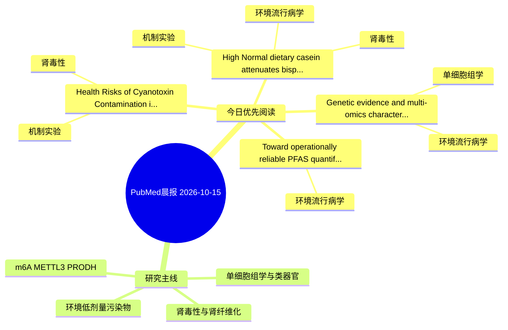

# PubMed 文献晨报｜2026-10-15

- 生成日期：2026-10-15 UTC
- 检索窗口：近 24 小时
- 高质量阈值：规则评分 ≥ 7
- 近 24 小时原始命中数：4

## 今日总体判断

今日筛选出 4 篇优先阅读文献，主要集中在：环境流行病学、机制实验、肾毒性。

## 今日最值得读的 5 篇文章

### 1. Health Risks of Cyanotoxin Contamination in Dietary Supplements: Mechanistic Insights into Organ-Specific Toxicity.

- 题目：Health Risks of Cyanotoxin Contamination in Dietary Supplements: Mechanistic Insights into Organ-Specific Toxicity.
- 期刊：Food and chemical toxicology : an international journal published for the British Industrial Biological Research Association
- 年份：2026
- PMID：[42874982](https://pubmed.ncbi.nlm.nih.gov/42874982/)
- DOI：[10.1016/j.fct.2026.116449](https://doi.org/10.1016/j.fct.2026.116449)
- 分类：机制实验、肾毒性
- 规则评分：14
- 研究对象：人群/队列或环境暴露人群
- 核心方法：基于题名/摘要的常规实验或文献分析，需阅读全文确认
- 主要发现：摘要提示研究重点涉及肾毒性/肾损伤；结论线索为：Future studies integrating toxicokinetics, multi-omics approaches, and validated biomarkers are essential to strengthen risk assessment, improve regulatory oversight, and ensure the safety of cyanobacteria- and microalgae-derived dietary supplements.
- 为什么值得读：与肾毒性/肾损伤主线直接相关；关键词匹配度较高

### 2. High Normal dietary casein attenuates bisphenol A-induced multiorgan toxicity in rats: Preservation of renal integrity, glucose homeostasis, and immune surveillance via modulation of oxidative stress, inflammation, and apoptosis.

- 题目：High Normal dietary casein attenuates bisphenol A-induced multiorgan toxicity in rats: Preservation of renal integrity, glucose homeostasis, and immune surveillance via modulation of oxidative stress, inflammation, and apoptosis.
- 期刊：Toxicology and applied pharmacology
- 年份：2026
- PMID：[42874876](https://pubmed.ncbi.nlm.nih.gov/42874876/)
- DOI：[10.1016/j.taap.2026.118085](https://doi.org/10.1016/j.taap.2026.118085)
- 分类：环境流行病学、机制实验、肾毒性
- 规则评分：12
- 研究对象：小鼠或大鼠肾损伤模型
- 核心方法：基于题名/摘要的常规实验或文献分析，需阅读全文确认
- 主要发现：摘要提示研究重点涉及肾毒性/肾损伤、肾纤维化；结论线索为：Nutritionally relevant elevation of casein (18%) provides significant partial protection against BPA-induced toxicity, supporting dietary protein modulation as a supportive strategy.
- 为什么值得读：同时连接环境暴露与机制线索；与肾毒性/肾损伤主线直接相关；关键词匹配度较高

### 3. Genetic evidence and multi-omics characterization of DEHP-relevant detoxification and metabolic heterogeneity in hepatocellular carcinoma.

- 题目：Genetic evidence and multi-omics characterization of DEHP-relevant detoxification and metabolic heterogeneity in hepatocellular carcinoma.
- 期刊：Frontiers in toxicology
- 年份：2026
- PMID：[42871276](https://pubmed.ncbi.nlm.nih.gov/42871276/)
- DOI：[10.3389/ftox.2026.1925431](https://doi.org/10.3389/ftox.2026.1925431)
- 分类：环境流行病学、单细胞组学
- 规则评分：10
- 研究对象：人群/队列或环境暴露人群
- 核心方法：单细胞或空间组学；细胞与动物机制实验
- 主要发现：摘要提示研究重点涉及单细胞或空间组学；结论线索为：CONCLUSION: DPTS defines a DEHP-relevant, detoxification-suppressed HCC molecular phenotype rather than an exposure-defined or DEHP-induced subtype.
- 为什么值得读：可帮助寻找细胞类型特异性机制

### 4. Toward operationally reliable PFAS quantification in complex liver matrices: Systematic optimization of commercial Cleanup cartridges for LC-MS/MS analysis.

- 题目：Toward operationally reliable PFAS quantification in complex liver matrices: Systematic optimization of commercial Cleanup cartridges for LC-MS/MS analysis.
- 期刊：Journal of chromatography. B, Analytical technologies in the biomedical and life sciences
- 年份：2026
- PMID：[42874323](https://pubmed.ncbi.nlm.nih.gov/42874323/)
- DOI：[10.1016/j.jchromb.2026.125337](https://doi.org/10.1016/j.jchromb.2026.125337)
- 分类：环境流行病学
- 规则评分：9
- 研究对象：题名和摘要未明确，建议阅读全文确认
- 核心方法：基于题名/摘要的常规实验或文献分析，需阅读全文确认
- 主要发现：摘要提示研究重点涉及环境污染物暴露；结论线索为：Overall, the proposed method enables sensitive and reliable quantification of structurally diverse legacy and alternative/emerging PFAS in complex biological tissues using only 0.1 g of dry tissue.
- 为什么值得读：与检索主题有交集，可作为背景或线索文献扫读

## 分类归档

### 环境流行病学
- [High Normal dietary casein attenuates bisphenol A-induced multiorgan toxicity in rats: Preservation of renal integrity, glucose homeostasis, and immune surveillance via modulation of oxidative stress, inflammation, and apoptosis.](https://pubmed.ncbi.nlm.nih.gov/42874876/)（PMID: 42874876）
- [Genetic evidence and multi-omics characterization of DEHP-relevant detoxification and metabolic heterogeneity in hepatocellular carcinoma.](https://pubmed.ncbi.nlm.nih.gov/42871276/)（PMID: 42871276）
- [Toward operationally reliable PFAS quantification in complex liver matrices: Systematic optimization of commercial Cleanup cartridges for LC-MS/MS analysis.](https://pubmed.ncbi.nlm.nih.gov/42874323/)（PMID: 42874323）

### 机制实验
- [Health Risks of Cyanotoxin Contamination in Dietary Supplements: Mechanistic Insights into Organ-Specific Toxicity.](https://pubmed.ncbi.nlm.nih.gov/42874982/)（PMID: 42874982）
- [High Normal dietary casein attenuates bisphenol A-induced multiorgan toxicity in rats: Preservation of renal integrity, glucose homeostasis, and immune surveillance via modulation of oxidative stress, inflammation, and apoptosis.](https://pubmed.ncbi.nlm.nih.gov/42874876/)（PMID: 42874876）

### 单细胞组学
- [Genetic evidence and multi-omics characterization of DEHP-relevant detoxification and metabolic heterogeneity in hepatocellular carcinoma.](https://pubmed.ncbi.nlm.nih.gov/42871276/)（PMID: 42871276）

### 类器官
- 今日暂无高质量新文献。

### 肾毒性
- [Health Risks of Cyanotoxin Contamination in Dietary Supplements: Mechanistic Insights into Organ-Specific Toxicity.](https://pubmed.ncbi.nlm.nih.gov/42874982/)（PMID: 42874982）
- [High Normal dietary casein attenuates bisphenol A-induced multiorgan toxicity in rats: Preservation of renal integrity, glucose homeostasis, and immune surveillance via modulation of oxidative stress, inflammation, and apoptosis.](https://pubmed.ncbi.nlm.nih.gov/42874876/)（PMID: 42874876）

### m6A-METTL3-PRODH
- 今日暂无高质量新文献。

## 今日阅读优先级

1. Health Risks of Cyanotoxin Contamination in Dietary Supplements: Mechanistic Insights into Organ-Specific Toxicity.（优先理由：与肾毒性/肾损伤主线直接相关；关键词匹配度较高）
2. High Normal dietary casein attenuates bisphenol A-induced multiorgan toxicity in rats: Preservation of renal integrity, glucose homeostasis, and immune surveillance via modulation of oxidative stress, inflammation, and apoptosis.（优先理由：同时连接环境暴露与机制线索；与肾毒性/肾损伤主线直接相关；关键词匹配度较高）
3. Genetic evidence and multi-omics characterization of DEHP-relevant detoxification and metabolic heterogeneity in hepatocellular carcinoma.（优先理由：可帮助寻找细胞类型特异性机制）
4. Toward operationally reliable PFAS quantification in complex liver matrices: Systematic optimization of commercial Cleanup cartridges for LC-MS/MS analysis.（优先理由：与检索主题有交集，可作为背景或线索文献扫读）

## Mermaid 思维导图

