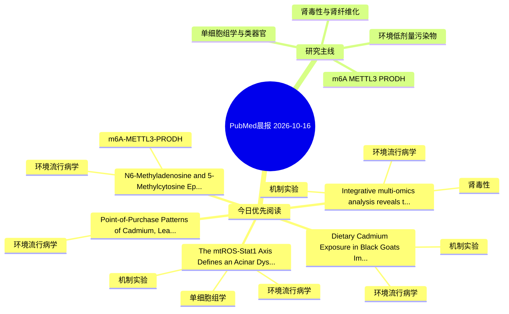

# PubMed 文献晨报｜2026-10-16

- 生成日期：2026-10-16 UTC
- 检索窗口：近 24 小时
- 高质量阈值：规则评分 ≥ 7
- 近 24 小时原始命中数：5

## 今日总体判断

今日筛选出 5 篇优先阅读文献，主要集中在：环境流行病学、机制实验、肾毒性。

## 今日最值得读的 5 篇文章

### 1. Integrative multi-omics analysis reveals the PFAS-gut microbiome-FN1 axis in chronic kidney disease: From exposome to therapeutic target.

- 题目：Integrative multi-omics analysis reveals the PFAS-gut microbiome-FN1 axis in chronic kidney disease: From exposome to therapeutic target.
- 期刊：Computational biology and chemistry
- 年份：2026
- PMID：[42880058](https://pubmed.ncbi.nlm.nih.gov/42880058/)
- DOI：[10.1016/j.compbiolchem.2026.109478](https://doi.org/10.1016/j.compbiolchem.2026.109478)
- 分类：环境流行病学、机制实验、肾毒性
- 规则评分：17
- 研究对象：题名和摘要未明确，建议阅读全文确认
- 核心方法：基于题名/摘要的常规实验或文献分析，需阅读全文确认
- 主要发现：摘要提示研究重点涉及环境污染物暴露、肾毒性/肾损伤、肾纤维化；结论线索为：MR analysis using real MiBioGen and CKDGen GWAS data (19 SNPs for Akkermansia, 12 SNPs for Desulfovibrio) revealed contrasting findings: Akkermansia to CKD showed no significant genetic association (0/4 methods, all p > 0.30), whereas Desulfovibrio to CKD d...
- 为什么值得读：同时连接环境暴露与机制线索；与肾毒性/肾损伤主线直接相关；关键词匹配度较高

### 2. The mtROS-Stat1 Axis Defines an Acinar Dysfunctional State Linking Metabolic Stress to Immune Activation in Cigarette Smoking-Associated Dry Eye Disease.

- 题目：The mtROS-Stat1 Axis Defines an Acinar Dysfunctional State Linking Metabolic Stress to Immune Activation in Cigarette Smoking-Associated Dry Eye Disease.
- 期刊：The ocular surface
- 年份：2026
- PMID：[42880493](https://pubmed.ncbi.nlm.nih.gov/42880493/)
- DOI：[10.1016/j.jtos.2026.10.002](https://doi.org/10.1016/j.jtos.2026.10.002)
- 分类：环境流行病学、机制实验、单细胞组学
- 规则评分：11
- 研究对象：小鼠或大鼠肾损伤模型
- 核心方法：单细胞或空间组学；细胞与动物机制实验
- 主要发现：摘要提示研究重点涉及环境污染物暴露、单细胞或空间组学；结论线索为：CONCLUSION: These findings define a mtROS-Stat1-DAAC axis that links metabolic stress to epithelial dysfunction and immune activation in CS-associated DED.
- 为什么值得读：同时连接环境暴露与机制线索；可帮助寻找细胞类型特异性机制

### 3. N6-Methyladenosine and 5-Methylcytosine Epitranscriptomic Regulation of Male Reproduction and Fertility.

- 题目：N6-Methyladenosine and 5-Methylcytosine Epitranscriptomic Regulation of Male Reproduction and Fertility.
- 期刊：Biology
- 年份：2026
- PMID：[42883351](https://pubmed.ncbi.nlm.nih.gov/42883351/)
- DOI：[10.3390/biology15191678](https://doi.org/10.3390/biology15191678)
- 分类：环境流行病学、m6A-METTL3-PRODH
- 规则评分：11
- 研究对象：题名和摘要未明确，建议阅读全文确认
- 核心方法：m6A RNA修饰检测
- 主要发现：摘要提示研究重点涉及环境污染物暴露、m6A-METTL3/PRODH 调控；结论线索为：Functional studies in genetic knockout animal models show that disrupting key epitranscriptomic regulators contributes to abnormal germ cell development at multiple developmental stages.
- 为什么值得读：贴近 m6A-METTL3-PRODH 调控假说

### 4. Dietary Cadmium Exposure in Black Goats: Impacts on Growth Performance, Serum Biochemical and Immune Parameters, Meat Quality, and Tissue Accumulation.

- 题目：Dietary Cadmium Exposure in Black Goats: Impacts on Growth Performance, Serum Biochemical and Immune Parameters, Meat Quality, and Tissue Accumulation.
- 期刊：Animals : an open access journal from MDPI
- 年份：2026
- PMID：[42883084](https://pubmed.ncbi.nlm.nih.gov/42883084/)
- DOI：[10.3390/ani16193115](https://doi.org/10.3390/ani16193115)
- 分类：环境流行病学、机制实验
- 规则评分：9
- 研究对象：人群/队列或环境暴露人群
- 核心方法：基于题名/摘要的常规实验或文献分析，需阅读全文确认
- 主要发现：摘要提示研究重点涉及环境污染物暴露；结论线索为：These findings indicate that fecal excretion constitutes the predominant elimination pathway for ingested Cd, with only a negligible proportion retained in edible tissues and internal organs.
- 为什么值得读：同时连接环境暴露与机制线索

### 5. Point-of-Purchase Patterns of Cadmium, Lead, and Other Toxic Elements in Houttuynia cordata Thunb. Rhizomes from Retail Markets Across Guizhou, China.

- 题目：Point-of-Purchase Patterns of Cadmium, Lead, and Other Toxic Elements in Houttuynia cordata Thunb. Rhizomes from Retail Markets Across Guizhou, China.
- 期刊：Foods (Basel, Switzerland)
- 年份：2026
- PMID：[42883568](https://pubmed.ncbi.nlm.nih.gov/42883568/)
- DOI：[10.3390/foods15193461](https://doi.org/10.3390/foods15193461)
- 分类：环境流行病学
- 规则评分：9
- 研究对象：题名和摘要未明确，建议阅读全文确认
- 核心方法：基于题名/摘要的常规实验或文献分析，需阅读全文确认
- 主要发现：摘要提示研究重点涉及环境污染物暴露；结论线索为：These findings identify Cd and Pb as priority elements in market-sold HCT and support targeted retail surveillance, supply-chain tracing, and refined assessment of samples with elevated As or Pb.
- 为什么值得读：与检索主题有交集，可作为背景或线索文献扫读

## 分类归档

### 环境流行病学
- [Integrative multi-omics analysis reveals the PFAS-gut microbiome-FN1 axis in chronic kidney disease: From exposome to therapeutic target.](https://pubmed.ncbi.nlm.nih.gov/42880058/)（PMID: 42880058）
- [The mtROS-Stat1 Axis Defines an Acinar Dysfunctional State Linking Metabolic Stress to Immune Activation in Cigarette Smoking-Associated Dry Eye Disease.](https://pubmed.ncbi.nlm.nih.gov/42880493/)（PMID: 42880493）
- [N6-Methyladenosine and 5-Methylcytosine Epitranscriptomic Regulation of Male Reproduction and Fertility.](https://pubmed.ncbi.nlm.nih.gov/42883351/)（PMID: 42883351）
- [Dietary Cadmium Exposure in Black Goats: Impacts on Growth Performance, Serum Biochemical and Immune Parameters, Meat Quality, and Tissue Accumulation.](https://pubmed.ncbi.nlm.nih.gov/42883084/)（PMID: 42883084）
- [Point-of-Purchase Patterns of Cadmium, Lead, and Other Toxic Elements in Houttuynia cordata Thunb. Rhizomes from Retail Markets Across Guizhou, China.](https://pubmed.ncbi.nlm.nih.gov/42883568/)（PMID: 42883568）

### 机制实验
- [Integrative multi-omics analysis reveals the PFAS-gut microbiome-FN1 axis in chronic kidney disease: From exposome to therapeutic target.](https://pubmed.ncbi.nlm.nih.gov/42880058/)（PMID: 42880058）
- [The mtROS-Stat1 Axis Defines an Acinar Dysfunctional State Linking Metabolic Stress to Immune Activation in Cigarette Smoking-Associated Dry Eye Disease.](https://pubmed.ncbi.nlm.nih.gov/42880493/)（PMID: 42880493）
- [Dietary Cadmium Exposure in Black Goats: Impacts on Growth Performance, Serum Biochemical and Immune Parameters, Meat Quality, and Tissue Accumulation.](https://pubmed.ncbi.nlm.nih.gov/42883084/)（PMID: 42883084）

### 单细胞组学
- [The mtROS-Stat1 Axis Defines an Acinar Dysfunctional State Linking Metabolic Stress to Immune Activation in Cigarette Smoking-Associated Dry Eye Disease.](https://pubmed.ncbi.nlm.nih.gov/42880493/)（PMID: 42880493）

### 类器官
- 今日暂无高质量新文献。

### 肾毒性
- [Integrative multi-omics analysis reveals the PFAS-gut microbiome-FN1 axis in chronic kidney disease: From exposome to therapeutic target.](https://pubmed.ncbi.nlm.nih.gov/42880058/)（PMID: 42880058）

### m6A-METTL3-PRODH
- [N6-Methyladenosine and 5-Methylcytosine Epitranscriptomic Regulation of Male Reproduction and Fertility.](https://pubmed.ncbi.nlm.nih.gov/42883351/)（PMID: 42883351）

## 今日阅读优先级

1. Integrative multi-omics analysis reveals the PFAS-gut microbiome-FN1 axis in chronic kidney disease: From exposome to therapeutic target.（优先理由：同时连接环境暴露与机制线索；与肾毒性/肾损伤主线直接相关；关键词匹配度较高）
2. The mtROS-Stat1 Axis Defines an Acinar Dysfunctional State Linking Metabolic Stress to Immune Activation in Cigarette Smoking-Associated Dry Eye Disease.（优先理由：同时连接环境暴露与机制线索；可帮助寻找细胞类型特异性机制）
3. N6-Methyladenosine and 5-Methylcytosine Epitranscriptomic Regulation of Male Reproduction and Fertility.（优先理由：贴近 m6A-METTL3-PRODH 调控假说）
4. Dietary Cadmium Exposure in Black Goats: Impacts on Growth Performance, Serum Biochemical and Immune Parameters, Meat Quality, and Tissue Accumulation.（优先理由：同时连接环境暴露与机制线索）
5. Point-of-Purchase Patterns of Cadmium, Lead, and Other Toxic Elements in Houttuynia cordata Thunb. Rhizomes from Retail Markets Across Guizhou, China.（优先理由：与检索主题有交集，可作为背景或线索文献扫读）

## Mermaid 思维导图

