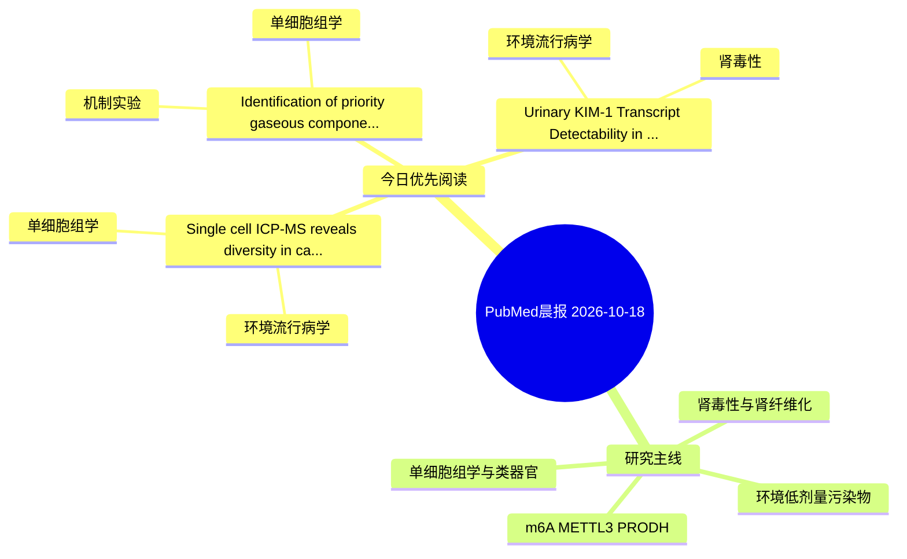

# PubMed 文献晨报｜2026-10-18

- 生成日期：2026-10-18 UTC
- 检索窗口：近 24 小时
- 高质量阈值：规则评分 ≥ 7
- 近 24 小时原始命中数：4

## 今日总体判断

今日筛选出 3 篇优先阅读文献，主要集中在：环境流行病学、单细胞组学、机制实验。

## 今日最值得读的 5 篇文章

### 1. Single cell ICP-MS reveals diversity in cadmium response across individual cells of three marine phytoplankton species.

- 题目：Single cell ICP-MS reveals diversity in cadmium response across individual cells of three marine phytoplankton species.
- 期刊：Ecotoxicology and environmental safety
- 年份：2026
- PMID：[42892292](https://pubmed.ncbi.nlm.nih.gov/42892292/)
- DOI：[10.1016/j.ecoenv.2026.120940](https://doi.org/10.1016/j.ecoenv.2026.120940)
- 分类：环境流行病学、单细胞组学
- 规则评分：10
- 研究对象：题名和摘要未明确，建议阅读全文确认
- 核心方法：单细胞或空间组学
- 主要发现：摘要提示研究重点涉及环境污染物暴露、单细胞或空间组学；结论线索为：viridis was the most Cd-tolerant of the three species under the tested conditions and priority candidate for removal-focused evaluation.
- 为什么值得读：可帮助寻找细胞类型特异性机制

### 2. Identification of priority gaseous component in biodiesel exhaust and its potential pulmonary hazards: a data-driven screening and validation strategy.

- 题目：Identification of priority gaseous component in biodiesel exhaust and its potential pulmonary hazards: a data-driven screening and validation strategy.
- 期刊：Environment international
- 年份：2026
- PMID：[42892262](https://pubmed.ncbi.nlm.nih.gov/42892262/)
- DOI：[10.1016/j.envint.2026.110558](https://doi.org/10.1016/j.envint.2026.110558)
- 分类：机制实验、单细胞组学
- 规则评分：10
- 研究对象：人群/队列或环境暴露人群
- 核心方法：单细胞或空间组学；细胞与动物机制实验
- 主要发现：摘要提示研究重点涉及环境污染物暴露、肾纤维化、单细胞或空间组学；结论线索为：This conclusion is further suppported by the upregulation of Tgfb1 expression both in vivo and in vitro.
- 为什么值得读：可帮助寻找细胞类型特异性机制

### 3. Urinary KIM-1 Transcript Detectability in Workers Chronically Exposed to Arsenic and Antimony in an Industrial Area of Central Chile: A Cross-Sectional Pilot Study.

- 题目：Urinary KIM-1 Transcript Detectability in Workers Chronically Exposed to Arsenic and Antimony in an Industrial Area of Central Chile: A Cross-Sectional Pilot Study.
- 期刊：Environmental toxicology and pharmacology
- 年份：2026
- PMID：[42892536](https://pubmed.ncbi.nlm.nih.gov/42892536/)
- DOI：[10.1016/j.etap.2026.105200](https://doi.org/10.1016/j.etap.2026.105200)
- 分类：环境流行病学、肾毒性
- 规则评分：9
- 研究对象：人群/队列或环境暴露人群
- 核心方法：环境流行病学/队列或人群数据；细胞与动物机制实验
- 主要发现：摘要提示研究重点涉及环境污染物暴露、肾毒性/肾损伤；结论线索为：CONCLUSION: Urinary KIM-1 transcripts are detectable in workers chronically exposed to As and Sb despite normal conventional renal function.
- 为什么值得读：与肾毒性/肾损伤主线直接相关

## 分类归档

### 环境流行病学
- [Single cell ICP-MS reveals diversity in cadmium response across individual cells of three marine phytoplankton species.](https://pubmed.ncbi.nlm.nih.gov/42892292/)（PMID: 42892292）
- [Urinary KIM-1 Transcript Detectability in Workers Chronically Exposed to Arsenic and Antimony in an Industrial Area of Central Chile: A Cross-Sectional Pilot Study.](https://pubmed.ncbi.nlm.nih.gov/42892536/)（PMID: 42892536）

### 机制实验
- [Identification of priority gaseous component in biodiesel exhaust and its potential pulmonary hazards: a data-driven screening and validation strategy.](https://pubmed.ncbi.nlm.nih.gov/42892262/)（PMID: 42892262）

### 单细胞组学
- [Single cell ICP-MS reveals diversity in cadmium response across individual cells of three marine phytoplankton species.](https://pubmed.ncbi.nlm.nih.gov/42892292/)（PMID: 42892292）
- [Identification of priority gaseous component in biodiesel exhaust and its potential pulmonary hazards: a data-driven screening and validation strategy.](https://pubmed.ncbi.nlm.nih.gov/42892262/)（PMID: 42892262）

### 类器官
- 今日暂无高质量新文献。

### 肾毒性
- [Urinary KIM-1 Transcript Detectability in Workers Chronically Exposed to Arsenic and Antimony in an Industrial Area of Central Chile: A Cross-Sectional Pilot Study.](https://pubmed.ncbi.nlm.nih.gov/42892536/)（PMID: 42892536）

### m6A-METTL3-PRODH
- 今日暂无高质量新文献。

## 今日阅读优先级

1. Single cell ICP-MS reveals diversity in cadmium response across individual cells of three marine phytoplankton species.（优先理由：可帮助寻找细胞类型特异性机制）
2. Identification of priority gaseous component in biodiesel exhaust and its potential pulmonary hazards: a data-driven screening and validation strategy.（优先理由：可帮助寻找细胞类型特异性机制）
3. Urinary KIM-1 Transcript Detectability in Workers Chronically Exposed to Arsenic and Antimony in an Industrial Area of Central Chile: A Cross-Sectional Pilot Study.（优先理由：与肾毒性/肾损伤主线直接相关）

## Mermaid 思维导图

