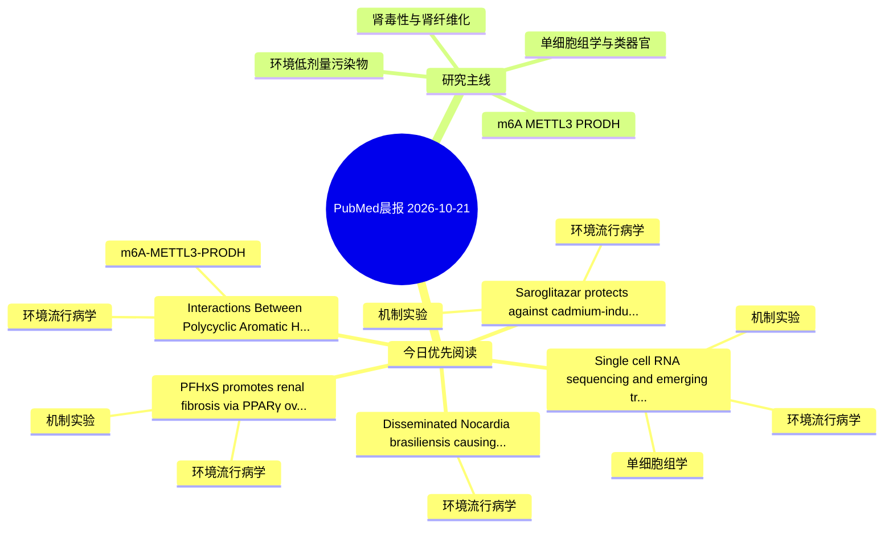

# PubMed 文献晨报｜2026-10-21

- 生成日期：2026-10-21 UTC
- 检索窗口：近 24 小时
- 高质量阈值：规则评分 ≥ 7
- 近 24 小时原始命中数：6

## 今日总体判断

今日筛选出 5 篇优先阅读文献，主要集中在：环境流行病学、机制实验、单细胞组学。

## 今日最值得读的 5 篇文章

### 1. PFHxS promotes renal fibrosis via PPARγ overactivation-dependent NLRP1 inflammasome-driven pyroptosis.

- 题目：PFHxS promotes renal fibrosis via PPARγ overactivation-dependent NLRP1 inflammasome-driven pyroptosis.
- 期刊：Environmental pollution (Barking, Essex : 1987)
- 年份：2026
- PMID：[42901464](https://pubmed.ncbi.nlm.nih.gov/42901464/)
- DOI：[10.1016/j.envpol.2026.129374](https://doi.org/10.1016/j.envpol.2026.129374)
- 分类：环境流行病学、机制实验
- 规则评分：17
- 研究对象：小鼠或大鼠肾损伤模型
- 核心方法：基于题名/摘要的常规实验或文献分析，需阅读全文确认
- 主要发现：摘要提示研究重点涉及环境污染物暴露、肾纤维化；结论线索为：Furthermore, RNA sequencing revealed that PFHxS activated the NLRP1 inflammasome, triggering Caspase-1-dependent pyroptosis, as validated by GSDMD cleavage.
- 为什么值得读：同时连接环境暴露与机制线索；关键词匹配度较高

### 2. Single cell RNA sequencing and emerging transcriptomic technologies in Alzheimer's disease cerebral organoids: a mini review.

- 题目：Single cell RNA sequencing and emerging transcriptomic technologies in Alzheimer's disease cerebral organoids: a mini review.
- 期刊：Molecular brain
- 年份：2026
- PMID：[42902292](https://pubmed.ncbi.nlm.nih.gov/42902292/)
- DOI：[10.1186/s13041-026-01335-w](https://doi.org/10.1186/s13041-026-01335-w)
- 分类：环境流行病学、机制实验、单细胞组学、类器官
- 规则评分：14
- 研究对象：人群/队列或环境暴露人群
- 核心方法：单细胞或空间组学；类器官/干细胞模型；细胞与动物机制实验
- 主要发现：摘要提示研究重点涉及单细胞或空间组学、类器官模型；结论线索为：Ultimately, integrating these advanced cerebral organoid platforms with single cell technologies offer a powerful toolkit to dissect early disease mechanisms and accelerate the development of personalised therapeutics.
- 为什么值得读：同时连接环境暴露与机制线索；可帮助寻找细胞类型特异性机制；对建立更接近人体的模型有参考价值

### 3. Interactions Between Polycyclic Aromatic Hydrocarbon Exposure and Epigenetic Regulatory Genes in Embryonic Arrest.

- 题目：Interactions Between Polycyclic Aromatic Hydrocarbon Exposure and Epigenetic Regulatory Genes in Embryonic Arrest.
- 期刊：Environmental pollution (Barking, Essex : 1987)
- 年份：2026
- PMID：[42901468](https://pubmed.ncbi.nlm.nih.gov/42901468/)
- DOI：[10.1016/j.envpol.2026.129385](https://doi.org/10.1016/j.envpol.2026.129385)
- 分类：环境流行病学、m6A-METTL3-PRODH
- 规则评分：13
- 研究对象：患者样本或临床数据
- 核心方法：m6A RNA修饰检测
- 主要发现：摘要提示研究重点涉及m6A-METTL3/PRODH 调控；结论线索为：These findings identify a novel gene-environment interaction underlying embryonic arrest and suggest that combining ALKBH5 rs4925144 genotyping with PAHs exposure assessment could serve as a valuable biomarker for early risk stratification, informing target...
- 为什么值得读：贴近 m6A-METTL3-PRODH 调控假说；关键词匹配度较高

### 4. Disseminated Nocardia brasiliensis causing septic arthritis in a patient with non-small cell lung adenocarcinoma: a case report.

- 题目：Disseminated Nocardia brasiliensis causing septic arthritis in a patient with non-small cell lung adenocarcinoma: a case report.
- 期刊：BMC infectious diseases
- 年份：2026
- PMID：[42902226](https://pubmed.ncbi.nlm.nih.gov/42902226/)
- DOI：[10.1186/s12879-026-14064-1](https://doi.org/10.1186/s12879-026-14064-1)
- 分类：环境流行病学
- 规则评分：13
- 研究对象：患者样本或临床数据
- 核心方法：基于题名/摘要的常规实验或文献分析，需阅读全文确认
- 主要发现：摘要提示研究重点涉及环境污染物暴露；结论线索为：CONCLUSIONS: This case highlights that Nocardia brasiliensis can cause disseminated musculoskeletal infection including septic arthritis in immunocompromised patients without clear environmental exposure.
- 为什么值得读：关键词匹配度较高

### 5. Saroglitazar protects against cadmium-induced hepatorenal injury in rats by suppressing NF-κB and upregulating Nrf2.

- 题目：Saroglitazar protects against cadmium-induced hepatorenal injury in rats by suppressing NF-κB and upregulating Nrf2.
- 期刊：Frontiers in pharmacology
- 年份：2026
- PMID：[42898561](https://pubmed.ncbi.nlm.nih.gov/42898561/)
- DOI：[10.3389/fphar.2026.1916439](https://doi.org/10.3389/fphar.2026.1916439)
- 分类：环境流行病学、机制实验
- 规则评分：12
- 研究对象：小鼠或大鼠肾损伤模型
- 核心方法：基于题名/摘要的常规实验或文献分析，需阅读全文确认
- 主要发现：摘要提示研究重点涉及环境污染物暴露；结论线索为：CONCLUSION: Collectively, saroglitazar showed a protective effect against Cd-induced hepatorenal injury in rats.
- 为什么值得读：同时连接环境暴露与机制线索；关键词匹配度较高

## 分类归档

### 环境流行病学
- [PFHxS promotes renal fibrosis via PPARγ overactivation-dependent NLRP1 inflammasome-driven pyroptosis.](https://pubmed.ncbi.nlm.nih.gov/42901464/)（PMID: 42901464）
- [Single cell RNA sequencing and emerging transcriptomic technologies in Alzheimer's disease cerebral organoids: a mini review.](https://pubmed.ncbi.nlm.nih.gov/42902292/)（PMID: 42902292）
- [Interactions Between Polycyclic Aromatic Hydrocarbon Exposure and Epigenetic Regulatory Genes in Embryonic Arrest.](https://pubmed.ncbi.nlm.nih.gov/42901468/)（PMID: 42901468）
- [Disseminated Nocardia brasiliensis causing septic arthritis in a patient with non-small cell lung adenocarcinoma: a case report.](https://pubmed.ncbi.nlm.nih.gov/42902226/)（PMID: 42902226）
- [Saroglitazar protects against cadmium-induced hepatorenal injury in rats by suppressing NF-κB and upregulating Nrf2.](https://pubmed.ncbi.nlm.nih.gov/42898561/)（PMID: 42898561）

### 机制实验
- [PFHxS promotes renal fibrosis via PPARγ overactivation-dependent NLRP1 inflammasome-driven pyroptosis.](https://pubmed.ncbi.nlm.nih.gov/42901464/)（PMID: 42901464）
- [Single cell RNA sequencing and emerging transcriptomic technologies in Alzheimer's disease cerebral organoids: a mini review.](https://pubmed.ncbi.nlm.nih.gov/42902292/)（PMID: 42902292）
- [Saroglitazar protects against cadmium-induced hepatorenal injury in rats by suppressing NF-κB and upregulating Nrf2.](https://pubmed.ncbi.nlm.nih.gov/42898561/)（PMID: 42898561）

### 单细胞组学
- [Single cell RNA sequencing and emerging transcriptomic technologies in Alzheimer's disease cerebral organoids: a mini review.](https://pubmed.ncbi.nlm.nih.gov/42902292/)（PMID: 42902292）

### 类器官
- [Single cell RNA sequencing and emerging transcriptomic technologies in Alzheimer's disease cerebral organoids: a mini review.](https://pubmed.ncbi.nlm.nih.gov/42902292/)（PMID: 42902292）

### 肾毒性
- 今日暂无高质量新文献。

### m6A-METTL3-PRODH
- [Interactions Between Polycyclic Aromatic Hydrocarbon Exposure and Epigenetic Regulatory Genes in Embryonic Arrest.](https://pubmed.ncbi.nlm.nih.gov/42901468/)（PMID: 42901468）

## 今日阅读优先级

1. PFHxS promotes renal fibrosis via PPARγ overactivation-dependent NLRP1 inflammasome-driven pyroptosis.（优先理由：同时连接环境暴露与机制线索；关键词匹配度较高）
2. Single cell RNA sequencing and emerging transcriptomic technologies in Alzheimer's disease cerebral organoids: a mini review.（优先理由：同时连接环境暴露与机制线索；可帮助寻找细胞类型特异性机制；对建立更接近人体的模型有参考价值）
3. Interactions Between Polycyclic Aromatic Hydrocarbon Exposure and Epigenetic Regulatory Genes in Embryonic Arrest.（优先理由：贴近 m6A-METTL3-PRODH 调控假说；关键词匹配度较高）
4. Disseminated Nocardia brasiliensis causing septic arthritis in a patient with non-small cell lung adenocarcinoma: a case report.（优先理由：关键词匹配度较高）
5. Saroglitazar protects against cadmium-induced hepatorenal injury in rats by suppressing NF-κB and upregulating Nrf2.（优先理由：同时连接环境暴露与机制线索；关键词匹配度较高）

## Mermaid 思维导图

