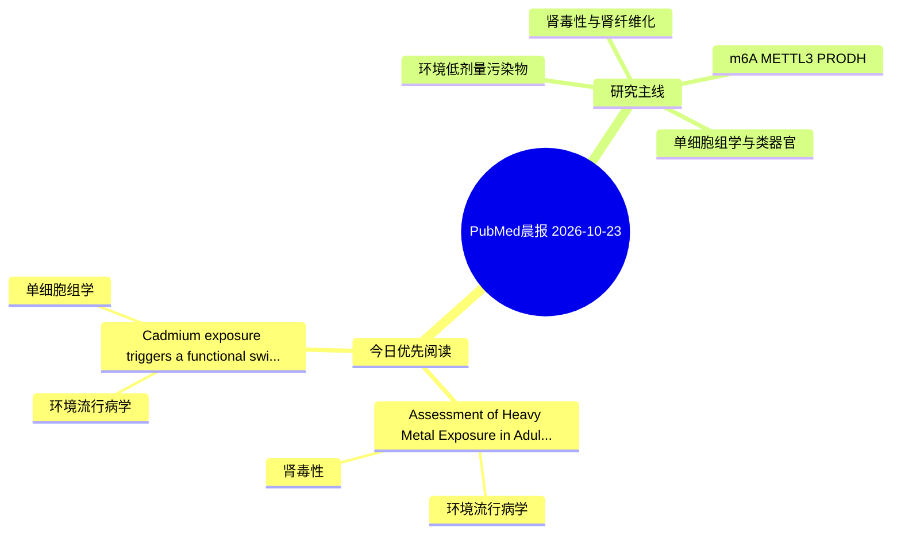

# PubMed 文献晨报｜2026-10-23

- 生成日期：2026-10-23 UTC
- 检索窗口：近 24 小时
- 高质量阈值：规则评分 ≥ 7
- 近 24 小时原始命中数：3

## 今日总体判断

今日筛选出 2 篇优先阅读文献，主要集中在：环境流行病学、肾毒性、单细胞组学。

## 今日最值得读的 5 篇文章

### 1. Assessment of Heavy Metal Exposure in Adult Patients with Minimal Change Disease: A Cross-sectional Case-Control Study.

- 题目：Assessment of Heavy Metal Exposure in Adult Patients with Minimal Change Disease: A Cross-sectional Case-Control Study.
- 期刊：Annals of African medicine
- 年份：2026
- PMID：[42904351](https://pubmed.ncbi.nlm.nih.gov/42904351/)
- DOI：[10.4103/aam.aam_825_26](https://doi.org/10.4103/aam.aam_825_26)
- 分类：环境流行病学、肾毒性
- 规则评分：19
- 研究对象：患者样本或临床数据
- 核心方法：基于题名/摘要的常规实验或文献分析，需阅读全文确认
- 主要发现：摘要提示研究重点涉及环境污染物暴露、肾毒性/肾损伤；结论线索为：These findings suggest that environmental heavy metals may act as contributory factors rather than direct determinants of disease expression.
- 为什么值得读：与肾毒性/肾损伤主线直接相关；关键词匹配度较高

### 2. Cadmium exposure triggers a functional switch of APP to drive joint degeneration.

- 题目：Cadmium exposure triggers a functional switch of APP to drive joint degeneration.
- 期刊：Molecular medicine (Cambridge, Mass.)
- 年份：2026
- PMID：[42907963](https://pubmed.ncbi.nlm.nih.gov/42907963/)
- DOI：[10.1186/s10020-026-01603-4](https://doi.org/10.1186/s10020-026-01603-4)
- 分类：环境流行病学、单细胞组学
- 规则评分：14
- 研究对象：人群/队列或环境暴露人群
- 核心方法：环境流行病学/队列或人群数据；单细胞或空间组学
- 主要发现：摘要提示研究重点涉及环境污染物暴露、单细胞或空间组学；结论线索为：CONCLUSION: This study systematically elucidates the molecular landscape through which Cd exposure drives OA progression via the APP-mediated immune-inflammatory axis.
- 为什么值得读：可帮助寻找细胞类型特异性机制；关键词匹配度较高

## 分类归档

### 环境流行病学
- [Assessment of Heavy Metal Exposure in Adult Patients with Minimal Change Disease: A Cross-sectional Case-Control Study.](https://pubmed.ncbi.nlm.nih.gov/42904351/)（PMID: 42904351）
- [Cadmium exposure triggers a functional switch of APP to drive joint degeneration.](https://pubmed.ncbi.nlm.nih.gov/42907963/)（PMID: 42907963）

### 机制实验
- 今日暂无高质量新文献。

### 单细胞组学
- [Cadmium exposure triggers a functional switch of APP to drive joint degeneration.](https://pubmed.ncbi.nlm.nih.gov/42907963/)（PMID: 42907963）

### 类器官
- 今日暂无高质量新文献。

### 肾毒性
- [Assessment of Heavy Metal Exposure in Adult Patients with Minimal Change Disease: A Cross-sectional Case-Control Study.](https://pubmed.ncbi.nlm.nih.gov/42904351/)（PMID: 42904351）

### m6A-METTL3-PRODH
- 今日暂无高质量新文献。

## 今日阅读优先级

1. Assessment of Heavy Metal Exposure in Adult Patients with Minimal Change Disease: A Cross-sectional Case-Control Study.（优先理由：与肾毒性/肾损伤主线直接相关；关键词匹配度较高）
2. Cadmium exposure triggers a functional switch of APP to drive joint degeneration.（优先理由：可帮助寻找细胞类型特异性机制；关键词匹配度较高）

## Mermaid 思维导图

