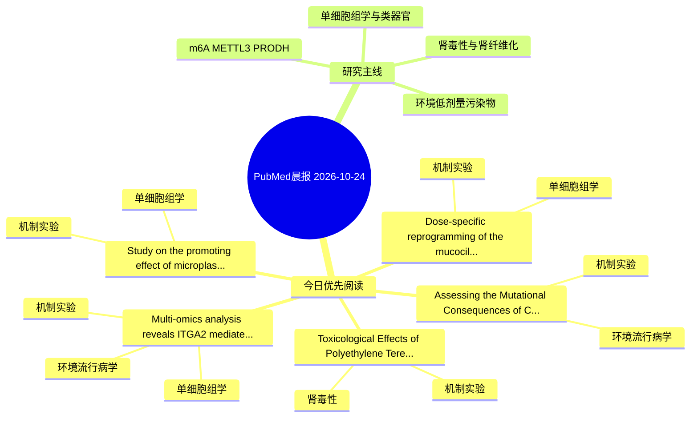

# PubMed 文献晨报｜2026-10-24

- 生成日期：2026-10-24 UTC
- 检索窗口：近 24 小时
- 高质量阈值：规则评分 ≥ 7
- 近 24 小时原始命中数：11

## 今日总体判断

今日筛选出 5 篇优先阅读文献，主要集中在：机制实验、单细胞组学、环境流行病学。

## 今日最值得读的 5 篇文章

### 1. Dose-specific reprogramming of the mucociliary-humoral immune interface in oysters upon biodegradable microplastics exposure.

- 题目：Dose-specific reprogramming of the mucociliary-humoral immune interface in oysters upon biodegradable microplastics exposure.
- 期刊：Environmental pollution (Barking, Essex : 1987)
- 年份：2026
- PMID：[42918596](https://pubmed.ncbi.nlm.nih.gov/42918596/)
- DOI：[10.1016/j.envpol.2026.129389](https://doi.org/10.1016/j.envpol.2026.129389)
- 分类：机制实验、单细胞组学
- 规则评分：19
- 研究对象：题名和摘要未明确，建议阅读全文确认
- 核心方法：单细胞或空间组学
- 主要发现：摘要提示研究重点涉及单细胞或空间组学；结论线索为：Taken together, these findings defined a nonlinear transition from low-dose physicochemical interface adaptation to high-dose particle burden associated mucociliary-immune remodeling, providing a cellular and mechanistic basis for identifying early biologic...
- 为什么值得读：可帮助寻找细胞类型特异性机制；关键词匹配度较高

### 2. Multi-omics analysis reveals ITGA2 mediates DEHP-induced decidual endothelial dysfunction in recurrent pregnancy loss.

- 题目：Multi-omics analysis reveals ITGA2 mediates DEHP-induced decidual endothelial dysfunction in recurrent pregnancy loss.
- 期刊：Ecotoxicology and environmental safety
- 年份：2026
- PMID：[42913103](https://pubmed.ncbi.nlm.nih.gov/42913103/)
- DOI：[10.1016/j.ecoenv.2026.120960](https://doi.org/10.1016/j.ecoenv.2026.120960)
- 分类：环境流行病学、机制实验、单细胞组学
- 规则评分：14
- 研究对象：题名和摘要未明确，建议阅读全文确认
- 核心方法：单细胞或空间组学
- 主要发现：摘要提示研究重点涉及单细胞或空间组学；结论线索为：Collectively, these findings identify ITGA2 as a biologically and genetically supported candidate linking DEHP exposure to impaired decidual endothelial function in RPL and provide a basis for future biomarker and mechanistic studies.
- 为什么值得读：同时连接环境暴露与机制线索；可帮助寻找细胞类型特异性机制；关键词匹配度较高

### 3. Study on the promoting effect of microplastic exposure on prostate cancer migration and invasion based on network toxicology and single-cell sequencing technology.

- 题目：Study on the promoting effect of microplastic exposure on prostate cancer migration and invasion based on network toxicology and single-cell sequencing technology.
- 期刊：Frontiers in oncology
- 年份：2026
- PMID：[42920511](https://pubmed.ncbi.nlm.nih.gov/42920511/)
- DOI：[10.3389/fonc.2026.1973812](https://doi.org/10.3389/fonc.2026.1973812)
- 分类：机制实验、单细胞组学
- 规则评分：14
- 研究对象：人群/队列或环境暴露人群
- 核心方法：单细胞或空间组学；细胞与动物机制实验
- 主要发现：摘要提示研究重点涉及单细胞或空间组学；结论线索为：CONCLUSION: ATBC exposure may promote PCa migration and invasion by targeting LPCAT1 and PDK1, thereby perturbing cytoskeletal dynamics and metabolic pathways.
- 为什么值得读：可帮助寻找细胞类型特异性机制；关键词匹配度较高

### 4. Assessing the Mutational Consequences of Chronic Arsenic Exposure Using Patient-Derived Tumor Samples and In Vitro Systems.

- 题目：Assessing the Mutational Consequences of Chronic Arsenic Exposure Using Patient-Derived Tumor Samples and In Vitro Systems.
- 期刊：Environmental and molecular mutagenesis
- 年份：2026
- PMID：[42920328](https://pubmed.ncbi.nlm.nih.gov/42920328/)
- DOI：[10.1002/em.70079](https://doi.org/10.1002/em.70079)
- 分类：环境流行病学、机制实验
- 规则评分：13
- 研究对象：人群/队列或环境暴露人群
- 核心方法：细胞与动物机制实验
- 主要发现：摘要提示研究重点涉及环境污染物暴露；结论线索为：Taken together, our findings suggest that arsenic alone may have limited independent mutagenic effects and instead may act through co-carcinogenic mechanisms.
- 为什么值得读：同时连接环境暴露与机制线索；关键词匹配度较高

### 5. Toxicological Effects of Polyethylene Terephthalate Microplastics on Chronic Kidney Disease: An Integrative Bioinformatics, Network Toxicology, and Machine Learning Study.

- 题目：Toxicological Effects of Polyethylene Terephthalate Microplastics on Chronic Kidney Disease: An Integrative Bioinformatics, Network Toxicology, and Machine Learning Study.
- 期刊：European journal of pharmaceutical sciences : official journal of the European Federation for Pharmaceutical Sciences
- 年份：2026
- PMID：[42913954](https://pubmed.ncbi.nlm.nih.gov/42913954/)
- DOI：[10.1016/j.ejps.2026.107694](https://doi.org/10.1016/j.ejps.2026.107694)
- 分类：机制实验、肾毒性
- 规则评分：11
- 研究对象：人群/队列或环境暴露人群
- 核心方法：基于题名/摘要的常规实验或文献分析，需阅读全文确认
- 主要发现：摘要提示研究重点涉及肾毒性/肾损伤；结论线索为：Molecular docking revealed high-affinity interactions between the PET-MP-derived small molecules and the core targets, suggesting direct interference with cellular activities that could influence CKD progression.
- 为什么值得读：与肾毒性/肾损伤主线直接相关

## 分类归档

### 环境流行病学
- [Multi-omics analysis reveals ITGA2 mediates DEHP-induced decidual endothelial dysfunction in recurrent pregnancy loss.](https://pubmed.ncbi.nlm.nih.gov/42913103/)（PMID: 42913103）
- [Assessing the Mutational Consequences of Chronic Arsenic Exposure Using Patient-Derived Tumor Samples and In Vitro Systems.](https://pubmed.ncbi.nlm.nih.gov/42920328/)（PMID: 42920328）

### 机制实验
- [Dose-specific reprogramming of the mucociliary-humoral immune interface in oysters upon biodegradable microplastics exposure.](https://pubmed.ncbi.nlm.nih.gov/42918596/)（PMID: 42918596）
- [Multi-omics analysis reveals ITGA2 mediates DEHP-induced decidual endothelial dysfunction in recurrent pregnancy loss.](https://pubmed.ncbi.nlm.nih.gov/42913103/)（PMID: 42913103）
- [Study on the promoting effect of microplastic exposure on prostate cancer migration and invasion based on network toxicology and single-cell sequencing technology.](https://pubmed.ncbi.nlm.nih.gov/42920511/)（PMID: 42920511）
- [Assessing the Mutational Consequences of Chronic Arsenic Exposure Using Patient-Derived Tumor Samples and In Vitro Systems.](https://pubmed.ncbi.nlm.nih.gov/42920328/)（PMID: 42920328）
- [Toxicological Effects of Polyethylene Terephthalate Microplastics on Chronic Kidney Disease: An Integrative Bioinformatics, Network Toxicology, and Machine Learning Study.](https://pubmed.ncbi.nlm.nih.gov/42913954/)（PMID: 42913954）

### 单细胞组学
- [Dose-specific reprogramming of the mucociliary-humoral immune interface in oysters upon biodegradable microplastics exposure.](https://pubmed.ncbi.nlm.nih.gov/42918596/)（PMID: 42918596）
- [Multi-omics analysis reveals ITGA2 mediates DEHP-induced decidual endothelial dysfunction in recurrent pregnancy loss.](https://pubmed.ncbi.nlm.nih.gov/42913103/)（PMID: 42913103）
- [Study on the promoting effect of microplastic exposure on prostate cancer migration and invasion based on network toxicology and single-cell sequencing technology.](https://pubmed.ncbi.nlm.nih.gov/42920511/)（PMID: 42920511）

### 类器官
- 今日暂无高质量新文献。

### 肾毒性
- [Toxicological Effects of Polyethylene Terephthalate Microplastics on Chronic Kidney Disease: An Integrative Bioinformatics, Network Toxicology, and Machine Learning Study.](https://pubmed.ncbi.nlm.nih.gov/42913954/)（PMID: 42913954）

### m6A-METTL3-PRODH
- 今日暂无高质量新文献。

## 今日阅读优先级

1. Dose-specific reprogramming of the mucociliary-humoral immune interface in oysters upon biodegradable microplastics exposure.（优先理由：可帮助寻找细胞类型特异性机制；关键词匹配度较高）
2. Multi-omics analysis reveals ITGA2 mediates DEHP-induced decidual endothelial dysfunction in recurrent pregnancy loss.（优先理由：同时连接环境暴露与机制线索；可帮助寻找细胞类型特异性机制；关键词匹配度较高）
3. Study on the promoting effect of microplastic exposure on prostate cancer migration and invasion based on network toxicology and single-cell sequencing technology.（优先理由：可帮助寻找细胞类型特异性机制；关键词匹配度较高）
4. Assessing the Mutational Consequences of Chronic Arsenic Exposure Using Patient-Derived Tumor Samples and In Vitro Systems.（优先理由：同时连接环境暴露与机制线索；关键词匹配度较高）
5. Toxicological Effects of Polyethylene Terephthalate Microplastics on Chronic Kidney Disease: An Integrative Bioinformatics, Network Toxicology, and Machine Learning Study.（优先理由：与肾毒性/肾损伤主线直接相关）

## Mermaid 思维导图

