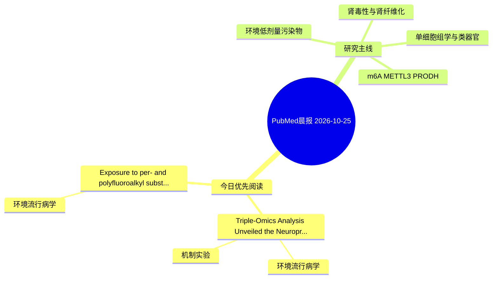

# PubMed 文献晨报｜2026-10-25

- 生成日期：2026-10-25 UTC
- 检索窗口：近 24 小时
- 高质量阈值：规则评分 ≥ 7
- 近 24 小时原始命中数：4

## 今日总体判断

今日筛选出 2 篇优先阅读文献，主要集中在：环境流行病学、机制实验。

## 今日最值得读的 5 篇文章

### 1. Triple-Omics Analysis Unveiled the Neuroprotective Mechanisms of Akkermansia muciniphila in an Environmental Exposure-Linked Mouse Model of Alzheimer's Disease.

- 题目：Triple-Omics Analysis Unveiled the Neuroprotective Mechanisms of Akkermansia muciniphila in an Environmental Exposure-Linked Mouse Model of Alzheimer's Disease.
- 期刊：bioRxiv : the preprint server for biology
- 年份：2026
- PMID：[42926367](https://pubmed.ncbi.nlm.nih.gov/42926367/)
- DOI：[10.64898/2026.09.30.755812](https://doi.org/10.64898/2026.09.30.755812)
- 分类：环境流行病学、机制实验
- 规则评分：10
- 研究对象：人群/队列或环境暴露人群
- 核心方法：m6A RNA修饰检测；细胞与动物机制实验
- 主要发现：摘要提示研究重点涉及环境污染物暴露；结论线索为：These results identify post-transcriptional RNA regulation as a gut-brain target for mitigating environmentally driven neurotoxicity, and show that conventional gene-expression analysis alone would miss most of the protective response.
- 为什么值得读：同时连接环境暴露与机制线索

### 2. Exposure to per- and polyfluoroalkyl substances and the odds of renal cell carcinoma: a case-control study.

- 题目：Exposure to per- and polyfluoroalkyl substances and the odds of renal cell carcinoma: a case-control study.
- 期刊：Environmental science and pollution research international
- 年份：2026
- PMID：[42925465](https://pubmed.ncbi.nlm.nih.gov/42925465/)
- DOI：[10.1007/s11356-026-38327-1](https://doi.org/10.1007/s11356-026-38327-1)
- 分类：环境流行病学
- 规则评分：9
- 研究对象：人群/队列或环境暴露人群
- 核心方法：环境流行病学/队列或人群数据
- 主要发现：摘要提示研究重点涉及环境污染物暴露；结论线索为：These findings provide epidemiological evidence supporting a potential link between PFOS exposure and RCC and underscore the need for prospective studies to clarify causality.
- 为什么值得读：与检索主题有交集，可作为背景或线索文献扫读

## 分类归档

### 环境流行病学
- [Triple-Omics Analysis Unveiled the Neuroprotective Mechanisms of Akkermansia muciniphila in an Environmental Exposure-Linked Mouse Model of Alzheimer's Disease.](https://pubmed.ncbi.nlm.nih.gov/42926367/)（PMID: 42926367）
- [Exposure to per- and polyfluoroalkyl substances and the odds of renal cell carcinoma: a case-control study.](https://pubmed.ncbi.nlm.nih.gov/42925465/)（PMID: 42925465）

### 机制实验
- [Triple-Omics Analysis Unveiled the Neuroprotective Mechanisms of Akkermansia muciniphila in an Environmental Exposure-Linked Mouse Model of Alzheimer's Disease.](https://pubmed.ncbi.nlm.nih.gov/42926367/)（PMID: 42926367）

### 单细胞组学
- 今日暂无高质量新文献。

### 类器官
- 今日暂无高质量新文献。

### 肾毒性
- 今日暂无高质量新文献。

### m6A-METTL3-PRODH
- 今日暂无高质量新文献。

## 今日阅读优先级

1. Triple-Omics Analysis Unveiled the Neuroprotective Mechanisms of Akkermansia muciniphila in an Environmental Exposure-Linked Mouse Model of Alzheimer's Disease.（优先理由：同时连接环境暴露与机制线索）
2. Exposure to per- and polyfluoroalkyl substances and the odds of renal cell carcinoma: a case-control study.（优先理由：与检索主题有交集，可作为背景或线索文献扫读）

## Mermaid 思维导图

