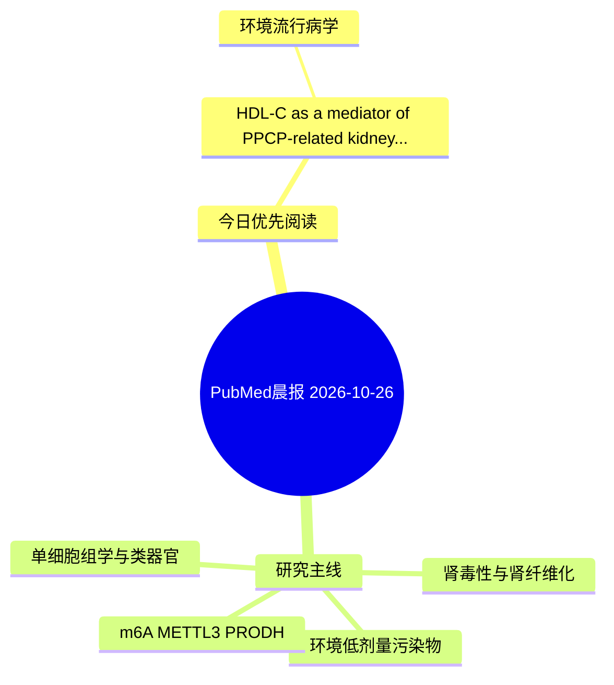

# PubMed 文献晨报｜2026-10-26

- 生成日期：2026-10-26 UTC
- 检索窗口：近 24 小时
- 高质量阈值：规则评分 ≥ 7
- 近 24 小时原始命中数：3

## 今日总体判断

今日筛选出 1 篇优先阅读文献，主要集中在：环境流行病学。

## 今日最值得读的 5 篇文章

### 1. HDL-C as a mediator of PPCP-related kidney function decline in community-dwelling elderly: a mixture analysis approach.

- 题目：HDL-C as a mediator of PPCP-related kidney function decline in community-dwelling elderly: a mixture analysis approach.
- 期刊：Environmental geochemistry and health
- 年份：2026
- PMID：[42928303](https://pubmed.ncbi.nlm.nih.gov/42928303/)
- DOI：[10.1007/s10653-026-03562-5](https://doi.org/10.1007/s10653-026-03562-5)
- 分类：环境流行病学
- 规则评分：10
- 研究对象：人群/队列或环境暴露人群
- 核心方法：环境流行病学/队列或人群数据
- 主要发现：摘要提示研究重点涉及环境污染物暴露；结论线索为：Prospective studies are needed to clarify temporal relationships and address possible reverse causation.
- 为什么值得读：与检索主题有交集，可作为背景或线索文献扫读

## 分类归档

### 环境流行病学
- [HDL-C as a mediator of PPCP-related kidney function decline in community-dwelling elderly: a mixture analysis approach.](https://pubmed.ncbi.nlm.nih.gov/42928303/)（PMID: 42928303）

### 机制实验
- 今日暂无高质量新文献。

### 单细胞组学
- 今日暂无高质量新文献。

### 类器官
- 今日暂无高质量新文献。

### 肾毒性
- 今日暂无高质量新文献。

### m6A-METTL3-PRODH
- 今日暂无高质量新文献。

## 今日阅读优先级

1. HDL-C as a mediator of PPCP-related kidney function decline in community-dwelling elderly: a mixture analysis approach.（优先理由：与检索主题有交集，可作为背景或线索文献扫读）

## Mermaid 思维导图

