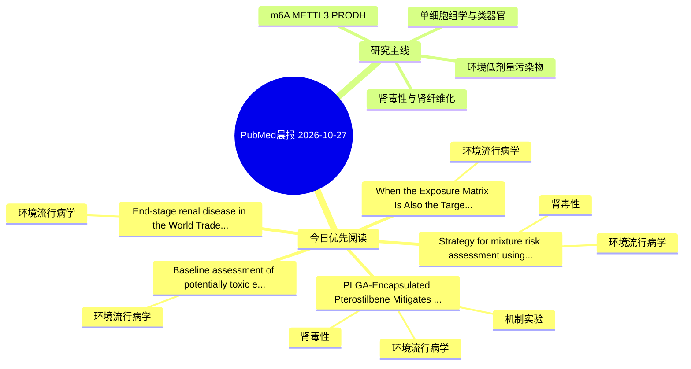

# PubMed 文献晨报｜2026-10-27

- 生成日期：2026-10-27 UTC
- 检索窗口：近 24 小时
- 高质量阈值：规则评分 ≥ 7
- 近 24 小时原始命中数：14

## 今日总体判断

今日筛选出 5 篇优先阅读文献，主要集中在：环境流行病学、肾毒性、机制实验。

## 今日最值得读的 5 篇文章

### 1. PLGA-Encapsulated Pterostilbene Mitigates Cadmium-Induced Nephrotoxicity in Rats by Modulating Oxidative Stress, Inflammation, and Apoptosis.

- 题目：PLGA-Encapsulated Pterostilbene Mitigates Cadmium-Induced Nephrotoxicity in Rats by Modulating Oxidative Stress, Inflammation, and Apoptosis.
- 期刊：Toxics
- 年份：2026
- PMID：[42931643](https://pubmed.ncbi.nlm.nih.gov/42931643/)
- DOI：[10.3390/toxics14100856](https://doi.org/10.3390/toxics14100856)
- 分类：环境流行病学、机制实验、肾毒性
- 规则评分：17
- 研究对象：小鼠或大鼠肾损伤模型
- 核心方法：细胞与动物机制实验
- 主要发现：摘要提示研究重点涉及环境污染物暴露、肾毒性/肾损伤；结论线索为：PLGA-encapsulated PTS therefore warrants further preclinical investigation as a potential approach to mitigate Cd-induced nephrotoxicity; pharmacokinetic, biodistribution, and empty-carrier control studies are needed to define the basis of the observed form...
- 为什么值得读：同时连接环境暴露与机制线索；与肾毒性/肾损伤主线直接相关；关键词匹配度较高

### 2. When the Exposure Matrix Is Also the Target Organ: Interpreting Urinary Phthalate Biomarkers in Pregnancy.

- 题目：When the Exposure Matrix Is Also the Target Organ: Interpreting Urinary Phthalate Biomarkers in Pregnancy.
- 期刊：Reproductive toxicology (Elmsford, N.Y.)
- 年份：2026
- PMID：[42933738](https://pubmed.ncbi.nlm.nih.gov/42933738/)
- DOI：[10.1016/j.reprotox.2026.109392](https://doi.org/10.1016/j.reprotox.2026.109392)
- 分类：环境流行病学
- 规则评分：15
- 研究对象：题名和摘要未明确，建议阅读全文确认
- 核心方法：环境流行病学/队列或人群数据
- 主要发现：摘要提示研究重点涉及环境污染物暴露；结论线索为：Future studies integrating repeated exposure measurements, complementary biological matrices, direct functional measures, and longitudinal trajectory analyses may provide a more mechanistic framework for understanding reproductive toxicity.
- 为什么值得读：关键词匹配度较高

### 3. Strategy for mixture risk assessment using European human biomonitoring data: lessons learned from applications to pesticides, per- and polyfluoroalkyl substances and metal(loid)s.

- 题目：Strategy for mixture risk assessment using European human biomonitoring data: lessons learned from applications to pesticides, per- and polyfluoroalkyl substances and metal(loid)s.
- 期刊：Environment international
- 年份：2026
- PMID：[42933280](https://pubmed.ncbi.nlm.nih.gov/42933280/)
- DOI：[10.1016/j.envint.2026.110560](https://doi.org/10.1016/j.envint.2026.110560)
- 分类：环境流行病学、肾毒性
- 规则评分：14
- 研究对象：人群/队列或环境暴露人群
- 核心方法：环境流行病学/队列或人群数据
- 主要发现：摘要提示研究重点涉及环境污染物暴露、肾毒性/肾损伤；结论线索为：Future research will focus on reducing uncertainties and expanding the approach to additional chemicals with common health endpoints and co-exposure.
- 为什么值得读：与肾毒性/肾损伤主线直接相关；关键词匹配度较高

### 4. Baseline assessment of potentially toxic elements in commercially important fish species from the coastal waters of Sur, Sultanate of Oman: tissue distribution and human health risk assessment.

- 题目：Baseline assessment of potentially toxic elements in commercially important fish species from the coastal waters of Sur, Sultanate of Oman: tissue distribution and human health risk assessment.
- 期刊：Environmental monitoring and assessment
- 年份：2026
- PMID：[42934433](https://pubmed.ncbi.nlm.nih.gov/42934433/)
- DOI：[10.1007/s10661-026-16106-2](https://doi.org/10.1007/s10661-026-16106-2)
- 分类：环境流行病学
- 规则评分：12
- 研究对象：人群/队列或环境暴露人群
- 核心方法：基于题名/摘要的常规实验或文献分析，需阅读全文确认
- 主要发现：摘要提示研究重点涉及环境污染物暴露；结论线索为：These results constitute the first quantitative baseline for the Ash Sharqiyah coast, and designate arsenic speciation as the primary research priority.
- 为什么值得读：关键词匹配度较高

### 5. End-stage renal disease in the World Trade Center Clinical Centers of Excellence General Responders.

- 题目：End-stage renal disease in the World Trade Center Clinical Centers of Excellence General Responders.
- 期刊：Occupational and environmental medicine
- 年份：2026
- PMID：[42933882](https://pubmed.ncbi.nlm.nih.gov/42933882/)
- DOI：[10.1136/oemed-2026-111008](https://doi.org/10.1136/oemed-2026-111008)
- 分类：环境流行病学
- 规则评分：12
- 研究对象：患者样本或临床数据
- 核心方法：基于题名/摘要的常规实验或文献分析，需阅读全文确认
- 主要发现：题名和关键词提示该文关注环境污染物暴露，需要阅读全文确认具体结果。
- 为什么值得读：关键词匹配度较高

## 分类归档

### 环境流行病学
- [PLGA-Encapsulated Pterostilbene Mitigates Cadmium-Induced Nephrotoxicity in Rats by Modulating Oxidative Stress, Inflammation, and Apoptosis.](https://pubmed.ncbi.nlm.nih.gov/42931643/)（PMID: 42931643）
- [When the Exposure Matrix Is Also the Target Organ: Interpreting Urinary Phthalate Biomarkers in Pregnancy.](https://pubmed.ncbi.nlm.nih.gov/42933738/)（PMID: 42933738）
- [Strategy for mixture risk assessment using European human biomonitoring data: lessons learned from applications to pesticides, per- and polyfluoroalkyl substances and metal(loid)s.](https://pubmed.ncbi.nlm.nih.gov/42933280/)（PMID: 42933280）
- [Baseline assessment of potentially toxic elements in commercially important fish species from the coastal waters of Sur, Sultanate of Oman: tissue distribution and human health risk assessment.](https://pubmed.ncbi.nlm.nih.gov/42934433/)（PMID: 42934433）
- [End-stage renal disease in the World Trade Center Clinical Centers of Excellence General Responders.](https://pubmed.ncbi.nlm.nih.gov/42933882/)（PMID: 42933882）

### 机制实验
- [PLGA-Encapsulated Pterostilbene Mitigates Cadmium-Induced Nephrotoxicity in Rats by Modulating Oxidative Stress, Inflammation, and Apoptosis.](https://pubmed.ncbi.nlm.nih.gov/42931643/)（PMID: 42931643）

### 单细胞组学
- 今日暂无高质量新文献。

### 类器官
- 今日暂无高质量新文献。

### 肾毒性
- [PLGA-Encapsulated Pterostilbene Mitigates Cadmium-Induced Nephrotoxicity in Rats by Modulating Oxidative Stress, Inflammation, and Apoptosis.](https://pubmed.ncbi.nlm.nih.gov/42931643/)（PMID: 42931643）
- [Strategy for mixture risk assessment using European human biomonitoring data: lessons learned from applications to pesticides, per- and polyfluoroalkyl substances and metal(loid)s.](https://pubmed.ncbi.nlm.nih.gov/42933280/)（PMID: 42933280）

### m6A-METTL3-PRODH
- 今日暂无高质量新文献。

## 今日阅读优先级

1. PLGA-Encapsulated Pterostilbene Mitigates Cadmium-Induced Nephrotoxicity in Rats by Modulating Oxidative Stress, Inflammation, and Apoptosis.（优先理由：同时连接环境暴露与机制线索；与肾毒性/肾损伤主线直接相关；关键词匹配度较高）
2. When the Exposure Matrix Is Also the Target Organ: Interpreting Urinary Phthalate Biomarkers in Pregnancy.（优先理由：关键词匹配度较高）
3. Strategy for mixture risk assessment using European human biomonitoring data: lessons learned from applications to pesticides, per- and polyfluoroalkyl substances and metal(loid)s.（优先理由：与肾毒性/肾损伤主线直接相关；关键词匹配度较高）
4. Baseline assessment of potentially toxic elements in commercially important fish species from the coastal waters of Sur, Sultanate of Oman: tissue distribution and human health risk assessment.（优先理由：关键词匹配度较高）
5. End-stage renal disease in the World Trade Center Clinical Centers of Excellence General Responders.（优先理由：关键词匹配度较高）

## Mermaid 思维导图

