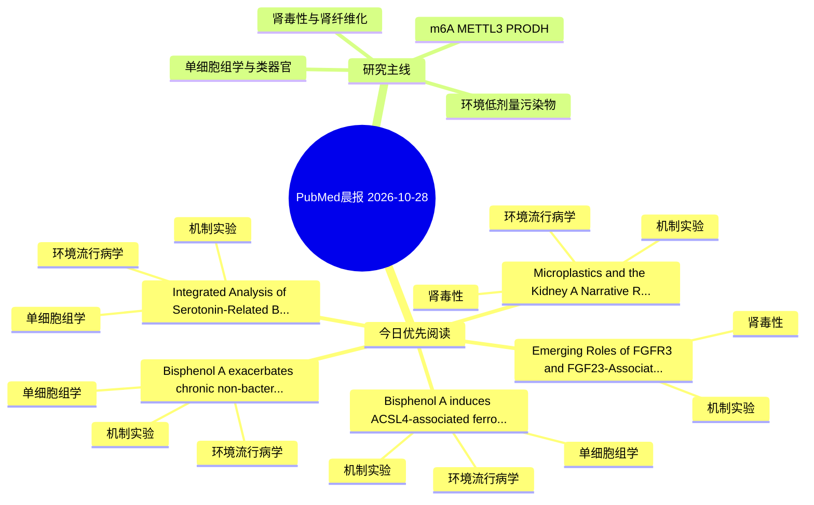

# PubMed 文献晨报｜2026-10-28

- 生成日期：2026-10-28 UTC
- 检索窗口：近 24 小时
- 高质量阈值：规则评分 ≥ 7
- 近 24 小时原始命中数：9

## 今日总体判断

今日筛选出 5 篇优先阅读文献，主要集中在：机制实验、环境流行病学、单细胞组学。

## 今日最值得读的 5 篇文章

### 1. Emerging Roles of FGFR3 and FGF23-Associated Signaling in Renal Fibrosis: Molecular Integration, Clinical Correlates, and Therapeutic Perspectives.

- 题目：Emerging Roles of FGFR3 and FGF23-Associated Signaling in Renal Fibrosis: Molecular Integration, Clinical Correlates, and Therapeutic Perspectives.
- 期刊：Biomolecules
- 年份：2026
- PMID：[42939685](https://pubmed.ncbi.nlm.nih.gov/42939685/)
- DOI：[10.3390/biom16101431](https://doi.org/10.3390/biom16101431)
- 分类：机制实验、肾毒性
- 规则评分：16
- 研究对象：人群/队列或环境暴露人群
- 核心方法：基于题名/摘要的常规实验或文献分析，需阅读全文确认
- 主要发现：摘要提示研究重点涉及环境污染物暴露、肾毒性/肾损伤、肾纤维化；结论线索为：Future priorities include human kidney spatial and phosphoproteomic profiling, cell-specific FGFR3 perturbation, longitudinal FGF23/Klotho biomarker studies, and mechanism-based evaluation of FGFR-directed strategies with integrated renal and mineral-metabo...
- 为什么值得读：与肾毒性/肾损伤主线直接相关；关键词匹配度较高

### 2. Microplastics and the Kidney: A Narrative Review of Human Evidence, Molecular Mechanisms of Cell Injury, and Future Directions.

- 题目：Microplastics and the Kidney: A Narrative Review of Human Evidence, Molecular Mechanisms of Cell Injury, and Future Directions.
- 期刊：International journal of molecular sciences
- 年份：2026
- PMID：[42941754](https://pubmed.ncbi.nlm.nih.gov/42941754/)
- DOI：[10.3390/ijms27208978](https://doi.org/10.3390/ijms27208978)
- 分类：环境流行病学、机制实验、肾毒性
- 规则评分：13
- 研究对象：人群/队列或环境暴露人群
- 核心方法：环境流行病学/队列或人群数据
- 主要发现：摘要提示研究重点涉及肾毒性/肾损伤、肾纤维化；结论线索为：Overall, available evidence provides a mechanistic basis for MP-induced kidney injury, but its clinical relevance and contribution to human kidney disease remain to be established.
- 为什么值得读：同时连接环境暴露与机制线索；与肾毒性/肾损伤主线直接相关；关键词匹配度较高

### 3. Bisphenol A induces ACSL4-associated ferro-aging-like urothelial injury: Implications for Hunner-type interstitial cystitis.

- 题目：Bisphenol A induces ACSL4-associated ferro-aging-like urothelial injury: Implications for Hunner-type interstitial cystitis.
- 期刊：Ecotoxicology and environmental safety
- 年份：2026
- PMID：[42945601](https://pubmed.ncbi.nlm.nih.gov/42945601/)
- DOI：[10.1016/j.ecoenv.2026.120976](https://doi.org/10.1016/j.ecoenv.2026.120976)
- 分类：环境流行病学、机制实验、单细胞组学
- 规则评分：10
- 研究对象：人群/队列或环境暴露人群
- 核心方法：单细胞或空间组学
- 主要发现：摘要提示研究重点涉及单细胞或空间组学；结论线索为：Together, these findings support an ACSL4-associated ferro-aging-like urothelial injury phenotype involving iron-lipid stress, senescence-associated changes, inflammation, and barrier impairment, with relevance to selected features of HIC.
- 为什么值得读：同时连接环境暴露与机制线索；可帮助寻找细胞类型特异性机制

### 4. Integrated Analysis of Serotonin-Related Biomarkers in Thoracic Aortic Aneurysm Based on Machine Learning and Single-Cell Sequencing Data.

- 题目：Integrated Analysis of Serotonin-Related Biomarkers in Thoracic Aortic Aneurysm Based on Machine Learning and Single-Cell Sequencing Data.
- 期刊：Biomedicines
- 年份：2026
- PMID：[42940024](https://pubmed.ncbi.nlm.nih.gov/42940024/)
- DOI：[10.3390/biomedicines14102218](https://doi.org/10.3390/biomedicines14102218)
- 分类：环境流行病学、机制实验、单细胞组学
- 规则评分：10
- 研究对象：题名和摘要未明确，建议阅读全文确认
- 核心方法：单细胞或空间组学；细胞与动物机制实验
- 主要发现：摘要提示研究重点涉及单细胞或空间组学；结论线索为：Conclusions: Biomarkers (CD300A and CLU) associated with serotonin in TAA were identified, with their expression trends validated by RT-qPCR.
- 为什么值得读：同时连接环境暴露与机制线索；可帮助寻找细胞类型特异性机制

### 5. Bisphenol A exacerbates chronic non-bacterial prostatitis by upregulating ITGAX and promoting M1 macrophage polarization.

- 题目：Bisphenol A exacerbates chronic non-bacterial prostatitis by upregulating ITGAX and promoting M1 macrophage polarization.
- 期刊：Journal of hazardous materials
- 年份：2026
- PMID：[42945667](https://pubmed.ncbi.nlm.nih.gov/42945667/)
- DOI：[10.1016/j.jhazmat.2026.143757](https://doi.org/10.1016/j.jhazmat.2026.143757)
- 分类：环境流行病学、机制实验、单细胞组学
- 规则评分：10
- 研究对象：小鼠或大鼠肾损伤模型
- 核心方法：单细胞或空间组学
- 主要发现：摘要提示研究重点涉及单细胞或空间组学；结论线索为：Collectively, these results suggest that BPA exposure may exacerbate CNP through ITGAX-associated macrophage inflammation, highlighting a potential mechanism linking BPA exposure to prostatitis.
- 为什么值得读：同时连接环境暴露与机制线索；可帮助寻找细胞类型特异性机制

## 分类归档

### 环境流行病学
- [Microplastics and the Kidney: A Narrative Review of Human Evidence, Molecular Mechanisms of Cell Injury, and Future Directions.](https://pubmed.ncbi.nlm.nih.gov/42941754/)（PMID: 42941754）
- [Bisphenol A induces ACSL4-associated ferro-aging-like urothelial injury: Implications for Hunner-type interstitial cystitis.](https://pubmed.ncbi.nlm.nih.gov/42945601/)（PMID: 42945601）
- [Integrated Analysis of Serotonin-Related Biomarkers in Thoracic Aortic Aneurysm Based on Machine Learning and Single-Cell Sequencing Data.](https://pubmed.ncbi.nlm.nih.gov/42940024/)（PMID: 42940024）
- [Bisphenol A exacerbates chronic non-bacterial prostatitis by upregulating ITGAX and promoting M1 macrophage polarization.](https://pubmed.ncbi.nlm.nih.gov/42945667/)（PMID: 42945667）

### 机制实验
- [Emerging Roles of FGFR3 and FGF23-Associated Signaling in Renal Fibrosis: Molecular Integration, Clinical Correlates, and Therapeutic Perspectives.](https://pubmed.ncbi.nlm.nih.gov/42939685/)（PMID: 42939685）
- [Microplastics and the Kidney: A Narrative Review of Human Evidence, Molecular Mechanisms of Cell Injury, and Future Directions.](https://pubmed.ncbi.nlm.nih.gov/42941754/)（PMID: 42941754）
- [Bisphenol A induces ACSL4-associated ferro-aging-like urothelial injury: Implications for Hunner-type interstitial cystitis.](https://pubmed.ncbi.nlm.nih.gov/42945601/)（PMID: 42945601）
- [Integrated Analysis of Serotonin-Related Biomarkers in Thoracic Aortic Aneurysm Based on Machine Learning and Single-Cell Sequencing Data.](https://pubmed.ncbi.nlm.nih.gov/42940024/)（PMID: 42940024）
- [Bisphenol A exacerbates chronic non-bacterial prostatitis by upregulating ITGAX and promoting M1 macrophage polarization.](https://pubmed.ncbi.nlm.nih.gov/42945667/)（PMID: 42945667）

### 单细胞组学
- [Bisphenol A induces ACSL4-associated ferro-aging-like urothelial injury: Implications for Hunner-type interstitial cystitis.](https://pubmed.ncbi.nlm.nih.gov/42945601/)（PMID: 42945601）
- [Integrated Analysis of Serotonin-Related Biomarkers in Thoracic Aortic Aneurysm Based on Machine Learning and Single-Cell Sequencing Data.](https://pubmed.ncbi.nlm.nih.gov/42940024/)（PMID: 42940024）
- [Bisphenol A exacerbates chronic non-bacterial prostatitis by upregulating ITGAX and promoting M1 macrophage polarization.](https://pubmed.ncbi.nlm.nih.gov/42945667/)（PMID: 42945667）

### 类器官
- 今日暂无高质量新文献。

### 肾毒性
- [Emerging Roles of FGFR3 and FGF23-Associated Signaling in Renal Fibrosis: Molecular Integration, Clinical Correlates, and Therapeutic Perspectives.](https://pubmed.ncbi.nlm.nih.gov/42939685/)（PMID: 42939685）
- [Microplastics and the Kidney: A Narrative Review of Human Evidence, Molecular Mechanisms of Cell Injury, and Future Directions.](https://pubmed.ncbi.nlm.nih.gov/42941754/)（PMID: 42941754）

### m6A-METTL3-PRODH
- 今日暂无高质量新文献。

## 今日阅读优先级

1. Emerging Roles of FGFR3 and FGF23-Associated Signaling in Renal Fibrosis: Molecular Integration, Clinical Correlates, and Therapeutic Perspectives.（优先理由：与肾毒性/肾损伤主线直接相关；关键词匹配度较高）
2. Microplastics and the Kidney: A Narrative Review of Human Evidence, Molecular Mechanisms of Cell Injury, and Future Directions.（优先理由：同时连接环境暴露与机制线索；与肾毒性/肾损伤主线直接相关；关键词匹配度较高）
3. Bisphenol A induces ACSL4-associated ferro-aging-like urothelial injury: Implications for Hunner-type interstitial cystitis.（优先理由：同时连接环境暴露与机制线索；可帮助寻找细胞类型特异性机制）
4. Integrated Analysis of Serotonin-Related Biomarkers in Thoracic Aortic Aneurysm Based on Machine Learning and Single-Cell Sequencing Data.（优先理由：同时连接环境暴露与机制线索；可帮助寻找细胞类型特异性机制）
5. Bisphenol A exacerbates chronic non-bacterial prostatitis by upregulating ITGAX and promoting M1 macrophage polarization.（优先理由：同时连接环境暴露与机制线索；可帮助寻找细胞类型特异性机制）

## Mermaid 思维导图

