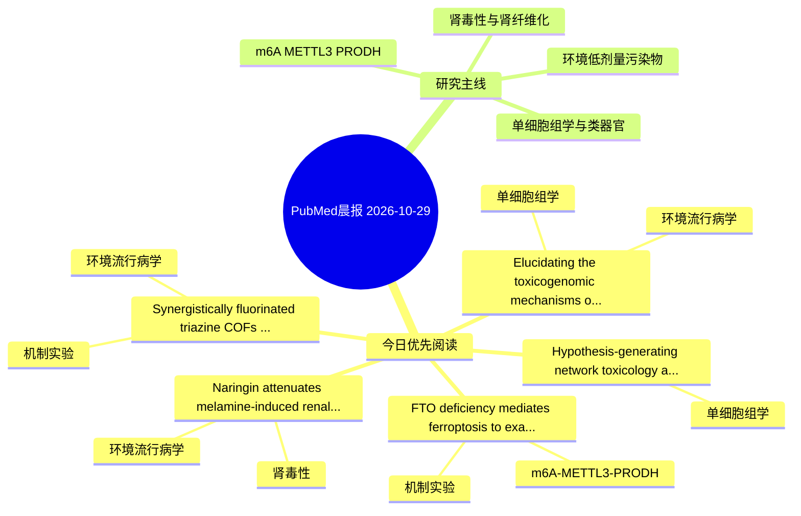

# PubMed 文献晨报｜2026-10-29

- 生成日期：2026-10-29 UTC
- 检索窗口：近 24 小时
- 高质量阈值：规则评分 ≥ 7
- 近 24 小时原始命中数：5

## 今日总体判断

今日筛选出 5 篇优先阅读文献，主要集中在：环境流行病学、单细胞组学、机制实验。

## 今日最值得读的 5 篇文章

### 1. Elucidating the toxicogenomic mechanisms of DBP exposure on Hepatocellular carcinoma through network toxicology and molecular docking analysis.

- 题目：Elucidating the toxicogenomic mechanisms of DBP exposure on Hepatocellular carcinoma through network toxicology and molecular docking analysis.
- 期刊：PloS one
- 年份：2026
- PMID：[42949901](https://pubmed.ncbi.nlm.nih.gov/42949901/)
- DOI：[10.1371/journal.pone.0359516](https://doi.org/10.1371/journal.pone.0359516)
- 分类：环境流行病学、单细胞组学
- 规则评分：10
- 研究对象：患者样本或临床数据
- 核心方法：单细胞或空间组学
- 主要发现：摘要提示研究重点涉及单细胞或空间组学；结论线索为：CONCLUSIONS: This integrative analysis suggests that DBP exposure may contribute to HCC pathogenesis by modulating core genes and pathways, although these findings are associative and require experimental confirmation.
- 为什么值得读：可帮助寻找细胞类型特异性机制

### 2. Synergistically fluorinated triazine COFs as adsorption-ionization integrated matrix for analysis and in situ MALDI imaging of PFOS.

- 题目：Synergistically fluorinated triazine COFs as adsorption-ionization integrated matrix for analysis and in situ MALDI imaging of PFOS.
- 期刊：Analytica chimica acta
- 年份：2026
- PMID：[42951528](https://pubmed.ncbi.nlm.nih.gov/42951528/)
- DOI：[10.1016/j.aca.2026.346280](https://doi.org/10.1016/j.aca.2026.346280)
- 分类：环境流行病学、机制实验
- 规则评分：9
- 研究对象：小鼠或大鼠肾损伤模型
- 核心方法：细胞与动物机制实验
- 主要发现：摘要提示研究重点涉及环境污染物暴露；结论线索为：It achieves ppt-level PFOS detection and tissue in-situ imaging, offering a new paradigm for trace persistent organic pollutant spatial analysis.
- 为什么值得读：同时连接环境暴露与机制线索

### 3. Naringin attenuates melamine-induced renal biochemical alterations in rats: Histopathological and immunohistochemical assessment.

- 题目：Naringin attenuates melamine-induced renal biochemical alterations in rats: Histopathological and immunohistochemical assessment.
- 期刊：Toxicology and applied pharmacology
- 年份：2026
- PMID：[42951041](https://pubmed.ncbi.nlm.nih.gov/42951041/)
- DOI：[10.1016/j.taap.2026.118095](https://doi.org/10.1016/j.taap.2026.118095)
- 分类：环境流行病学、肾毒性
- 规则评分：9
- 研究对象：小鼠或大鼠肾损伤模型
- 核心方法：基于题名/摘要的常规实验或文献分析，需阅读全文确认
- 主要发现：摘要提示研究重点涉及环境污染物暴露；结论线索为：Small samples, summary-data inference, and antibody specificity limit conclusions about sex differences and DNA-specific injury.
- 为什么值得读：与肾毒性/肾损伤主线直接相关

### 4. FTO deficiency mediates ferroptosis to exacerbate cobalt-induced neurotoxicity.

- 题目：FTO deficiency mediates ferroptosis to exacerbate cobalt-induced neurotoxicity.
- 期刊：Environmental research
- 年份：2026
- PMID：[42951169](https://pubmed.ncbi.nlm.nih.gov/42951169/)
- DOI：[10.1016/j.envres.2026.126027](https://doi.org/10.1016/j.envres.2026.126027)
- 分类：机制实验、m6A-METTL3-PRODH
- 规则评分：8
- 研究对象：人群/队列或环境暴露人群
- 核心方法：m6A RNA修饰检测；细胞与动物机制实验
- 主要发现：摘要提示研究重点涉及m6A-METTL3/PRODH 调控；结论线索为：Moreover, we found that FTO depletion effectively enhanced ferroptosis following cobalt-induced oxidative stress.
- 为什么值得读：贴近 m6A-METTL3-PRODH 调控假说

### 5. Hypothesis-generating network toxicology analysis of potential molecular convergence between a polystyrene oligomer proxy and papillary thyroid carcinoma.

- 题目：Hypothesis-generating network toxicology analysis of potential molecular convergence between a polystyrene oligomer proxy and papillary thyroid carcinoma.
- 期刊：Frontiers in endocrinology
- 年份：2026
- PMID：[42952571](https://pubmed.ncbi.nlm.nih.gov/42952571/)
- DOI：[10.3389/fendo.2026.1942165](https://doi.org/10.3389/fendo.2026.1942165)
- 分类：单细胞组学
- 规则评分：7
- 研究对象：人群/队列或环境暴露人群
- 核心方法：单细胞或空间组学
- 主要发现：摘要提示研究重点涉及单细胞或空间组学；结论线索为：The findings do not demonstrate patient PS-MPs exposure, intact-particle effects, or causality, and require validation in material-characterized exposure experiments and exposure-aware clinical studies.
- 为什么值得读：可帮助寻找细胞类型特异性机制

## 分类归档

### 环境流行病学
- [Elucidating the toxicogenomic mechanisms of DBP exposure on Hepatocellular carcinoma through network toxicology and molecular docking analysis.](https://pubmed.ncbi.nlm.nih.gov/42949901/)（PMID: 42949901）
- [Synergistically fluorinated triazine COFs as adsorption-ionization integrated matrix for analysis and in situ MALDI imaging of PFOS.](https://pubmed.ncbi.nlm.nih.gov/42951528/)（PMID: 42951528）
- [Naringin attenuates melamine-induced renal biochemical alterations in rats: Histopathological and immunohistochemical assessment.](https://pubmed.ncbi.nlm.nih.gov/42951041/)（PMID: 42951041）

### 机制实验
- [Synergistically fluorinated triazine COFs as adsorption-ionization integrated matrix for analysis and in situ MALDI imaging of PFOS.](https://pubmed.ncbi.nlm.nih.gov/42951528/)（PMID: 42951528）
- [FTO deficiency mediates ferroptosis to exacerbate cobalt-induced neurotoxicity.](https://pubmed.ncbi.nlm.nih.gov/42951169/)（PMID: 42951169）

### 单细胞组学
- [Elucidating the toxicogenomic mechanisms of DBP exposure on Hepatocellular carcinoma through network toxicology and molecular docking analysis.](https://pubmed.ncbi.nlm.nih.gov/42949901/)（PMID: 42949901）
- [Hypothesis-generating network toxicology analysis of potential molecular convergence between a polystyrene oligomer proxy and papillary thyroid carcinoma.](https://pubmed.ncbi.nlm.nih.gov/42952571/)（PMID: 42952571）

### 类器官
- 今日暂无高质量新文献。

### 肾毒性
- [Naringin attenuates melamine-induced renal biochemical alterations in rats: Histopathological and immunohistochemical assessment.](https://pubmed.ncbi.nlm.nih.gov/42951041/)（PMID: 42951041）

### m6A-METTL3-PRODH
- [FTO deficiency mediates ferroptosis to exacerbate cobalt-induced neurotoxicity.](https://pubmed.ncbi.nlm.nih.gov/42951169/)（PMID: 42951169）

## 今日阅读优先级

1. Elucidating the toxicogenomic mechanisms of DBP exposure on Hepatocellular carcinoma through network toxicology and molecular docking analysis.（优先理由：可帮助寻找细胞类型特异性机制）
2. Synergistically fluorinated triazine COFs as adsorption-ionization integrated matrix for analysis and in situ MALDI imaging of PFOS.（优先理由：同时连接环境暴露与机制线索）
3. Naringin attenuates melamine-induced renal biochemical alterations in rats: Histopathological and immunohistochemical assessment.（优先理由：与肾毒性/肾损伤主线直接相关）
4. FTO deficiency mediates ferroptosis to exacerbate cobalt-induced neurotoxicity.（优先理由：贴近 m6A-METTL3-PRODH 调控假说）
5. Hypothesis-generating network toxicology analysis of potential molecular convergence between a polystyrene oligomer proxy and papillary thyroid carcinoma.（优先理由：可帮助寻找细胞类型特异性机制）

## Mermaid 思维导图

