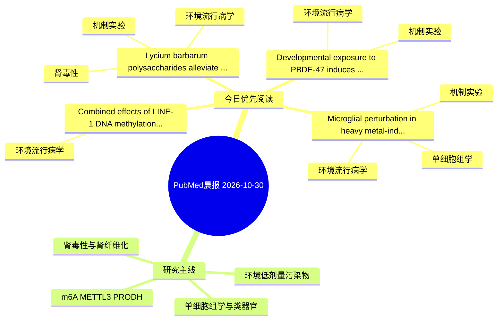

# PubMed 文献晨报｜2026-10-30

- 生成日期：2026-10-30 UTC
- 检索窗口：近 24 小时
- 高质量阈值：规则评分 ≥ 7
- 近 24 小时原始命中数：5

## 今日总体判断

今日筛选出 4 篇优先阅读文献，主要集中在：环境流行病学、机制实验、肾毒性。

## 今日最值得读的 5 篇文章

### 1. Lycium barbarum polysaccharides alleviate cadmium-induced renal injury in ducks by activating the Nrf2-mediated antioxidant defense pathway.

- 题目：Lycium barbarum polysaccharides alleviate cadmium-induced renal injury in ducks by activating the Nrf2-mediated antioxidant defense pathway.
- 期刊：Frontiers in veterinary science
- 年份：2026
- PMID：[42953643](https://pubmed.ncbi.nlm.nih.gov/42953643/)
- DOI：[10.3389/fvets.2026.1998071](https://doi.org/10.3389/fvets.2026.1998071)
- 分类：环境流行病学、机制实验、肾毒性
- 规则评分：17
- 研究对象：题名和摘要未明确，建议阅读全文确认
- 核心方法：细胞与动物机制实验
- 主要发现：摘要提示研究重点涉及环境污染物暴露、肾毒性/肾损伤；结论线索为：Finally, we found that Cd promoted lipid accumulation, disrupted lipid metabolism, and thereby induced renal immunosuppression.
- 为什么值得读：同时连接环境暴露与机制线索；与肾毒性/肾损伤主线直接相关；关键词匹配度较高

### 2. Microglial perturbation in heavy metal-induced neuroinflammation and neurodegeneration: mechanisms, phenotypic plasticity, and therapeutic prospects.

- 题目：Microglial perturbation in heavy metal-induced neuroinflammation and neurodegeneration: mechanisms, phenotypic plasticity, and therapeutic prospects.
- 期刊：Biometals : an international journal on the role of metal ions in biology, biochemistry, and medicine
- 年份：2026
- PMID：[42955216](https://pubmed.ncbi.nlm.nih.gov/42955216/)
- DOI：[10.1007/s10534-026-00895-7](https://doi.org/10.1007/s10534-026-00895-7)
- 分类：环境流行病学、机制实验、单细胞组学
- 规则评分：12
- 研究对象：人群/队列或环境暴露人群
- 核心方法：环境流行病学/队列或人群数据；单细胞或空间组学
- 主要发现：摘要提示研究重点涉及环境污染物暴露、单细胞或空间组学；结论线索为：The review concludes by identifying priorities for translational research, including longitudinal human cohort studies, single-cell transcriptomic profiling of metal-exposed microglia, and the development of region-specific exposure models that better refle...
- 为什么值得读：同时连接环境暴露与机制线索；可帮助寻找细胞类型特异性机制；关键词匹配度较高

### 3. Developmental exposure to PBDE-47 induces sex- and organ-specific glucose uptake alterations linked to thyroid hormone disruption in rats: phenotypic parallels to early cardiorenal-metabolic crosstalk.

- 题目：Developmental exposure to PBDE-47 induces sex- and organ-specific glucose uptake alterations linked to thyroid hormone disruption in rats: phenotypic parallels to early cardiorenal-metabolic crosstalk.
- 期刊：Environmental pollution (Barking, Essex : 1987)
- 年份：2026
- PMID：[42957043](https://pubmed.ncbi.nlm.nih.gov/42957043/)
- DOI：[10.1016/j.envpol.2026.129440](https://doi.org/10.1016/j.envpol.2026.129440)
- 分类：环境流行病学、机制实验
- 规则评分：9
- 研究对象：小鼠或大鼠肾损伤模型
- 核心方法：细胞与动物机制实验
- 主要发现：摘要提示研究重点涉及环境污染物暴露；结论线索为：Correlation analyses revealed significant associations between TH levels and organ-specific FDG uptake.
- 为什么值得读：同时连接环境暴露与机制线索

### 4. Combined effects of LINE-1 DNA methylation and exposure to metals on renal cell carcinoma.

- 题目：Combined effects of LINE-1 DNA methylation and exposure to metals on renal cell carcinoma.
- 期刊：Environmental pollution (Barking, Essex : 1987)
- 年份：2026
- PMID：[42957038](https://pubmed.ncbi.nlm.nih.gov/42957038/)
- DOI：[10.1016/j.envpol.2026.129443](https://doi.org/10.1016/j.envpol.2026.129443)
- 分类：环境流行病学
- 规则评分：9
- 研究对象：肾小管/肾脏细胞与组织
- 核心方法：m6A RNA修饰检测
- 主要发现：摘要提示研究重点涉及环境污染物暴露；结论线索为：These findings support the consideration of epigenetic factors when evaluating associations between metals and RCC.
- 为什么值得读：与检索主题有交集，可作为背景或线索文献扫读

## 分类归档

### 环境流行病学
- [Lycium barbarum polysaccharides alleviate cadmium-induced renal injury in ducks by activating the Nrf2-mediated antioxidant defense pathway.](https://pubmed.ncbi.nlm.nih.gov/42953643/)（PMID: 42953643）
- [Microglial perturbation in heavy metal-induced neuroinflammation and neurodegeneration: mechanisms, phenotypic plasticity, and therapeutic prospects.](https://pubmed.ncbi.nlm.nih.gov/42955216/)（PMID: 42955216）
- [Developmental exposure to PBDE-47 induces sex- and organ-specific glucose uptake alterations linked to thyroid hormone disruption in rats: phenotypic parallels to early cardiorenal-metabolic crosstalk.](https://pubmed.ncbi.nlm.nih.gov/42957043/)（PMID: 42957043）
- [Combined effects of LINE-1 DNA methylation and exposure to metals on renal cell carcinoma.](https://pubmed.ncbi.nlm.nih.gov/42957038/)（PMID: 42957038）

### 机制实验
- [Lycium barbarum polysaccharides alleviate cadmium-induced renal injury in ducks by activating the Nrf2-mediated antioxidant defense pathway.](https://pubmed.ncbi.nlm.nih.gov/42953643/)（PMID: 42953643）
- [Microglial perturbation in heavy metal-induced neuroinflammation and neurodegeneration: mechanisms, phenotypic plasticity, and therapeutic prospects.](https://pubmed.ncbi.nlm.nih.gov/42955216/)（PMID: 42955216）
- [Developmental exposure to PBDE-47 induces sex- and organ-specific glucose uptake alterations linked to thyroid hormone disruption in rats: phenotypic parallels to early cardiorenal-metabolic crosstalk.](https://pubmed.ncbi.nlm.nih.gov/42957043/)（PMID: 42957043）

### 单细胞组学
- [Microglial perturbation in heavy metal-induced neuroinflammation and neurodegeneration: mechanisms, phenotypic plasticity, and therapeutic prospects.](https://pubmed.ncbi.nlm.nih.gov/42955216/)（PMID: 42955216）

### 类器官
- 今日暂无高质量新文献。

### 肾毒性
- [Lycium barbarum polysaccharides alleviate cadmium-induced renal injury in ducks by activating the Nrf2-mediated antioxidant defense pathway.](https://pubmed.ncbi.nlm.nih.gov/42953643/)（PMID: 42953643）

### m6A-METTL3-PRODH
- 今日暂无高质量新文献。

## 今日阅读优先级

1. Lycium barbarum polysaccharides alleviate cadmium-induced renal injury in ducks by activating the Nrf2-mediated antioxidant defense pathway.（优先理由：同时连接环境暴露与机制线索；与肾毒性/肾损伤主线直接相关；关键词匹配度较高）
2. Microglial perturbation in heavy metal-induced neuroinflammation and neurodegeneration: mechanisms, phenotypic plasticity, and therapeutic prospects.（优先理由：同时连接环境暴露与机制线索；可帮助寻找细胞类型特异性机制；关键词匹配度较高）
3. Developmental exposure to PBDE-47 induces sex- and organ-specific glucose uptake alterations linked to thyroid hormone disruption in rats: phenotypic parallels to early cardiorenal-metabolic crosstalk.（优先理由：同时连接环境暴露与机制线索）
4. Combined effects of LINE-1 DNA methylation and exposure to metals on renal cell carcinoma.（优先理由：与检索主题有交集，可作为背景或线索文献扫读）

## Mermaid 思维导图

