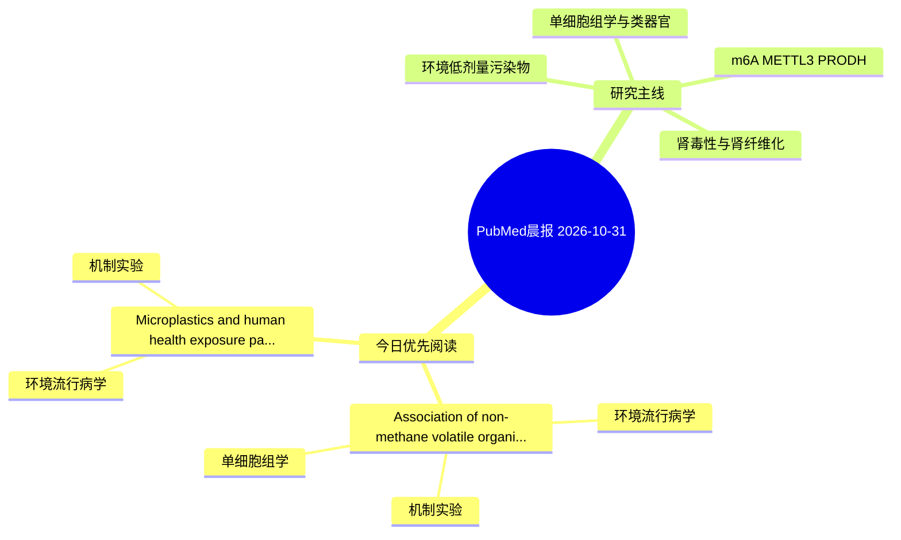

# PubMed 文献晨报｜2026-10-31

- 生成日期：2026-10-31 UTC
- 检索窗口：近 24 小时
- 高质量阈值：规则评分 ≥ 7
- 近 24 小时原始命中数：2

## 今日总体判断

今日筛选出 2 篇优先阅读文献，主要集中在：环境流行病学、机制实验、单细胞组学。

## 今日最值得读的 5 篇文章

### 1. Association of non-methane volatile organic compound emission burden with chronic kidney disease: integrated epidemiological, transcriptomic and in vitro analyses.

- 题目：Association of non-methane volatile organic compound emission burden with chronic kidney disease: integrated epidemiological, transcriptomic and in vitro analyses.
- 期刊：Renal failure
- 年份：2026
- PMID：[42960465](https://pubmed.ncbi.nlm.nih.gov/42960465/)
- DOI：[10.1080/0886022X.2026.2751342](https://doi.org/10.1080/0886022X.2026.2751342)
- 分类：环境流行病学、机制实验、单细胞组学、肾毒性
- 规则评分：22
- 研究对象：肾小管/肾脏细胞与组织
- 核心方法：单细胞或空间组学；细胞与动物机制实验
- 主要发现：摘要提示研究重点涉及环境污染物暴露、肾毒性/肾损伤、肾纤维化；结论线索为：CONCLUSIONS: Province-level NMVOC emission burden was associated with CKD.
- 为什么值得读：同时连接环境暴露与机制线索；与肾毒性/肾损伤主线直接相关；可帮助寻找细胞类型特异性机制

### 2. Microplastics and human health: exposure pathways, toxicological evidence and mitigation strategies.

- 题目：Microplastics and human health: exposure pathways, toxicological evidence and mitigation strategies.
- 期刊：Environmental science and pollution research international
- 年份：2026
- PMID：[42961733](https://pubmed.ncbi.nlm.nih.gov/42961733/)
- DOI：[10.1007/s11356-026-38343-1](https://doi.org/10.1007/s11356-026-38343-1)
- 分类：环境流行病学、机制实验
- 规则评分：8
- 研究对象：人群/队列或环境暴露人群
- 核心方法：环境流行病学/队列或人群数据；细胞与动物机制实验
- 主要发现：摘要提示研究重点涉及本方向相关问题；结论线索为：Future research should prioritize standardized analytical methodologies, environmentally realistic exposure models, longitudinal human studies and integrated biomonitoring approaches to strengthen the evidence base for quantitative risk assessment and effec...
- 为什么值得读：同时连接环境暴露与机制线索

## 分类归档

### 环境流行病学
- [Association of non-methane volatile organic compound emission burden with chronic kidney disease: integrated epidemiological, transcriptomic and in vitro analyses.](https://pubmed.ncbi.nlm.nih.gov/42960465/)（PMID: 42960465）
- [Microplastics and human health: exposure pathways, toxicological evidence and mitigation strategies.](https://pubmed.ncbi.nlm.nih.gov/42961733/)（PMID: 42961733）

### 机制实验
- [Association of non-methane volatile organic compound emission burden with chronic kidney disease: integrated epidemiological, transcriptomic and in vitro analyses.](https://pubmed.ncbi.nlm.nih.gov/42960465/)（PMID: 42960465）
- [Microplastics and human health: exposure pathways, toxicological evidence and mitigation strategies.](https://pubmed.ncbi.nlm.nih.gov/42961733/)（PMID: 42961733）

### 单细胞组学
- [Association of non-methane volatile organic compound emission burden with chronic kidney disease: integrated epidemiological, transcriptomic and in vitro analyses.](https://pubmed.ncbi.nlm.nih.gov/42960465/)（PMID: 42960465）

### 类器官
- 今日暂无高质量新文献。

### 肾毒性
- [Association of non-methane volatile organic compound emission burden with chronic kidney disease: integrated epidemiological, transcriptomic and in vitro analyses.](https://pubmed.ncbi.nlm.nih.gov/42960465/)（PMID: 42960465）

### m6A-METTL3-PRODH
- 今日暂无高质量新文献。

## 今日阅读优先级

1. Association of non-methane volatile organic compound emission burden with chronic kidney disease: integrated epidemiological, transcriptomic and in vitro analyses.（优先理由：同时连接环境暴露与机制线索；与肾毒性/肾损伤主线直接相关；可帮助寻找细胞类型特异性机制）
2. Microplastics and human health: exposure pathways, toxicological evidence and mitigation strategies.（优先理由：同时连接环境暴露与机制线索）

## Mermaid 思维导图

