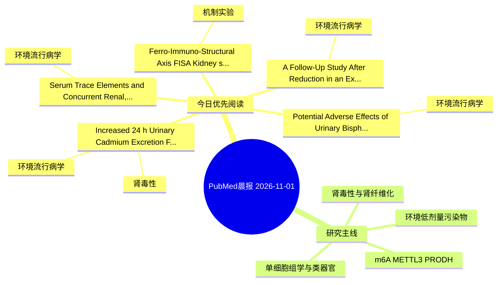

# PubMed 文献晨报｜2026-11-01

- 生成日期：2026-11-01 UTC
- 检索窗口：近 7 天
- 高质量阈值：规则评分 ≥ 7
- 近 24 小时原始命中数：0

## 今日总体判断

今日筛选出 5 篇优先阅读文献，主要集中在：环境流行病学、肾毒性、机制实验。
由于近 24 小时内没有检索到候选文献，本次已自动扩大检索范围。

## 今日最值得读的 5 篇文章

### 1. Increased 24 h Urinary Cadmium Excretion Following Intravenous Ca-DTPA: A Retrospective Paired Analysis.

- 题目：Increased 24 h Urinary Cadmium Excretion Following Intravenous Ca-DTPA: A Retrospective Paired Analysis.
- 期刊：Journal of xenobiotics
- 年份：2026
- PMID：[42931083](https://pubmed.ncbi.nlm.nih.gov/42931083/)
- DOI：[10.3390/jox16060197](https://doi.org/10.3390/jox16060197)
- 分类：环境流行病学、肾毒性
- 规则评分：12
- 研究对象：人群/队列或环境暴露人群
- 核心方法：环境流行病学/队列或人群数据
- 主要发现：摘要提示研究重点涉及环境污染物暴露；结论线索为：These findings demonstrate increased urinary cadmium excretion following Ca-DTPA under the conditions studied, but do not establish a clinically meaningful reduction in total-body cadmium burden, treatment safety, or clinical benefit.
- 为什么值得读：与肾毒性/肾损伤主线直接相关；关键词匹配度较高

### 2. A Follow-Up Study After Reduction in an Excessive Intake of Cadmium from Rice on Changes in Blood and Urinary Cadmium Levels and Renal Tubular Function Among Female Farmers in Cadmium-Polluted Areas in Northern Japan.

- 题目：A Follow-Up Study After Reduction in an Excessive Intake of Cadmium from Rice on Changes in Blood and Urinary Cadmium Levels and Renal Tubular Function Among Female Farmers in Cadmium-Polluted Areas in Northern Japan.
- 期刊：Toxics
- 年份：2026
- PMID：[42931659](https://pubmed.ncbi.nlm.nih.gov/42931659/)
- DOI：[10.3390/toxics14100872](https://doi.org/10.3390/toxics14100872)
- 分类：环境流行病学
- 规则评分：12
- 研究对象：肾小管/肾脏细胞与组织
- 核心方法：基于题名/摘要的常规实验或文献分析，需阅读全文确认
- 主要发现：摘要提示研究重点涉及环境污染物暴露；结论线索为：Collectively, these results provide a temporal picture of the sequential development of Cd nephropathy: an individual exposed to a high level of Cd for a long time develops renal tubular dysfunction gradually when older than 70 years, and Cd nephropathy the...
- 为什么值得读：关键词匹配度较高

### 3. Potential Adverse Effects of Urinary Bisphenol A Concentrations on Renal Function, Gestation, and Newborn Characteristics in Healthy Pregnant Women.

- 题目：Potential Adverse Effects of Urinary Bisphenol A Concentrations on Renal Function, Gestation, and Newborn Characteristics in Healthy Pregnant Women.
- 期刊：Journal of xenobiotics
- 年份：2026
- PMID：[42931066](https://pubmed.ncbi.nlm.nih.gov/42931066/)
- DOI：[10.3390/jox16060180](https://doi.org/10.3390/jox16060180)
- 分类：环境流行病学
- 规则评分：12
- 研究对象：题名和摘要未明确，建议阅读全文确认
- 核心方法：基于题名/摘要的常规实验或文献分析，需阅读全文确认
- 主要发现：摘要提示研究重点涉及本方向相关问题；结论线索为：These findings suggest that BPA exposure during late pregnancy may influence maternal kidney function and potentially ovarian reserve, as well as neonatal outcomes, warranting further investigation.
- 为什么值得读：关键词匹配度较高

### 4. Ferro-Immuno-Structural Axis (FISA): Kidney specific microplastic toxicity via TLR18 centric immunosuppression and iron dyshomeostasis in rainbow trout.

- 题目：Ferro-Immuno-Structural Axis (FISA): Kidney specific microplastic toxicity via TLR18 centric immunosuppression and iron dyshomeostasis in rainbow trout.
- 期刊：Comparative biochemistry and physiology. Part D, Genomics & proteomics
- 年份：2026
- PMID：[42933081](https://pubmed.ncbi.nlm.nih.gov/42933081/)
- DOI：[10.1016/j.cbd.2026.102066](https://doi.org/10.1016/j.cbd.2026.102066)
- 分类：机制实验
- 规则评分：9
- 研究对象：题名和摘要未明确，建议阅读全文确认
- 核心方法：基于题名/摘要的常规实验或文献分析，需阅读全文确认
- 主要发现：摘要提示研究重点涉及本方向相关问题；结论线索为：Multi-tissue transcriptomics revealed kidney-specific TLR18 centric immunosuppression: TLR18 was exclusively and dramatically downregulated (log2FC = -2.90, P = 1.22 × 10-11), accompanied by suppression of TLR8, TLR13, TLR21, and TLR3.
- 为什么值得读：与检索主题有交集，可作为背景或线索文献扫读

### 5. Serum Trace Elements and Concurrent Renal, Hepatic, and Electrolyte Biomarkers: A Secondary Cross-Sectional Analysis of SPES.

- 题目：Serum Trace Elements and Concurrent Renal, Hepatic, and Electrolyte Biomarkers: A Secondary Cross-Sectional Analysis of SPES.
- 期刊：International journal of molecular sciences
- 年份：2026
- PMID：[42942083](https://pubmed.ncbi.nlm.nih.gov/42942083/)
- DOI：[10.3390/ijms27209313](https://doi.org/10.3390/ijms27209313)
- 分类：环境流行病学
- 规则评分：9
- 研究对象：人群/队列或环境暴露人群
- 核心方法：环境流行病学/队列或人群数据
- 主要发现：摘要提示研究重点涉及环境污染物暴露；结论线索为：These cross-sectional findings identify hypotheses concerning renal handling, iron status, and overlapping protein-associated biochemistry.
- 为什么值得读：与检索主题有交集，可作为背景或线索文献扫读

## 分类归档

### 环境流行病学
- [Increased 24 h Urinary Cadmium Excretion Following Intravenous Ca-DTPA: A Retrospective Paired Analysis.](https://pubmed.ncbi.nlm.nih.gov/42931083/)（PMID: 42931083）
- [A Follow-Up Study After Reduction in an Excessive Intake of Cadmium from Rice on Changes in Blood and Urinary Cadmium Levels and Renal Tubular Function Among Female Farmers in Cadmium-Polluted Areas in Northern Japan.](https://pubmed.ncbi.nlm.nih.gov/42931659/)（PMID: 42931659）
- [Potential Adverse Effects of Urinary Bisphenol A Concentrations on Renal Function, Gestation, and Newborn Characteristics in Healthy Pregnant Women.](https://pubmed.ncbi.nlm.nih.gov/42931066/)（PMID: 42931066）
- [Serum Trace Elements and Concurrent Renal, Hepatic, and Electrolyte Biomarkers: A Secondary Cross-Sectional Analysis of SPES.](https://pubmed.ncbi.nlm.nih.gov/42942083/)（PMID: 42942083）

### 机制实验
- [Ferro-Immuno-Structural Axis (FISA): Kidney specific microplastic toxicity via TLR18 centric immunosuppression and iron dyshomeostasis in rainbow trout.](https://pubmed.ncbi.nlm.nih.gov/42933081/)（PMID: 42933081）

### 单细胞组学
- 今日暂无高质量新文献。

### 类器官
- 今日暂无高质量新文献。

### 肾毒性
- [Increased 24 h Urinary Cadmium Excretion Following Intravenous Ca-DTPA: A Retrospective Paired Analysis.](https://pubmed.ncbi.nlm.nih.gov/42931083/)（PMID: 42931083）

### m6A-METTL3-PRODH
- 今日暂无高质量新文献。

## 今日阅读优先级

1. Increased 24 h Urinary Cadmium Excretion Following Intravenous Ca-DTPA: A Retrospective Paired Analysis.（优先理由：与肾毒性/肾损伤主线直接相关；关键词匹配度较高）
2. A Follow-Up Study After Reduction in an Excessive Intake of Cadmium from Rice on Changes in Blood and Urinary Cadmium Levels and Renal Tubular Function Among Female Farmers in Cadmium-Polluted Areas in Northern Japan.（优先理由：关键词匹配度较高）
3. Potential Adverse Effects of Urinary Bisphenol A Concentrations on Renal Function, Gestation, and Newborn Characteristics in Healthy Pregnant Women.（优先理由：关键词匹配度较高）
4. Ferro-Immuno-Structural Axis (FISA): Kidney specific microplastic toxicity via TLR18 centric immunosuppression and iron dyshomeostasis in rainbow trout.（优先理由：与检索主题有交集，可作为背景或线索文献扫读）
5. Serum Trace Elements and Concurrent Renal, Hepatic, and Electrolyte Biomarkers: A Secondary Cross-Sectional Analysis of SPES.（优先理由：与检索主题有交集，可作为背景或线索文献扫读）

## Mermaid 思维导图

