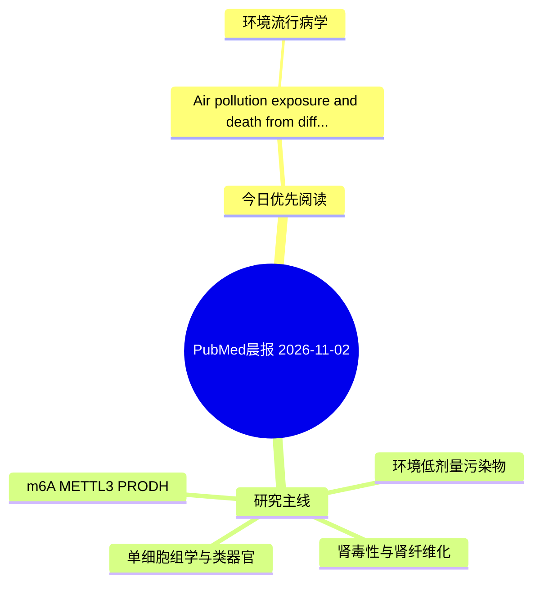

# PubMed 文献晨报｜2026-11-02

- 生成日期：2026-11-02 UTC
- 检索窗口：近 24 小时
- 高质量阈值：规则评分 ≥ 7
- 近 24 小时原始命中数：1

## 今日总体判断

今日筛选出 1 篇优先阅读文献，主要集中在：环境流行病学。

## 今日最值得读的 5 篇文章

### 1. Air pollution exposure and death from different subtypes of kidney diseases: A nationwide, individual-level, case-crossover study in China.

- 题目：Air pollution exposure and death from different subtypes of kidney diseases: A nationwide, individual-level, case-crossover study in China.
- 期刊：Chinese medical journal
- 年份：2026
- PMID：[42967812](https://pubmed.ncbi.nlm.nih.gov/42967812/)
- DOI：[10.1097/CM9.0000000000004318](https://doi.org/10.1097/CM9.0000000000004318)
- 分类：环境流行病学
- 规则评分：12
- 研究对象：题名和摘要未明确，建议阅读全文确认
- 核心方法：基于题名/摘要的常规实验或文献分析，需阅读全文确认
- 主要发现：摘要提示研究重点涉及环境污染物暴露；结论线索为：CONCLUSIONS: Short-term exposure to air pollution could significantly elevate the risk of death from kidney diseases, with renal failure being the most affected subtype, followed by glomerular diseases.
- 为什么值得读：关键词匹配度较高

## 分类归档

### 环境流行病学
- [Air pollution exposure and death from different subtypes of kidney diseases: A nationwide, individual-level, case-crossover study in China.](https://pubmed.ncbi.nlm.nih.gov/42967812/)（PMID: 42967812）

### 机制实验
- 今日暂无高质量新文献。

### 单细胞组学
- 今日暂无高质量新文献。

### 类器官
- 今日暂无高质量新文献。

### 肾毒性
- 今日暂无高质量新文献。

### m6A-METTL3-PRODH
- 今日暂无高质量新文献。

## 今日阅读优先级

1. Air pollution exposure and death from different subtypes of kidney diseases: A nationwide, individual-level, case-crossover study in China.（优先理由：关键词匹配度较高）

## Mermaid 思维导图

