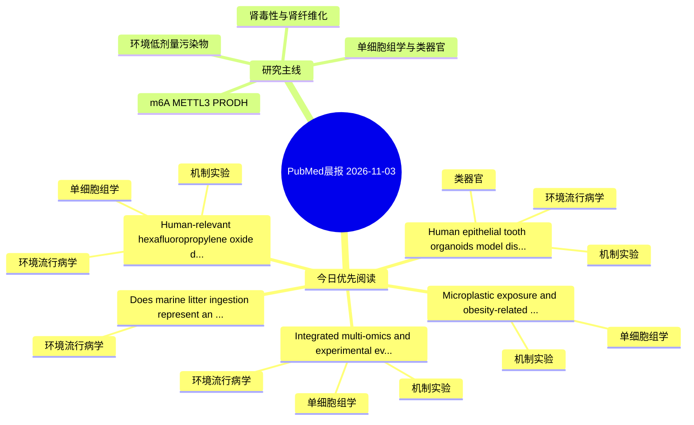

# PubMed 文献晨报｜2026-11-03

- 生成日期：2026-11-03 UTC
- 检索窗口：近 24 小时
- 高质量阈值：规则评分 ≥ 7
- 近 24 小时原始命中数：5

## 今日总体判断

今日筛选出 5 篇优先阅读文献，主要集中在：环境流行病学、机制实验、单细胞组学。

## 今日最值得读的 5 篇文章

### 1. Human epithelial tooth organoids model disrupted amelogenesis following environmental and pharmacological exposures.

- 题目：Human epithelial tooth organoids model disrupted amelogenesis following environmental and pharmacological exposures.
- 期刊：Stem cell research & therapy
- 年份：2026
- PMID：[42972581](https://pubmed.ncbi.nlm.nih.gov/42972581/)
- DOI：[10.1186/s13287-026-05206-y](https://doi.org/10.1186/s13287-026-05206-y)
- 分类：环境流行病学、机制实验、类器官
- 规则评分：14
- 研究对象：人群/队列或环境暴露人群
- 核心方法：类器官/干细胞模型；细胞与动物机制实验
- 主要发现：摘要提示研究重点涉及环境污染物暴露、类器官模型；结论线索为：CONCLUSIONS: Our study establishes human epithelial tooth organoids as a robust platform to model exposure-induced disruptions in amelogenesis and provides direct experimental evidence that commonly encountered environmental and pharmacological agents can i...
- 为什么值得读：同时连接环境暴露与机制线索；对建立更接近人体的模型有参考价值；关键词匹配度较高

### 2. Does marine litter ingestion represent an underestimated pressure on Yelkouan shearwaters? Insights from GIT marine-litter and tissue PAE analyses in the core breeding range.

- 题目：Does marine litter ingestion represent an underestimated pressure on Yelkouan shearwaters? Insights from GIT marine-litter and tissue PAE analyses in the core breeding range.
- 期刊：Environmental pollution (Barking, Essex : 1987)
- 年份：2026
- PMID：[42971450](https://pubmed.ncbi.nlm.nih.gov/42971450/)
- DOI：[10.1016/j.envpol.2026.129427](https://doi.org/10.1016/j.envpol.2026.129427)
- 分类：环境流行病学
- 规则评分：12
- 研究对象：人群/队列或环境暴露人群
- 核心方法：环境流行病学/队列或人群数据
- 主要发现：摘要提示研究重点涉及本方向相关问题；结论线索为：The results of our study, obtained through a multidisciplinary approach, are of particular concern, as they indicate an additional stressor for this endemic mediterranean species, already impacted by multiple anthropogenic pressures such as bycatch, light p...
- 为什么值得读：关键词匹配度较高

### 3. Microplastic exposure and obesity-related metabolic dysfunction: A proposed gut microbiota-metabolite framework.

- 题目：Microplastic exposure and obesity-related metabolic dysfunction: A proposed gut microbiota-metabolite framework.
- 期刊：NanoImpact
- 年份：2026
- PMID：[42971402](https://pubmed.ncbi.nlm.nih.gov/42971402/)
- DOI：[10.1016/j.impact.2026.100652](https://doi.org/10.1016/j.impact.2026.100652)
- 分类：机制实验、单细胞组学
- 规则评分：10
- 研究对象：题名和摘要未明确，建议阅读全文确认
- 核心方法：单细胞或空间组学；细胞与动物机制实验
- 主要发现：摘要提示研究重点涉及单细胞或空间组学；结论线索为：Overall, this review synthesizes emerging evidence on the potential links between MP exposure and adipogenesis dysregulation and identifies priorities for future mechanistic research and risk assessment.
- 为什么值得读：可帮助寻找细胞类型特异性机制

### 4. Integrated multi-omics and experimental evidence implicate DVL3-associated Wnt/β-catenin signaling in PFHxS-related colorectal cancer progression.

- 题目：Integrated multi-omics and experimental evidence implicate DVL3-associated Wnt/β-catenin signaling in PFHxS-related colorectal cancer progression.
- 期刊：Ecotoxicology and environmental safety
- 年份：2026
- PMID：[42971049](https://pubmed.ncbi.nlm.nih.gov/42971049/)
- DOI：[10.1016/j.ecoenv.2026.121006](https://doi.org/10.1016/j.ecoenv.2026.121006)
- 分类：环境流行病学、机制实验、单细胞组学
- 规则评分：10
- 研究对象：人群/队列或环境暴露人群
- 核心方法：单细胞或空间组学；细胞与动物机制实验
- 主要发现：摘要提示研究重点涉及环境污染物暴露、单细胞或空间组学；结论线索为：Collectively, these findings link PFHxS exposure to aggressive CRC phenotypes and support DVL3 as a functional contributor to Wnt/β-catenin transcriptional responses.
- 为什么值得读：同时连接环境暴露与机制线索；可帮助寻找细胞类型特异性机制

### 5. Human-relevant hexafluoropropylene oxide dimer acid exposure drives neuronal senescence via KDM6A-mediated CDC42 K27 demethylation.

- 题目：Human-relevant hexafluoropropylene oxide dimer acid exposure drives neuronal senescence via KDM6A-mediated CDC42 K27 demethylation.
- 期刊：Journal of hazardous materials
- 年份：2026
- PMID：[42970922](https://pubmed.ncbi.nlm.nih.gov/42970922/)
- DOI：[10.1016/j.jhazmat.2026.144095](https://doi.org/10.1016/j.jhazmat.2026.144095)
- 分类：环境流行病学、机制实验、单细胞组学
- 规则评分：10
- 研究对象：人群/队列或环境暴露人群
- 核心方法：单细胞或空间组学；m6A RNA修饰检测
- 主要发现：摘要提示研究重点涉及环境污染物暴露、单细胞或空间组学；结论线索为：Inhibition of KDM6A emerges as a potential strategy to counteract age-related neurodegeneration.
- 为什么值得读：同时连接环境暴露与机制线索；可帮助寻找细胞类型特异性机制

## 分类归档

### 环境流行病学
- [Human epithelial tooth organoids model disrupted amelogenesis following environmental and pharmacological exposures.](https://pubmed.ncbi.nlm.nih.gov/42972581/)（PMID: 42972581）
- [Does marine litter ingestion represent an underestimated pressure on Yelkouan shearwaters? Insights from GIT marine-litter and tissue PAE analyses in the core breeding range.](https://pubmed.ncbi.nlm.nih.gov/42971450/)（PMID: 42971450）
- [Integrated multi-omics and experimental evidence implicate DVL3-associated Wnt/β-catenin signaling in PFHxS-related colorectal cancer progression.](https://pubmed.ncbi.nlm.nih.gov/42971049/)（PMID: 42971049）
- [Human-relevant hexafluoropropylene oxide dimer acid exposure drives neuronal senescence via KDM6A-mediated CDC42 K27 demethylation.](https://pubmed.ncbi.nlm.nih.gov/42970922/)（PMID: 42970922）

### 机制实验
- [Human epithelial tooth organoids model disrupted amelogenesis following environmental and pharmacological exposures.](https://pubmed.ncbi.nlm.nih.gov/42972581/)（PMID: 42972581）
- [Microplastic exposure and obesity-related metabolic dysfunction: A proposed gut microbiota-metabolite framework.](https://pubmed.ncbi.nlm.nih.gov/42971402/)（PMID: 42971402）
- [Integrated multi-omics and experimental evidence implicate DVL3-associated Wnt/β-catenin signaling in PFHxS-related colorectal cancer progression.](https://pubmed.ncbi.nlm.nih.gov/42971049/)（PMID: 42971049）
- [Human-relevant hexafluoropropylene oxide dimer acid exposure drives neuronal senescence via KDM6A-mediated CDC42 K27 demethylation.](https://pubmed.ncbi.nlm.nih.gov/42970922/)（PMID: 42970922）

### 单细胞组学
- [Microplastic exposure and obesity-related metabolic dysfunction: A proposed gut microbiota-metabolite framework.](https://pubmed.ncbi.nlm.nih.gov/42971402/)（PMID: 42971402）
- [Integrated multi-omics and experimental evidence implicate DVL3-associated Wnt/β-catenin signaling in PFHxS-related colorectal cancer progression.](https://pubmed.ncbi.nlm.nih.gov/42971049/)（PMID: 42971049）
- [Human-relevant hexafluoropropylene oxide dimer acid exposure drives neuronal senescence via KDM6A-mediated CDC42 K27 demethylation.](https://pubmed.ncbi.nlm.nih.gov/42970922/)（PMID: 42970922）

### 类器官
- [Human epithelial tooth organoids model disrupted amelogenesis following environmental and pharmacological exposures.](https://pubmed.ncbi.nlm.nih.gov/42972581/)（PMID: 42972581）

### 肾毒性
- 今日暂无高质量新文献。

### m6A-METTL3-PRODH
- 今日暂无高质量新文献。

## 今日阅读优先级

1. Human epithelial tooth organoids model disrupted amelogenesis following environmental and pharmacological exposures.（优先理由：同时连接环境暴露与机制线索；对建立更接近人体的模型有参考价值；关键词匹配度较高）
2. Does marine litter ingestion represent an underestimated pressure on Yelkouan shearwaters? Insights from GIT marine-litter and tissue PAE analyses in the core breeding range.（优先理由：关键词匹配度较高）
3. Microplastic exposure and obesity-related metabolic dysfunction: A proposed gut microbiota-metabolite framework.（优先理由：可帮助寻找细胞类型特异性机制）
4. Integrated multi-omics and experimental evidence implicate DVL3-associated Wnt/β-catenin signaling in PFHxS-related colorectal cancer progression.（优先理由：同时连接环境暴露与机制线索；可帮助寻找细胞类型特异性机制）
5. Human-relevant hexafluoropropylene oxide dimer acid exposure drives neuronal senescence via KDM6A-mediated CDC42 K27 demethylation.（优先理由：同时连接环境暴露与机制线索；可帮助寻找细胞类型特异性机制）

## Mermaid 思维导图

