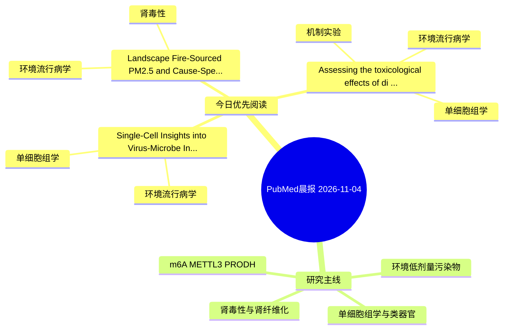

# PubMed 文献晨报｜2026-11-04

- 生成日期：2026-11-04 UTC
- 检索窗口：近 24 小时
- 高质量阈值：规则评分 ≥ 7
- 近 24 小时原始命中数：4

## 今日总体判断

今日筛选出 3 篇优先阅读文献，主要集中在：环境流行病学、单细胞组学、肾毒性。

## 今日最值得读的 5 篇文章

### 1. Landscape Fire-Sourced PM2.5 and Cause-Specific Renal Hospitalizations: A Multicountry Two-Stage Time-Series Analysis of 12.5 Million Admissions.

- 题目：Landscape Fire-Sourced PM2.5 and Cause-Specific Renal Hospitalizations: A Multicountry Two-Stage Time-Series Analysis of 12.5 Million Admissions.
- 期刊：Environmental science & technology
- 年份：2026
- PMID：[42975488](https://pubmed.ncbi.nlm.nih.gov/42975488/)
- DOI：[10.1021/acs.est.6c04677](https://doi.org/10.1021/acs.est.6c04677)
- 分类：环境流行病学、肾毒性
- 规则评分：12
- 研究对象：人群/队列或环境暴露人群
- 核心方法：环境流行病学/队列或人群数据
- 主要发现：摘要提示研究重点涉及环境污染物暴露、肾毒性/肾损伤；结论线索为：These findings highlight renal disease as an underrecognized health consequence of landscape fire smoke and support strengthened strategies to reduce wildfire smoke exposure under a changing climate.
- 为什么值得读：与肾毒性/肾损伤主线直接相关；关键词匹配度较高

### 2. Single-Cell Insights into Virus-Microbe Interactions in Emerging Contaminant Degradation.

- 题目：Single-Cell Insights into Virus-Microbe Interactions in Emerging Contaminant Degradation.
- 期刊：Environmental science & technology
- 年份：2026
- PMID：[42975441](https://pubmed.ncbi.nlm.nih.gov/42975441/)
- DOI：[10.1021/acs.est.6c09032](https://doi.org/10.1021/acs.est.6c09032)
- 分类：环境流行病学、单细胞组学
- 规则评分：10
- 研究对象：题名和摘要未明确，建议阅读全文确认
- 核心方法：单细胞或空间组学
- 主要发现：摘要提示研究重点涉及环境污染物暴露、单细胞或空间组学；结论线索为：These findings broaden our understanding of viral ecological functions and highlight novel leverage points for bioremediation technologies targeting emerging contaminants.
- 为什么值得读：可帮助寻找细胞类型特异性机制

### 3. Assessing the toxicological effects of di(2-ethylhexyl) phthalate on vascular diseases: Insights from network toxicology, Mendelian randomization, single-cell RNA sequencing, and experimental validation.

- 题目：Assessing the toxicological effects of di(2-ethylhexyl) phthalate on vascular diseases: Insights from network toxicology, Mendelian randomization, single-cell RNA sequencing, and experimental validation.
- 期刊：Tissue & cell
- 年份：2026
- PMID：[42976599](https://pubmed.ncbi.nlm.nih.gov/42976599/)
- DOI：[10.1016/j.tice.2026.104114](https://doi.org/10.1016/j.tice.2026.104114)
- 分类：环境流行病学、机制实验、单细胞组学
- 规则评分：10
- 研究对象：题名和摘要未明确，建议阅读全文确认
- 核心方法：单细胞或空间组学；细胞与动物机制实验
- 主要发现：摘要提示研究重点涉及单细胞或空间组学；结论线索为：GO and KEGG analyses revealed that DEHP exposure was associated with the Toll-like receptor signaling pathway, lipid and atherosclerosis signaling pathway, and apoptosis pathway.
- 为什么值得读：同时连接环境暴露与机制线索；可帮助寻找细胞类型特异性机制

## 分类归档

### 环境流行病学
- [Landscape Fire-Sourced PM2.5 and Cause-Specific Renal Hospitalizations: A Multicountry Two-Stage Time-Series Analysis of 12.5 Million Admissions.](https://pubmed.ncbi.nlm.nih.gov/42975488/)（PMID: 42975488）
- [Single-Cell Insights into Virus-Microbe Interactions in Emerging Contaminant Degradation.](https://pubmed.ncbi.nlm.nih.gov/42975441/)（PMID: 42975441）
- [Assessing the toxicological effects of di(2-ethylhexyl) phthalate on vascular diseases: Insights from network toxicology, Mendelian randomization, single-cell RNA sequencing, and experimental validation.](https://pubmed.ncbi.nlm.nih.gov/42976599/)（PMID: 42976599）

### 机制实验
- [Assessing the toxicological effects of di(2-ethylhexyl) phthalate on vascular diseases: Insights from network toxicology, Mendelian randomization, single-cell RNA sequencing, and experimental validation.](https://pubmed.ncbi.nlm.nih.gov/42976599/)（PMID: 42976599）

### 单细胞组学
- [Single-Cell Insights into Virus-Microbe Interactions in Emerging Contaminant Degradation.](https://pubmed.ncbi.nlm.nih.gov/42975441/)（PMID: 42975441）
- [Assessing the toxicological effects of di(2-ethylhexyl) phthalate on vascular diseases: Insights from network toxicology, Mendelian randomization, single-cell RNA sequencing, and experimental validation.](https://pubmed.ncbi.nlm.nih.gov/42976599/)（PMID: 42976599）

### 类器官
- 今日暂无高质量新文献。

### 肾毒性
- [Landscape Fire-Sourced PM2.5 and Cause-Specific Renal Hospitalizations: A Multicountry Two-Stage Time-Series Analysis of 12.5 Million Admissions.](https://pubmed.ncbi.nlm.nih.gov/42975488/)（PMID: 42975488）

### m6A-METTL3-PRODH
- 今日暂无高质量新文献。

## 今日阅读优先级

1. Landscape Fire-Sourced PM2.5 and Cause-Specific Renal Hospitalizations: A Multicountry Two-Stage Time-Series Analysis of 12.5 Million Admissions.（优先理由：与肾毒性/肾损伤主线直接相关；关键词匹配度较高）
2. Single-Cell Insights into Virus-Microbe Interactions in Emerging Contaminant Degradation.（优先理由：可帮助寻找细胞类型特异性机制）
3. Assessing the toxicological effects of di(2-ethylhexyl) phthalate on vascular diseases: Insights from network toxicology, Mendelian randomization, single-cell RNA sequencing, and experimental validation.（优先理由：同时连接环境暴露与机制线索；可帮助寻找细胞类型特异性机制）

## Mermaid 思维导图

