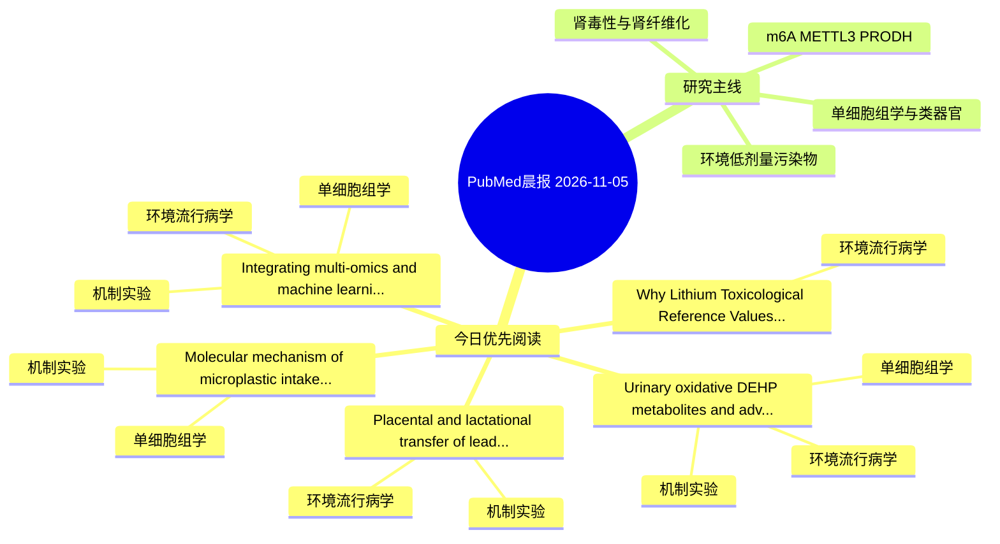

# PubMed 文献晨报｜2026-11-05

- 生成日期：2026-11-05 UTC
- 检索窗口：近 24 小时
- 高质量阈值：规则评分 ≥ 7
- 近 24 小时原始命中数：5

## 今日总体判断

今日筛选出 5 篇优先阅读文献，主要集中在：环境流行病学、机制实验、单细胞组学。

## 今日最值得读的 5 篇文章

### 1. Urinary oxidative DEHP metabolites and advanced cardiovascular-kidney-metabolic syndrome: Evidence from NHANES and mechanistic insights into MECPP-related macrophage inflammatory-glycolytic activation.

- 题目：Urinary oxidative DEHP metabolites and advanced cardiovascular-kidney-metabolic syndrome: Evidence from NHANES and mechanistic insights into MECPP-related macrophage inflammatory-glycolytic activation.
- 期刊：Ecotoxicology and environmental safety
- 年份：2026
- PMID：[42981990](https://pubmed.ncbi.nlm.nih.gov/42981990/)
- DOI：[10.1016/j.ecoenv.2026.121017](https://doi.org/10.1016/j.ecoenv.2026.121017)
- 分类：环境流行病学、机制实验、单细胞组学
- 规则评分：16
- 研究对象：人群/队列或环境暴露人群
- 核心方法：环境流行病学/队列或人群数据；单细胞或空间组学；细胞与动物机制实验
- 主要发现：摘要提示研究重点涉及单细胞或空间组学；结论线索为：CONCLUSIONS: Urinary oxidative DEHP metabolites, particularly MECPP, were positively associated with advanced CKM syndrome in US adults.
- 为什么值得读：同时连接环境暴露与机制线索；可帮助寻找细胞类型特异性机制；关键词匹配度较高

### 2. Why Lithium Toxicological Reference Values Are Needed for the General Population and Workers?

- 题目：Why Lithium Toxicological Reference Values Are Needed for the General Population and Workers?
- 期刊：Regulatory toxicology and pharmacology : RTP
- 年份：2026
- PMID：[42982404](https://pubmed.ncbi.nlm.nih.gov/42982404/)
- DOI：[10.1016/j.yrtph.2026.106288](https://doi.org/10.1016/j.yrtph.2026.106288)
- 分类：环境流行病学
- 规则评分：14
- 研究对象：人群/队列或环境暴露人群
- 核心方法：环境流行病学/队列或人群数据
- 主要发现：摘要提示研究重点涉及环境污染物暴露；结论线索为：These guidance values will allow the implementation of management measures.
- 为什么值得读：关键词匹配度较高

### 3. Molecular mechanism of microplastic intake promoting gastric epithelial cell carcinogenesis.

- 题目：Molecular mechanism of microplastic intake promoting gastric epithelial cell carcinogenesis.
- 期刊：Translational oncology
- 年份：2026
- PMID：[42981821](https://pubmed.ncbi.nlm.nih.gov/42981821/)
- DOI：[10.1016/j.tranon.2026.103101](https://doi.org/10.1016/j.tranon.2026.103101)
- 分类：机制实验、单细胞组学
- 规则评分：10
- 研究对象：小鼠或大鼠肾损伤模型
- 核心方法：单细胞或空间组学
- 主要发现：摘要提示研究重点涉及单细胞或空间组学；结论线索为：Further functional studies are needed to determine whether these changes contribute to gastric neoplastic progression.
- 为什么值得读：可帮助寻找细胞类型特异性机制

### 4. Integrating multi-omics and machine learning to reveal IL1R2-driven macrophage-fibroblast spatial interactions in polycyclic aromatic hydrocarbon-induced pulmonary fibrosis.

- 题目：Integrating multi-omics and machine learning to reveal IL1R2-driven macrophage-fibroblast spatial interactions in polycyclic aromatic hydrocarbon-induced pulmonary fibrosis.
- 期刊：Frontiers in immunology
- 年份：2026
- PMID：[42984627](https://pubmed.ncbi.nlm.nih.gov/42984627/)
- DOI：[10.3389/fimmu.2026.1968775](https://doi.org/10.3389/fimmu.2026.1968775)
- 分类：环境流行病学、机制实验、单细胞组学
- 规则评分：10
- 研究对象：题名和摘要未明确，建议阅读全文确认
- 核心方法：单细胞或空间组学；细胞与动物机制实验
- 主要发现：摘要提示研究重点涉及环境污染物暴露、肾纤维化、单细胞或空间组学；结论线索为：CONCLUSIONS: In summary, this study clarifies the key targets and cellular mechanisms underlying PAH-mediated respiratory toxicity, providing a multidimensional research strategy for the risk assessment of environmental pollutant-induced pulmonary fibrosis.
- 为什么值得读：同时连接环境暴露与机制线索；可帮助寻找细胞类型特异性机制

### 5. Placental and lactational transfer of lead across the perinatal continuum: a proof-of-concept extended PBPK model calibrated with longitudinal data from two independent human birth cohorts.

- 题目：Placental and lactational transfer of lead across the perinatal continuum: a proof-of-concept extended PBPK model calibrated with longitudinal data from two independent human birth cohorts.
- 期刊：Toxicology and applied pharmacology
- 年份：2026
- PMID：[42982197](https://pubmed.ncbi.nlm.nih.gov/42982197/)
- DOI：[10.1016/j.taap.2026.118110](https://doi.org/10.1016/j.taap.2026.118110)
- 分类：环境流行病学、机制实验
- 规则评分：9
- 研究对象：人群/队列或环境暴露人群
- 核心方法：环境流行病学/队列或人群数据
- 主要发现：摘要提示研究重点涉及环境污染物暴露；结论线索为：Although calibrated on Korean data, the workflow is presented as a transferable proof-of-concept that can be re-applied to any birth cohort with serial maternal, cord and milk biomonitoring; the complete model code is publicly available.
- 为什么值得读：同时连接环境暴露与机制线索

## 分类归档

### 环境流行病学
- [Urinary oxidative DEHP metabolites and advanced cardiovascular-kidney-metabolic syndrome: Evidence from NHANES and mechanistic insights into MECPP-related macrophage inflammatory-glycolytic activation.](https://pubmed.ncbi.nlm.nih.gov/42981990/)（PMID: 42981990）
- [Why Lithium Toxicological Reference Values Are Needed for the General Population and Workers?](https://pubmed.ncbi.nlm.nih.gov/42982404/)（PMID: 42982404）
- [Integrating multi-omics and machine learning to reveal IL1R2-driven macrophage-fibroblast spatial interactions in polycyclic aromatic hydrocarbon-induced pulmonary fibrosis.](https://pubmed.ncbi.nlm.nih.gov/42984627/)（PMID: 42984627）
- [Placental and lactational transfer of lead across the perinatal continuum: a proof-of-concept extended PBPK model calibrated with longitudinal data from two independent human birth cohorts.](https://pubmed.ncbi.nlm.nih.gov/42982197/)（PMID: 42982197）

### 机制实验
- [Urinary oxidative DEHP metabolites and advanced cardiovascular-kidney-metabolic syndrome: Evidence from NHANES and mechanistic insights into MECPP-related macrophage inflammatory-glycolytic activation.](https://pubmed.ncbi.nlm.nih.gov/42981990/)（PMID: 42981990）
- [Molecular mechanism of microplastic intake promoting gastric epithelial cell carcinogenesis.](https://pubmed.ncbi.nlm.nih.gov/42981821/)（PMID: 42981821）
- [Integrating multi-omics and machine learning to reveal IL1R2-driven macrophage-fibroblast spatial interactions in polycyclic aromatic hydrocarbon-induced pulmonary fibrosis.](https://pubmed.ncbi.nlm.nih.gov/42984627/)（PMID: 42984627）
- [Placental and lactational transfer of lead across the perinatal continuum: a proof-of-concept extended PBPK model calibrated with longitudinal data from two independent human birth cohorts.](https://pubmed.ncbi.nlm.nih.gov/42982197/)（PMID: 42982197）

### 单细胞组学
- [Urinary oxidative DEHP metabolites and advanced cardiovascular-kidney-metabolic syndrome: Evidence from NHANES and mechanistic insights into MECPP-related macrophage inflammatory-glycolytic activation.](https://pubmed.ncbi.nlm.nih.gov/42981990/)（PMID: 42981990）
- [Molecular mechanism of microplastic intake promoting gastric epithelial cell carcinogenesis.](https://pubmed.ncbi.nlm.nih.gov/42981821/)（PMID: 42981821）
- [Integrating multi-omics and machine learning to reveal IL1R2-driven macrophage-fibroblast spatial interactions in polycyclic aromatic hydrocarbon-induced pulmonary fibrosis.](https://pubmed.ncbi.nlm.nih.gov/42984627/)（PMID: 42984627）

### 类器官
- 今日暂无高质量新文献。

### 肾毒性
- 今日暂无高质量新文献。

### m6A-METTL3-PRODH
- 今日暂无高质量新文献。

## 今日阅读优先级

1. Urinary oxidative DEHP metabolites and advanced cardiovascular-kidney-metabolic syndrome: Evidence from NHANES and mechanistic insights into MECPP-related macrophage inflammatory-glycolytic activation.（优先理由：同时连接环境暴露与机制线索；可帮助寻找细胞类型特异性机制；关键词匹配度较高）
2. Why Lithium Toxicological Reference Values Are Needed for the General Population and Workers?（优先理由：关键词匹配度较高）
3. Molecular mechanism of microplastic intake promoting gastric epithelial cell carcinogenesis.（优先理由：可帮助寻找细胞类型特异性机制）
4. Integrating multi-omics and machine learning to reveal IL1R2-driven macrophage-fibroblast spatial interactions in polycyclic aromatic hydrocarbon-induced pulmonary fibrosis.（优先理由：同时连接环境暴露与机制线索；可帮助寻找细胞类型特异性机制）
5. Placental and lactational transfer of lead across the perinatal continuum: a proof-of-concept extended PBPK model calibrated with longitudinal data from two independent human birth cohorts.（优先理由：同时连接环境暴露与机制线索）

## Mermaid 思维导图

