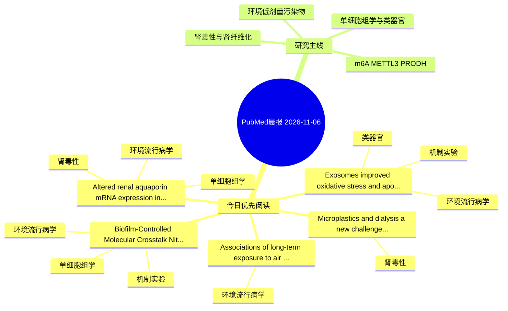

# PubMed 文献晨报｜2026-11-06

- 生成日期：2026-11-06 UTC
- 检索窗口：近 24 小时
- 高质量阈值：规则评分 ≥ 7
- 近 24 小时原始命中数：6

## 今日总体判断

今日筛选出 5 篇优先阅读文献，主要集中在：环境流行病学、肾毒性、机制实验。

## 今日最值得读的 5 篇文章

### 1. Exosomes improved oxidative stress and apoptosis in BPA-induced nephrotoxicity in kidney cells through modulation of Nrf2/Keap1 signaling pathway.

- 题目：Exosomes improved oxidative stress and apoptosis in BPA-induced nephrotoxicity in kidney cells through modulation of Nrf2/Keap1 signaling pathway.
- 期刊：Biomedical engineering online
- 年份：2026
- PMID：[42989331](https://pubmed.ncbi.nlm.nih.gov/42989331/)
- DOI：[10.1186/s12938-026-01605-7](https://doi.org/10.1186/s12938-026-01605-7)
- 分类：环境流行病学、机制实验、类器官、肾毒性
- 规则评分：25
- 研究对象：HK-2 近端肾小管上皮细胞
- 核心方法：类器官/干细胞模型；细胞与动物机制实验
- 主要发现：摘要提示研究重点涉及环境污染物暴露、肾毒性/肾损伤；结论线索为：CONCLUSION: Bone marrow mesenchymal stromal cell-derived exosomes exert protective effects against BPA-induced cytotoxicity in HK-2 cells by alleviating oxidative stress, modulating the Nrf2/Keap1 signaling pathway, and suppressing apoptosis.
- 为什么值得读：同时连接环境暴露与机制线索；与肾毒性/肾损伤主线直接相关；对建立更接近人体的模型有参考价值

### 2. Altered renal aquaporin mRNA expression in early response to arsenic trioxide exposure.

- 题目：Altered renal aquaporin mRNA expression in early response to arsenic trioxide exposure.
- 期刊：Journal of toxicologic pathology
- 年份：2026
- PMID：[42985383](https://pubmed.ncbi.nlm.nih.gov/42985383/)
- DOI：[10.1293/tox.2026-0024](https://doi.org/10.1293/tox.2026-0024)
- 分类：环境流行病学、单细胞组学、肾毒性
- 规则评分：17
- 研究对象：小鼠或大鼠肾损伤模型
- 核心方法：细胞与动物机制实验
- 主要发现：摘要提示研究重点涉及环境污染物暴露、肾毒性/肾损伤；结论线索为：The discrepancy in the regulation of AQP3 gene and protein levels may indicate the complicated nature of AQP regulation during early renal response to arsenic exposure.
- 为什么值得读：与肾毒性/肾损伤主线直接相关；可帮助寻找细胞类型特异性机制；关键词匹配度较高

### 3. Associations of long-term exposure to air pollution with glucose homeostasis biomarkers and diabetes-related comorbidities in people with recent-onset type 1 and type 2 diabetes.

- 题目：Associations of long-term exposure to air pollution with glucose homeostasis biomarkers and diabetes-related comorbidities in people with recent-onset type 1 and type 2 diabetes.
- 期刊：Diabetologia
- 年份：2026
- PMID：[42988924](https://pubmed.ncbi.nlm.nih.gov/42988924/)
- DOI：[10.1007/s00125-026-06908-x](https://doi.org/10.1007/s00125-026-06908-x)
- 分类：环境流行病学
- 规则评分：9
- 研究对象：题名和摘要未明确，建议阅读全文确认
- 核心方法：基于题名/摘要的常规实验或文献分析，需阅读全文确认
- 主要发现：摘要提示研究重点涉及环境污染物暴露；结论线索为：CONCLUSIONS/INTERPRETATION: Long-term AP exposure was consistently associated with higher HbA1c; reduced whole-body insulin sensitivity, secretion and clearance; and an increased burden of diabetes-related comorbidities in type 2 diabetes.
- 为什么值得读：与检索主题有交集，可作为背景或线索文献扫读

### 4. Biofilm-Controlled Molecular Crosstalk: Nitrogen Fixation, Arsenic Transformation and Antibiotic Resistance.

- 题目：Biofilm-Controlled Molecular Crosstalk: Nitrogen Fixation, Arsenic Transformation and Antibiotic Resistance.
- 期刊：International journal of microbiology
- 年份：2026
- PMID：[42985124](https://pubmed.ncbi.nlm.nih.gov/42985124/)
- DOI：[10.1155/ijm/4307970](https://doi.org/10.1155/ijm/4307970)
- 分类：环境流行病学、机制实验、单细胞组学
- 规则评分：9
- 研究对象：题名和摘要未明确，建议阅读全文确认
- 核心方法：单细胞或空间组学；m6A RNA修饰检测
- 主要发现：摘要提示研究重点涉及环境污染物暴露、单细胞或空间组学；结论线索为：This review integrates these processes into a single biofilm framework, classifies each proposed linkage by the evidence behind it, identifies candidate trifunctional mobile elements carrying ars, nif and ARG cassettes in hyperaccumulator rhizospheres and p...
- 为什么值得读：同时连接环境暴露与机制线索；可帮助寻找细胞类型特异性机制

### 5. Microplastics and dialysis: a new challenge for green nephrology.

- 题目：Microplastics and dialysis: a new challenge for green nephrology.
- 期刊：Jornal brasileiro de nefrologia
- 年份：2026
- PMID：[42987266](https://pubmed.ncbi.nlm.nih.gov/42987266/)
- DOI：[10.1590/2175-8239-JBN-2026-0094en](https://doi.org/10.1590/2175-8239-JBN-2026-0094en)
- 分类：肾毒性
- 规则评分：8
- 研究对象：人群/队列或环境暴露人群
- 核心方法：基于题名/摘要的常规实验或文献分析，需阅读全文确认
- 主要发现：摘要提示研究重点涉及肾毒性/肾损伤；结论线索为：In this opinion paper, we discuss the emerging challenges and potential opportunities at the intersection of microplastics, dialysis, and green nephrology.
- 为什么值得读：与肾毒性/肾损伤主线直接相关

## 分类归档

### 环境流行病学
- [Exosomes improved oxidative stress and apoptosis in BPA-induced nephrotoxicity in kidney cells through modulation of Nrf2/Keap1 signaling pathway.](https://pubmed.ncbi.nlm.nih.gov/42989331/)（PMID: 42989331）
- [Altered renal aquaporin mRNA expression in early response to arsenic trioxide exposure.](https://pubmed.ncbi.nlm.nih.gov/42985383/)（PMID: 42985383）
- [Associations of long-term exposure to air pollution with glucose homeostasis biomarkers and diabetes-related comorbidities in people with recent-onset type 1 and type 2 diabetes.](https://pubmed.ncbi.nlm.nih.gov/42988924/)（PMID: 42988924）
- [Biofilm-Controlled Molecular Crosstalk: Nitrogen Fixation, Arsenic Transformation and Antibiotic Resistance.](https://pubmed.ncbi.nlm.nih.gov/42985124/)（PMID: 42985124）

### 机制实验
- [Exosomes improved oxidative stress and apoptosis in BPA-induced nephrotoxicity in kidney cells through modulation of Nrf2/Keap1 signaling pathway.](https://pubmed.ncbi.nlm.nih.gov/42989331/)（PMID: 42989331）
- [Biofilm-Controlled Molecular Crosstalk: Nitrogen Fixation, Arsenic Transformation and Antibiotic Resistance.](https://pubmed.ncbi.nlm.nih.gov/42985124/)（PMID: 42985124）

### 单细胞组学
- [Altered renal aquaporin mRNA expression in early response to arsenic trioxide exposure.](https://pubmed.ncbi.nlm.nih.gov/42985383/)（PMID: 42985383）
- [Biofilm-Controlled Molecular Crosstalk: Nitrogen Fixation, Arsenic Transformation and Antibiotic Resistance.](https://pubmed.ncbi.nlm.nih.gov/42985124/)（PMID: 42985124）

### 类器官
- [Exosomes improved oxidative stress and apoptosis in BPA-induced nephrotoxicity in kidney cells through modulation of Nrf2/Keap1 signaling pathway.](https://pubmed.ncbi.nlm.nih.gov/42989331/)（PMID: 42989331）

### 肾毒性
- [Exosomes improved oxidative stress and apoptosis in BPA-induced nephrotoxicity in kidney cells through modulation of Nrf2/Keap1 signaling pathway.](https://pubmed.ncbi.nlm.nih.gov/42989331/)（PMID: 42989331）
- [Altered renal aquaporin mRNA expression in early response to arsenic trioxide exposure.](https://pubmed.ncbi.nlm.nih.gov/42985383/)（PMID: 42985383）
- [Microplastics and dialysis: a new challenge for green nephrology.](https://pubmed.ncbi.nlm.nih.gov/42987266/)（PMID: 42987266）

### m6A-METTL3-PRODH
- 今日暂无高质量新文献。

## 今日阅读优先级

1. Exosomes improved oxidative stress and apoptosis in BPA-induced nephrotoxicity in kidney cells through modulation of Nrf2/Keap1 signaling pathway.（优先理由：同时连接环境暴露与机制线索；与肾毒性/肾损伤主线直接相关；对建立更接近人体的模型有参考价值）
2. Altered renal aquaporin mRNA expression in early response to arsenic trioxide exposure.（优先理由：与肾毒性/肾损伤主线直接相关；可帮助寻找细胞类型特异性机制；关键词匹配度较高）
3. Associations of long-term exposure to air pollution with glucose homeostasis biomarkers and diabetes-related comorbidities in people with recent-onset type 1 and type 2 diabetes.（优先理由：与检索主题有交集，可作为背景或线索文献扫读）
4. Biofilm-Controlled Molecular Crosstalk: Nitrogen Fixation, Arsenic Transformation and Antibiotic Resistance.（优先理由：同时连接环境暴露与机制线索；可帮助寻找细胞类型特异性机制）
5. Microplastics and dialysis: a new challenge for green nephrology.（优先理由：与肾毒性/肾损伤主线直接相关）

## Mermaid 思维导图

