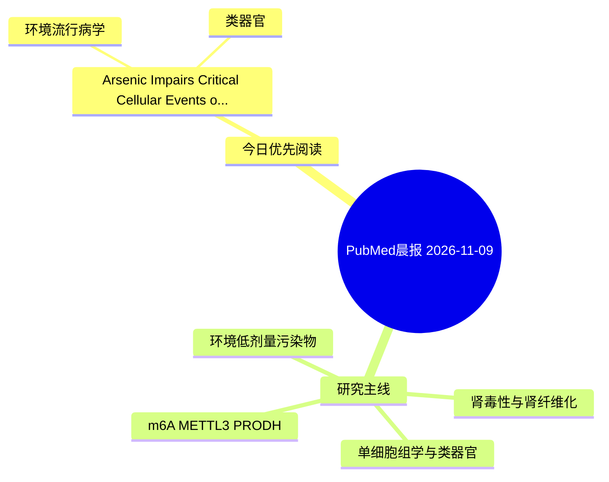

# PubMed 文献晨报｜2026-11-09

- 生成日期：2026-11-09 UTC
- 检索窗口：近 24 小时
- 高质量阈值：规则评分 ≥ 7
- 近 24 小时原始命中数：2

## 今日总体判断

今日筛选出 1 篇优先阅读文献，主要集中在：环境流行病学、类器官。

## 今日最值得读的 5 篇文章

### 1. Arsenic Impairs Critical Cellular Events of Human Cardiac Development Across Differentiation and Metabolic Maturation.

- 题目：Arsenic Impairs Critical Cellular Events of Human Cardiac Development Across Differentiation and Metabolic Maturation.
- 期刊：bioRxiv : the preprint server for biology
- 年份：2026
- PMID：[42999210](https://pubmed.ncbi.nlm.nih.gov/42999210/)
- DOI：[10.64898/2026.10.11.758344](https://doi.org/10.64898/2026.10.11.758344)
- 分类：环境流行病学、类器官
- 规则评分：10
- 研究对象：人群/队列或环境暴露人群
- 核心方法：类器官/干细胞模型
- 主要发现：摘要提示研究重点涉及环境污染物暴露、类器官模型；结论线索为：In conclusion, As inhibits ESC differentiation into cardiomyocytes and disrupts cardiomyocyte maturation.
- 为什么值得读：对建立更接近人体的模型有参考价值

## 分类归档

### 环境流行病学
- [Arsenic Impairs Critical Cellular Events of Human Cardiac Development Across Differentiation and Metabolic Maturation.](https://pubmed.ncbi.nlm.nih.gov/42999210/)（PMID: 42999210）

### 机制实验
- 今日暂无高质量新文献。

### 单细胞组学
- 今日暂无高质量新文献。

### 类器官
- [Arsenic Impairs Critical Cellular Events of Human Cardiac Development Across Differentiation and Metabolic Maturation.](https://pubmed.ncbi.nlm.nih.gov/42999210/)（PMID: 42999210）

### 肾毒性
- 今日暂无高质量新文献。

### m6A-METTL3-PRODH
- 今日暂无高质量新文献。

## 今日阅读优先级

1. Arsenic Impairs Critical Cellular Events of Human Cardiac Development Across Differentiation and Metabolic Maturation.（优先理由：对建立更接近人体的模型有参考价值）

## Mermaid 思维导图

