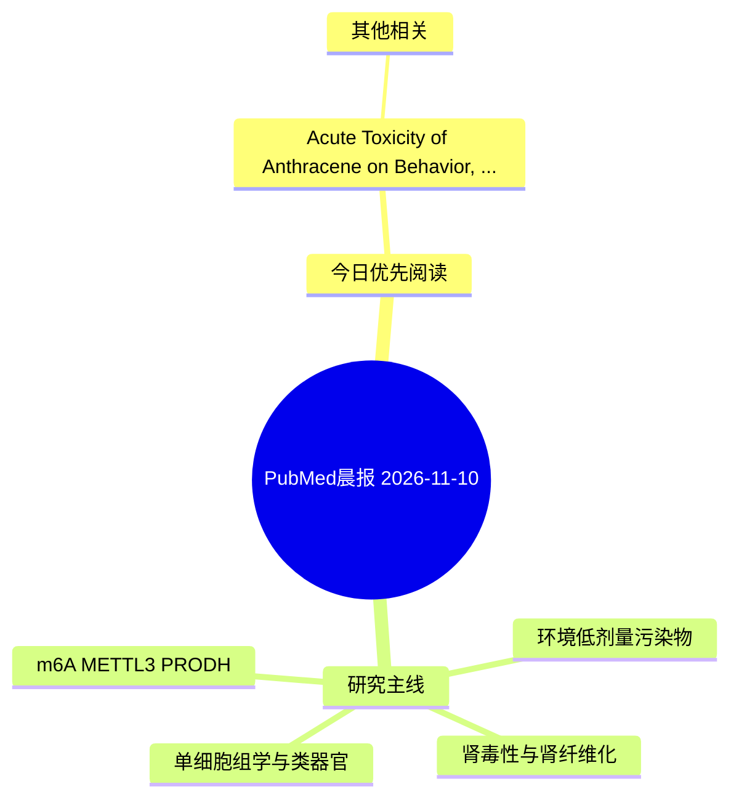

# PubMed 文献晨报｜2026-11-10

- 生成日期：2026-11-10 UTC
- 检索窗口：近 24 小时
- 高质量阈值：规则评分 ≥ 7
- 近 24 小时原始命中数：1

## 今日总体判断

今日筛选出 1 篇优先阅读文献，主要集中在：其他相关。

## 今日最值得读的 5 篇文章

### 1. Acute Toxicity of Anthracene on Behavior, Blood Biochemistry, and Organ Histopathology in Nile Tilapia, Oreochromis niloticus.

- 题目：Acute Toxicity of Anthracene on Behavior, Blood Biochemistry, and Organ Histopathology in Nile Tilapia, Oreochromis niloticus.
- 期刊：Journal of applied toxicology : JAT
- 年份：2026
- PMID：[43003686](https://pubmed.ncbi.nlm.nih.gov/43003686/)
- DOI：[10.1002/jat.70502](https://doi.org/10.1002/jat.70502)
- 分类：其他相关
- 规则评分：9
- 研究对象：题名和摘要未明确，建议阅读全文确认
- 核心方法：基于题名/摘要的常规实验或文献分析，需阅读全文确认
- 主要发现：摘要提示研究重点涉及环境污染物暴露；结论线索为：These findings collectively indicate anthracene as a potent toxicant capable of inducing severe mortality, behavioral disturbances, hematological alterations and tissue damage in major organs of Nile tilapia, highlighting potential ecological risks and need...
- 为什么值得读：与检索主题有交集，可作为背景或线索文献扫读

## 分类归档

### 环境流行病学
- 今日暂无高质量新文献。

### 机制实验
- 今日暂无高质量新文献。

### 单细胞组学
- 今日暂无高质量新文献。

### 类器官
- 今日暂无高质量新文献。

### 肾毒性
- 今日暂无高质量新文献。

### m6A-METTL3-PRODH
- 今日暂无高质量新文献。

## 今日阅读优先级

1. Acute Toxicity of Anthracene on Behavior, Blood Biochemistry, and Organ Histopathology in Nile Tilapia, Oreochromis niloticus.（优先理由：与检索主题有交集，可作为背景或线索文献扫读）

## Mermaid 思维导图

