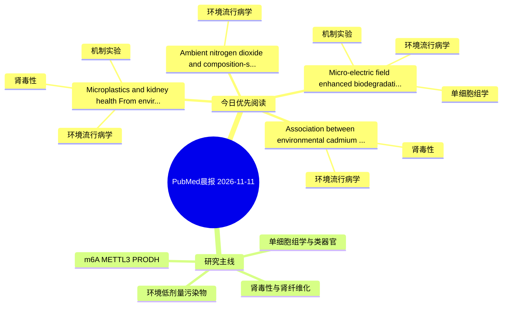

# PubMed 文献晨报｜2026-11-11

- 生成日期：2026-11-11 UTC
- 检索窗口：近 24 小时
- 高质量阈值：规则评分 ≥ 7
- 近 24 小时原始命中数：4

## 今日总体判断

今日筛选出 4 篇优先阅读文献，主要集中在：环境流行病学、机制实验、肾毒性。

## 今日最值得读的 5 篇文章

### 1. Microplastics and kidney health: From environmental exposure to renal toxicity.

- 题目：Microplastics and kidney health: From environmental exposure to renal toxicity.
- 期刊：Science progress
- 年份：2026
- PMID：[43006978](https://pubmed.ncbi.nlm.nih.gov/43006978/)
- DOI：[10.1177/00368504261506780](https://doi.org/10.1177/00368504261506780)
- 分类：环境流行病学、机制实验、肾毒性
- 规则评分：17
- 研究对象：人群/队列或环境暴露人群
- 核心方法：基于题名/摘要的常规实验或文献分析，需阅读全文确认
- 主要发现：摘要提示研究重点涉及环境污染物暴露、肾毒性/肾损伤、肾纤维化；结论线索为：Experimental studies show that MPs and NPs can accumulate in renal tissue, inducing oxidative stress, inflammation, mitochondrial dysfunction, autophagy, pyroptosis and apoptosis, along with histopathological changes such as tubular injury and early fibrosis.
- 为什么值得读：同时连接环境暴露与机制线索；与肾毒性/肾损伤主线直接相关；关键词匹配度较高

### 2. Micro-electric field enhanced biodegradation of refractory organics for strengthening industrial wastewater treatment: microbial electron flow, interspecies interactions, and scale-up.

- 题目：Micro-electric field enhanced biodegradation of refractory organics for strengthening industrial wastewater treatment: microbial electron flow, interspecies interactions, and scale-up.
- 期刊：Water research
- 年份：2026
- PMID：[43008495](https://pubmed.ncbi.nlm.nih.gov/43008495/)
- DOI：[10.1016/j.watres.2026.127298](https://doi.org/10.1016/j.watres.2026.127298)
- 分类：环境流行病学、机制实验、单细胞组学
- 规则评分：9
- 研究对象：题名和摘要未明确，建议阅读全文确认
- 核心方法：单细胞或空间组学
- 主要发现：摘要提示研究重点涉及环境污染物暴露、单细胞或空间组学；结论线索为：By linking electrical regulation with electron transfer, microbial interactions and pollutant transformation, this review establishes a mechanistic framework for designing intensified anaerobic pretreatment processes and advancing the practical application...
- 为什么值得读：同时连接环境暴露与机制线索；可帮助寻找细胞类型特异性机制

### 3. [Association between environmental cadmium exposure and chronic kidney disease: a Meta-analysis].

- 题目：[Association between environmental cadmium exposure and chronic kidney disease: a Meta-analysis].
- 期刊：Wei sheng yan jiu = Journal of hygiene research
- 年份：2026
- PMID：[43004798](https://pubmed.ncbi.nlm.nih.gov/43004798/)
- DOI：[10.19813/j.cnki.weishengyanjiu.2026.05.014](https://doi.org/10.19813/j.cnki.weishengyanjiu.2026.05.014)
- 分类：环境流行病学、肾毒性
- 规则评分：9
- 研究对象：题名和摘要未明确，建议阅读全文确认
- 核心方法：基于题名/摘要的常规实验或文献分析，需阅读全文确认
- 主要发现：摘要提示研究重点涉及环境污染物暴露、肾毒性/肾损伤；结论线索为：CONCLUSION: This meta-analysis demonstrates that environmental cadmium exposure is associated with an increased risk of CKD.
- 为什么值得读：与肾毒性/肾损伤主线直接相关

### 4. Ambient nitrogen dioxide and composition-specific risk of urolithiasis: a multicenter time-stratified case-crossover study.

- 题目：Ambient nitrogen dioxide and composition-specific risk of urolithiasis: a multicenter time-stratified case-crossover study.
- 期刊：BMC public health
- 年份：2026
- PMID：[43004228](https://pubmed.ncbi.nlm.nih.gov/43004228/)
- DOI：[10.1186/s12889-026-28561-0](https://doi.org/10.1186/s12889-026-28561-0)
- 分类：环境流行病学
- 规则评分：9
- 研究对象：人群/队列或环境暴露人群
- 核心方法：环境流行病学/队列或人群数据
- 主要发现：摘要提示研究重点涉及环境污染物暴露；结论线索为：CONCLUSIONS: Ambient NO₂ is a consistent and composition-dependent risk factor for urolithiasis, whereas PM₁₀ and meteorological factors show more complex, often non-linear relationships.
- 为什么值得读：与检索主题有交集，可作为背景或线索文献扫读

## 分类归档

### 环境流行病学
- [Microplastics and kidney health: From environmental exposure to renal toxicity.](https://pubmed.ncbi.nlm.nih.gov/43006978/)（PMID: 43006978）
- [Micro-electric field enhanced biodegradation of refractory organics for strengthening industrial wastewater treatment: microbial electron flow, interspecies interactions, and scale-up.](https://pubmed.ncbi.nlm.nih.gov/43008495/)（PMID: 43008495）
- [\[Association between environmental cadmium exposure and chronic kidney disease: a Meta-analysis\].](https://pubmed.ncbi.nlm.nih.gov/43004798/)（PMID: 43004798）
- [Ambient nitrogen dioxide and composition-specific risk of urolithiasis: a multicenter time-stratified case-crossover study.](https://pubmed.ncbi.nlm.nih.gov/43004228/)（PMID: 43004228）

### 机制实验
- [Microplastics and kidney health: From environmental exposure to renal toxicity.](https://pubmed.ncbi.nlm.nih.gov/43006978/)（PMID: 43006978）
- [Micro-electric field enhanced biodegradation of refractory organics for strengthening industrial wastewater treatment: microbial electron flow, interspecies interactions, and scale-up.](https://pubmed.ncbi.nlm.nih.gov/43008495/)（PMID: 43008495）

### 单细胞组学
- [Micro-electric field enhanced biodegradation of refractory organics for strengthening industrial wastewater treatment: microbial electron flow, interspecies interactions, and scale-up.](https://pubmed.ncbi.nlm.nih.gov/43008495/)（PMID: 43008495）

### 类器官
- 今日暂无高质量新文献。

### 肾毒性
- [Microplastics and kidney health: From environmental exposure to renal toxicity.](https://pubmed.ncbi.nlm.nih.gov/43006978/)（PMID: 43006978）
- [\[Association between environmental cadmium exposure and chronic kidney disease: a Meta-analysis\].](https://pubmed.ncbi.nlm.nih.gov/43004798/)（PMID: 43004798）

### m6A-METTL3-PRODH
- 今日暂无高质量新文献。

## 今日阅读优先级

1. Microplastics and kidney health: From environmental exposure to renal toxicity.（优先理由：同时连接环境暴露与机制线索；与肾毒性/肾损伤主线直接相关；关键词匹配度较高）
2. Micro-electric field enhanced biodegradation of refractory organics for strengthening industrial wastewater treatment: microbial electron flow, interspecies interactions, and scale-up.（优先理由：同时连接环境暴露与机制线索；可帮助寻找细胞类型特异性机制）
3. [Association between environmental cadmium exposure and chronic kidney disease: a Meta-analysis].（优先理由：与肾毒性/肾损伤主线直接相关）
4. Ambient nitrogen dioxide and composition-specific risk of urolithiasis: a multicenter time-stratified case-crossover study.（优先理由：与检索主题有交集，可作为背景或线索文献扫读）

## Mermaid 思维导图

