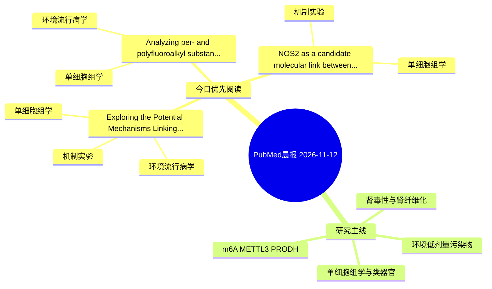

# PubMed 文献晨报｜2026-11-12

- 生成日期：2026-11-12 UTC
- 检索窗口：近 24 小时
- 高质量阈值：规则评分 ≥ 7
- 近 24 小时原始命中数：3

## 今日总体判断

今日筛选出 3 篇优先阅读文献，主要集中在：单细胞组学、环境流行病学、机制实验。

## 今日最值得读的 5 篇文章

### 1. Exploring the Potential Mechanisms Linking Bisphenol A Exposure to Atrial Fibrillation: An Integrated Multi-Dimensional Analysis from Network Toxicology to In Vivo Validation.

- 题目：Exploring the Potential Mechanisms Linking Bisphenol A Exposure to Atrial Fibrillation: An Integrated Multi-Dimensional Analysis from Network Toxicology to In Vivo Validation.
- 期刊：Omics : a journal of integrative biology
- 年份：2026
- PMID：[43015988](https://pubmed.ncbi.nlm.nih.gov/43015988/)
- DOI：[10.1177/15578100261505581](https://doi.org/10.1177/15578100261505581)
- 分类：环境流行病学、机制实验、单细胞组学
- 规则评分：10
- 研究对象：小鼠或大鼠肾损伤模型
- 核心方法：单细胞或空间组学；细胞与动物机制实验
- 主要发现：摘要提示研究重点涉及肾纤维化、单细胞或空间组学；结论线索为：Single-cell transcriptomics revealed cell-type-specific expression of target genes: CST3 in immune and stromal cells, GSTA1 in smooth muscle cells and fibroblasts, and PGF predominantly in smooth muscle cells.
- 为什么值得读：同时连接环境暴露与机制线索；可帮助寻找细胞类型特异性机制

### 2. Analyzing per- and polyfluoroalkyl substances (PFAS) in triple-negative breast cancer (TNBC): an integrative transcriptomic and computational study.

- 题目：Analyzing per- and polyfluoroalkyl substances (PFAS) in triple-negative breast cancer (TNBC): an integrative transcriptomic and computational study.
- 期刊：Cell biology and toxicology
- 年份：2026
- PMID：[43009672](https://pubmed.ncbi.nlm.nih.gov/43009672/)
- DOI：[10.1007/s10565-026-10250-8](https://doi.org/10.1007/s10565-026-10250-8)
- 分类：环境流行病学、单细胞组学
- 规则评分：10
- 研究对象：患者样本或临床数据
- 核心方法：单细胞或空间组学；细胞与动物机制实验
- 主要发现：摘要提示研究重点涉及环境污染物暴露、单细胞或空间组学；结论线索为：CONCLUSIONS: The findings define a TNBC gene signature that overlaps with predicted PFAS targets and provide a testable computational hypothesis.
- 为什么值得读：可帮助寻找细胞类型特异性机制

### 3. NOS2 as a candidate molecular link between air pollutants and depression: an integrated computational and experimental study.

- 题目：NOS2 as a candidate molecular link between air pollutants and depression: an integrated computational and experimental study.
- 期刊：Frontiers in cell and developmental biology
- 年份：2026
- PMID：[43017093](https://pubmed.ncbi.nlm.nih.gov/43017093/)
- DOI：[10.3389/fcell.2026.1962251](https://doi.org/10.3389/fcell.2026.1962251)
- 分类：机制实验、单细胞组学
- 规则评分：7
- 研究对象：题名和摘要未明确，建议阅读全文确认
- 核心方法：单细胞或空间组学；细胞与动物机制实验
- 主要发现：摘要提示研究重点涉及单细胞或空间组学；结论线索为：This study provides new hypotheses and theoretical clues for the possible molecular mechanisms linking air pollutants and depression, but the underlying mechanisms still require further experimental investigation.
- 为什么值得读：可帮助寻找细胞类型特异性机制

## 分类归档

### 环境流行病学
- [Exploring the Potential Mechanisms Linking Bisphenol A Exposure to Atrial Fibrillation: An Integrated Multi-Dimensional Analysis from Network Toxicology to In Vivo Validation.](https://pubmed.ncbi.nlm.nih.gov/43015988/)（PMID: 43015988）
- [Analyzing per- and polyfluoroalkyl substances (PFAS) in triple-negative breast cancer (TNBC): an integrative transcriptomic and computational study.](https://pubmed.ncbi.nlm.nih.gov/43009672/)（PMID: 43009672）

### 机制实验
- [Exploring the Potential Mechanisms Linking Bisphenol A Exposure to Atrial Fibrillation: An Integrated Multi-Dimensional Analysis from Network Toxicology to In Vivo Validation.](https://pubmed.ncbi.nlm.nih.gov/43015988/)（PMID: 43015988）
- [NOS2 as a candidate molecular link between air pollutants and depression: an integrated computational and experimental study.](https://pubmed.ncbi.nlm.nih.gov/43017093/)（PMID: 43017093）

### 单细胞组学
- [Exploring the Potential Mechanisms Linking Bisphenol A Exposure to Atrial Fibrillation: An Integrated Multi-Dimensional Analysis from Network Toxicology to In Vivo Validation.](https://pubmed.ncbi.nlm.nih.gov/43015988/)（PMID: 43015988）
- [Analyzing per- and polyfluoroalkyl substances (PFAS) in triple-negative breast cancer (TNBC): an integrative transcriptomic and computational study.](https://pubmed.ncbi.nlm.nih.gov/43009672/)（PMID: 43009672）
- [NOS2 as a candidate molecular link between air pollutants and depression: an integrated computational and experimental study.](https://pubmed.ncbi.nlm.nih.gov/43017093/)（PMID: 43017093）

### 类器官
- 今日暂无高质量新文献。

### 肾毒性
- 今日暂无高质量新文献。

### m6A-METTL3-PRODH
- 今日暂无高质量新文献。

## 今日阅读优先级

1. Exploring the Potential Mechanisms Linking Bisphenol A Exposure to Atrial Fibrillation: An Integrated Multi-Dimensional Analysis from Network Toxicology to In Vivo Validation.（优先理由：同时连接环境暴露与机制线索；可帮助寻找细胞类型特异性机制）
2. Analyzing per- and polyfluoroalkyl substances (PFAS) in triple-negative breast cancer (TNBC): an integrative transcriptomic and computational study.（优先理由：可帮助寻找细胞类型特异性机制）
3. NOS2 as a candidate molecular link between air pollutants and depression: an integrated computational and experimental study.（优先理由：可帮助寻找细胞类型特异性机制）

## Mermaid 思维导图

