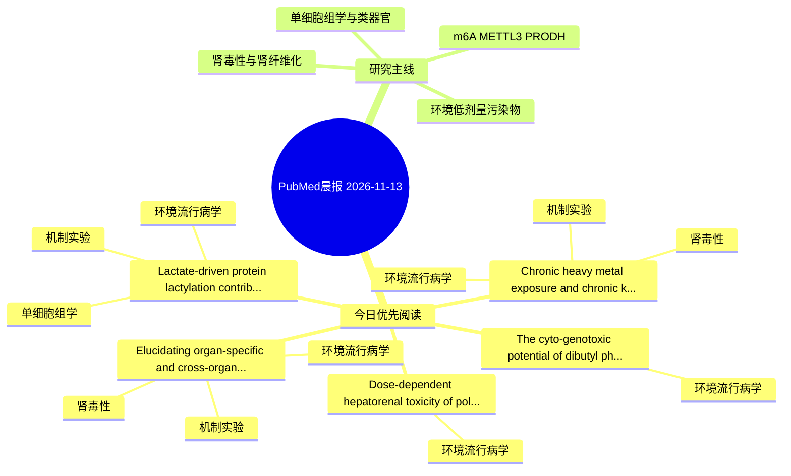

# PubMed 文献晨报｜2026-11-13

- 生成日期：2026-11-13 UTC
- 检索窗口：近 24 小时
- 高质量阈值：规则评分 ≥ 7
- 近 24 小时原始命中数：8

## 今日总体判断

今日筛选出 5 篇优先阅读文献，主要集中在：环境流行病学、机制实验、肾毒性。

## 今日最值得读的 5 篇文章

### 1. Chronic heavy metal exposure and chronic kidney disease: integrating epidemiology, mechanisms, biomarkers, and interventions.

- 题目：Chronic heavy metal exposure and chronic kidney disease: integrating epidemiology, mechanisms, biomarkers, and interventions.
- 期刊：International urology and nephrology
- 年份：2026
- PMID：[43018870](https://pubmed.ncbi.nlm.nih.gov/43018870/)
- DOI：[10.1007/s11255-026-05480-y](https://doi.org/10.1007/s11255-026-05480-y)
- 分类：环境流行病学、机制实验、肾毒性
- 规则评分：16
- 研究对象：人群/队列或环境暴露人群
- 核心方法：环境流行病学/队列或人群数据
- 主要发现：摘要提示研究重点涉及环境污染物暴露、肾毒性/肾损伤；结论线索为：Translational strategies, including nutritional antagonism, environmental source control, and emerging therapies, show promise in mitigating nephrotoxicity.
- 为什么值得读：同时连接环境暴露与机制线索；与肾毒性/肾损伤主线直接相关；关键词匹配度较高

### 2. Elucidating organ-specific and cross-organ toxic effects of 6PPDQ in mice via integrated network toxicology and multi-omics analysis.

- 题目：Elucidating organ-specific and cross-organ toxic effects of 6PPDQ in mice via integrated network toxicology and multi-omics analysis.
- 期刊：Ecotoxicology and environmental safety
- 年份：2026
- PMID：[43019659](https://pubmed.ncbi.nlm.nih.gov/43019659/)
- DOI：[10.1016/j.ecoenv.2026.121037](https://doi.org/10.1016/j.ecoenv.2026.121037)
- 分类：环境流行病学、机制实验、肾毒性
- 规则评分：12
- 研究对象：小鼠或大鼠肾损伤模型
- 核心方法：细胞与动物机制实验
- 主要发现：摘要提示研究重点涉及环境污染物暴露、肾毒性/肾损伤；结论线索为：Multi-omics analysis revealed that 6PPDQ selectively disrupts hepatic arachidonic acid pathways as well as renal arginine metabolism and osmoregulation.
- 为什么值得读：同时连接环境暴露与机制线索；与肾毒性/肾损伤主线直接相关；关键词匹配度较高

### 3. Dose-dependent hepatorenal toxicity of polystyrene microplastics in BALB/c mice.

- 题目：Dose-dependent hepatorenal toxicity of polystyrene microplastics in BALB/c mice.
- 期刊：PloS one
- 年份：2026
- PMID：[43019317](https://pubmed.ncbi.nlm.nih.gov/43019317/)
- DOI：[10.1371/journal.pone.0362569](https://doi.org/10.1371/journal.pone.0362569)
- 分类：环境流行病学
- 规则评分：12
- 研究对象：小鼠或大鼠肾损伤模型
- 核心方法：基于题名/摘要的常规实验或文献分析，需阅读全文确认
- 主要发现：摘要提示研究重点涉及本方向相关问题；结论线索为：In conclusion, oral exposure to PS-MPs was associated with hepatorenal toxicity,characterized by biochemical alterations and increasing histopathological injury with increasing exposure dose.
- 为什么值得读：关键词匹配度较高

### 4. The cyto-genotoxic potential of dibutyl phthalate promotes DNA damage and cellular stress with altered DNA repair gene expression in Madin-Darby Bovine Kidney (MDBK) cells.

- 题目：The cyto-genotoxic potential of dibutyl phthalate promotes DNA damage and cellular stress with altered DNA repair gene expression in Madin-Darby Bovine Kidney (MDBK) cells.
- 期刊：BMC pharmacology & toxicology
- 年份：2026
- PMID：[43021340](https://pubmed.ncbi.nlm.nih.gov/43021340/)
- DOI：[10.1186/s40360-026-01239-4](https://doi.org/10.1186/s40360-026-01239-4)
- 分类：环境流行病学
- 规则评分：12
- 研究对象：题名和摘要未明确，建议阅读全文确认
- 核心方法：基于题名/摘要的常规实验或文献分析，需阅读全文确认
- 主要发现：摘要提示研究重点涉及本方向相关问题；结论线索为：These findings highlight that DBP induces concentration-dependent cyto-genotoxicity and transcriptional alterations in MDBK cells, underscoring the need for safer plasticizer alternatives.
- 为什么值得读：关键词匹配度较高

### 5. Lactate-driven protein lactylation contributes to aniline-induced hepatic metabolic dysfunction.

- 题目：Lactate-driven protein lactylation contributes to aniline-induced hepatic metabolic dysfunction.
- 期刊：Environmental pollution (Barking, Essex : 1987)
- 年份：2026
- PMID：[43020241](https://pubmed.ncbi.nlm.nih.gov/43020241/)
- DOI：[10.1016/j.envpol.2026.129551](https://doi.org/10.1016/j.envpol.2026.129551)
- 分类：环境流行病学、机制实验、单细胞组学
- 规则评分：10
- 研究对象：小鼠或大鼠肾损伤模型
- 核心方法：单细胞或空间组学；细胞与动物机制实验
- 主要发现：摘要提示研究重点涉及环境污染物暴露、单细胞或空间组学；结论线索为：These findings implicate LDHA-associated lactate accumulation and protein lactylation in aniline-induced hepatic metabolic dysfunction under the tested exposure conditions.
- 为什么值得读：同时连接环境暴露与机制线索；可帮助寻找细胞类型特异性机制

## 分类归档

### 环境流行病学
- [Chronic heavy metal exposure and chronic kidney disease: integrating epidemiology, mechanisms, biomarkers, and interventions.](https://pubmed.ncbi.nlm.nih.gov/43018870/)（PMID: 43018870）
- [Elucidating organ-specific and cross-organ toxic effects of 6PPDQ in mice via integrated network toxicology and multi-omics analysis.](https://pubmed.ncbi.nlm.nih.gov/43019659/)（PMID: 43019659）
- [Dose-dependent hepatorenal toxicity of polystyrene microplastics in BALB/c mice.](https://pubmed.ncbi.nlm.nih.gov/43019317/)（PMID: 43019317）
- [The cyto-genotoxic potential of dibutyl phthalate promotes DNA damage and cellular stress with altered DNA repair gene expression in Madin-Darby Bovine Kidney (MDBK) cells.](https://pubmed.ncbi.nlm.nih.gov/43021340/)（PMID: 43021340）
- [Lactate-driven protein lactylation contributes to aniline-induced hepatic metabolic dysfunction.](https://pubmed.ncbi.nlm.nih.gov/43020241/)（PMID: 43020241）

### 机制实验
- [Chronic heavy metal exposure and chronic kidney disease: integrating epidemiology, mechanisms, biomarkers, and interventions.](https://pubmed.ncbi.nlm.nih.gov/43018870/)（PMID: 43018870）
- [Elucidating organ-specific and cross-organ toxic effects of 6PPDQ in mice via integrated network toxicology and multi-omics analysis.](https://pubmed.ncbi.nlm.nih.gov/43019659/)（PMID: 43019659）
- [Lactate-driven protein lactylation contributes to aniline-induced hepatic metabolic dysfunction.](https://pubmed.ncbi.nlm.nih.gov/43020241/)（PMID: 43020241）

### 单细胞组学
- [Lactate-driven protein lactylation contributes to aniline-induced hepatic metabolic dysfunction.](https://pubmed.ncbi.nlm.nih.gov/43020241/)（PMID: 43020241）

### 类器官
- 今日暂无高质量新文献。

### 肾毒性
- [Chronic heavy metal exposure and chronic kidney disease: integrating epidemiology, mechanisms, biomarkers, and interventions.](https://pubmed.ncbi.nlm.nih.gov/43018870/)（PMID: 43018870）
- [Elucidating organ-specific and cross-organ toxic effects of 6PPDQ in mice via integrated network toxicology and multi-omics analysis.](https://pubmed.ncbi.nlm.nih.gov/43019659/)（PMID: 43019659）

### m6A-METTL3-PRODH
- 今日暂无高质量新文献。

## 今日阅读优先级

1. Chronic heavy metal exposure and chronic kidney disease: integrating epidemiology, mechanisms, biomarkers, and interventions.（优先理由：同时连接环境暴露与机制线索；与肾毒性/肾损伤主线直接相关；关键词匹配度较高）
2. Elucidating organ-specific and cross-organ toxic effects of 6PPDQ in mice via integrated network toxicology and multi-omics analysis.（优先理由：同时连接环境暴露与机制线索；与肾毒性/肾损伤主线直接相关；关键词匹配度较高）
3. Dose-dependent hepatorenal toxicity of polystyrene microplastics in BALB/c mice.（优先理由：关键词匹配度较高）
4. The cyto-genotoxic potential of dibutyl phthalate promotes DNA damage and cellular stress with altered DNA repair gene expression in Madin-Darby Bovine Kidney (MDBK) cells.（优先理由：关键词匹配度较高）
5. Lactate-driven protein lactylation contributes to aniline-induced hepatic metabolic dysfunction.（优先理由：同时连接环境暴露与机制线索；可帮助寻找细胞类型特异性机制）

## Mermaid 思维导图

