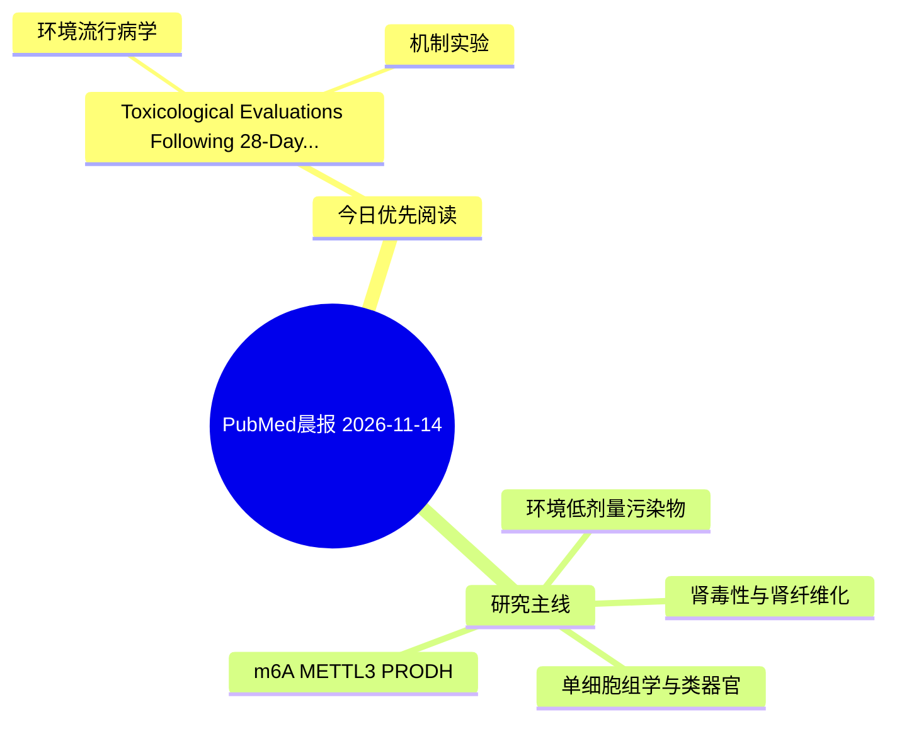

# PubMed 文献晨报｜2026-11-14

- 生成日期：2026-11-14 UTC
- 检索窗口：近 24 小时
- 高质量阈值：规则评分 ≥ 7
- 近 24 小时原始命中数：2

## 今日总体判断

今日筛选出 1 篇优先阅读文献，主要集中在：环境流行病学、机制实验。

## 今日最值得读的 5 篇文章

### 1. Toxicological Evaluations Following 28-Day Oral Gavage Exposure to Polyethylene Terephthalate Microplastic Particles in Mice.

- 题目：Toxicological Evaluations Following 28-Day Oral Gavage Exposure to Polyethylene Terephthalate Microplastic Particles in Mice.
- 期刊：International journal of molecular sciences
- 年份：2026
- PMID：[43027650](https://pubmed.ncbi.nlm.nih.gov/43027650/)
- DOI：[10.3390/ijms27219397](https://doi.org/10.3390/ijms27219397)
- 分类：环境流行病学、机制实验
- 规则评分：9
- 研究对象：人群/队列或环境暴露人群
- 核心方法：环境流行病学/队列或人群数据
- 主要发现：摘要提示研究重点涉及本方向相关问题；结论线索为：Our findings show only minor effects following short-term exposure, but real-world microplastic exposure is likely to be chronic, thus a longer exposure period may be necessary to fully elucidate the potential impact of PET microplastic-induced toxicity.
- 为什么值得读：同时连接环境暴露与机制线索

## 分类归档

### 环境流行病学
- [Toxicological Evaluations Following 28-Day Oral Gavage Exposure to Polyethylene Terephthalate Microplastic Particles in Mice.](https://pubmed.ncbi.nlm.nih.gov/43027650/)（PMID: 43027650）

### 机制实验
- [Toxicological Evaluations Following 28-Day Oral Gavage Exposure to Polyethylene Terephthalate Microplastic Particles in Mice.](https://pubmed.ncbi.nlm.nih.gov/43027650/)（PMID: 43027650）

### 单细胞组学
- 今日暂无高质量新文献。

### 类器官
- 今日暂无高质量新文献。

### 肾毒性
- 今日暂无高质量新文献。

### m6A-METTL3-PRODH
- 今日暂无高质量新文献。

## 今日阅读优先级

1. Toxicological Evaluations Following 28-Day Oral Gavage Exposure to Polyethylene Terephthalate Microplastic Particles in Mice.（优先理由：同时连接环境暴露与机制线索）

## Mermaid 思维导图

