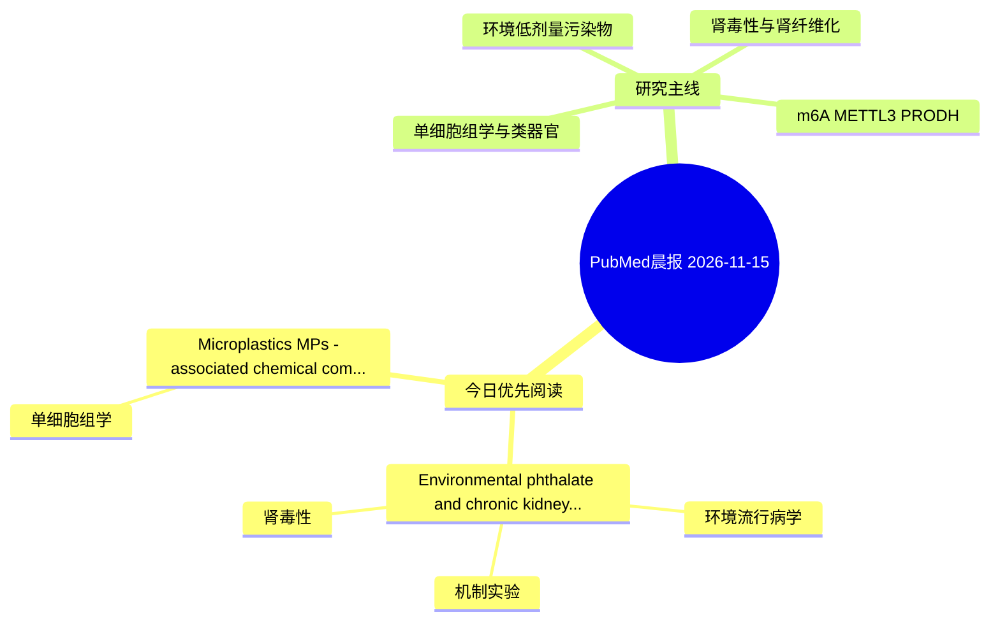

# PubMed 文献晨报｜2026-11-15

- 生成日期：2026-11-15 UTC
- 检索窗口：近 24 小时
- 高质量阈值：规则评分 ≥ 7
- 近 24 小时原始命中数：3

## 今日总体判断

今日筛选出 2 篇优先阅读文献，主要集中在：环境流行病学、机制实验、肾毒性。

## 今日最值得读的 5 篇文章

### 1. Environmental phthalate and chronic kidney disease: Epidemiology, mechanistic pathways, and clinical implications.

- 题目：Environmental phthalate and chronic kidney disease: Epidemiology, mechanistic pathways, and clinical implications.
- 期刊：iScience
- 年份：2026
- PMID：[43034648](https://pubmed.ncbi.nlm.nih.gov/43034648/)
- DOI：[10.1016/j.isci.2026.118139](https://doi.org/10.1016/j.isci.2026.118139)
- 分类：环境流行病学、机制实验、肾毒性
- 规则评分：8
- 研究对象：人群/队列或环境暴露人群
- 核心方法：环境流行病学/队列或人群数据
- 主要发现：摘要提示研究重点涉及肾毒性/肾损伤；结论线索为：Future longitudinal, pharmacokinetic, and intervention studies are needed to determine whether phthalate biomarkers have clinically meaningful prognostic or predictive utility.
- 为什么值得读：同时连接环境暴露与机制线索；与肾毒性/肾损伤主线直接相关

### 2. Microplastics (MPs)-associated chemical components are associated with hepatocellular carcinoma (HCC) progression via genomic instability and spatial microenvironment remodeling: A study based on integrated multi-omics analysis.

- 题目：Microplastics (MPs)-associated chemical components are associated with hepatocellular carcinoma (HCC) progression via genomic instability and spatial microenvironment remodeling: A study based on integrated multi-omics analysis.
- 期刊：Biochemical and biophysical research communications
- 年份：2026
- PMID：[43033798](https://pubmed.ncbi.nlm.nih.gov/43033798/)
- DOI：[10.1016/j.bbrc.2026.154872](https://doi.org/10.1016/j.bbrc.2026.154872)
- 分类：单细胞组学
- 规则评分：7
- 研究对象：患者样本或临床数据
- 核心方法：单细胞或空间组学
- 主要发现：摘要提示研究重点涉及单细胞或空间组学；结论线索为：CONCLUSION: This study provides a multidimensional, hypothesis-generating landscape of HCC progression associated with MP-associated chemical exposure at single-cell and spatial resolutions, with dynamic and energetic evidence supporting the structural plau...
- 为什么值得读：可帮助寻找细胞类型特异性机制

## 分类归档

### 环境流行病学
- [Environmental phthalate and chronic kidney disease: Epidemiology, mechanistic pathways, and clinical implications.](https://pubmed.ncbi.nlm.nih.gov/43034648/)（PMID: 43034648）

### 机制实验
- [Environmental phthalate and chronic kidney disease: Epidemiology, mechanistic pathways, and clinical implications.](https://pubmed.ncbi.nlm.nih.gov/43034648/)（PMID: 43034648）

### 单细胞组学
- [Microplastics (MPs)-associated chemical components are associated with hepatocellular carcinoma (HCC) progression via genomic instability and spatial microenvironment remodeling: A study based on integrated multi-omics analysis.](https://pubmed.ncbi.nlm.nih.gov/43033798/)（PMID: 43033798）

### 类器官
- 今日暂无高质量新文献。

### 肾毒性
- [Environmental phthalate and chronic kidney disease: Epidemiology, mechanistic pathways, and clinical implications.](https://pubmed.ncbi.nlm.nih.gov/43034648/)（PMID: 43034648）

### m6A-METTL3-PRODH
- 今日暂无高质量新文献。

## 今日阅读优先级

1. Environmental phthalate and chronic kidney disease: Epidemiology, mechanistic pathways, and clinical implications.（优先理由：同时连接环境暴露与机制线索；与肾毒性/肾损伤主线直接相关）
2. Microplastics (MPs)-associated chemical components are associated with hepatocellular carcinoma (HCC) progression via genomic instability and spatial microenvironment remodeling: A study based on integrated multi-omics analysis.（优先理由：可帮助寻找细胞类型特异性机制）

## Mermaid 思维导图

