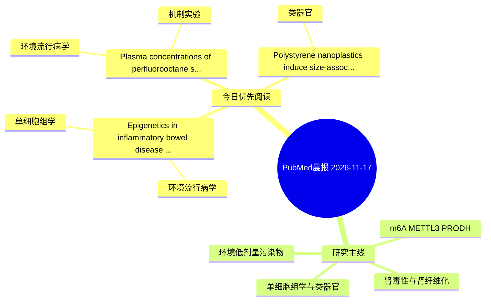

# PubMed 文献晨报｜2026-11-17

- 生成日期：2026-11-17 UTC
- 检索窗口：近 24 小时
- 高质量阈值：规则评分 ≥ 7
- 近 24 小时原始命中数：4

## 今日总体判断

今日筛选出 3 篇优先阅读文献，主要集中在：环境流行病学、单细胞组学、机制实验。

## 今日最值得读的 5 篇文章

### 1. Epigenetics in inflammatory bowel disease: from mechanistic insights to personalized therapeutic strategies.

- 题目：Epigenetics in inflammatory bowel disease: from mechanistic insights to personalized therapeutic strategies.
- 期刊：Nature reviews. Gastroenterology & hepatology
- 年份：2026
- PMID：[43040008](https://pubmed.ncbi.nlm.nih.gov/43040008/)
- DOI：[10.1038/s41575-026-01275-9](https://doi.org/10.1038/s41575-026-01275-9)
- 分类：环境流行病学、单细胞组学
- 规则评分：10
- 研究对象：患者样本或临床数据
- 核心方法：单细胞或空间组学；m6A RNA修饰检测
- 主要发现：摘要提示研究重点涉及环境污染物暴露、单细胞或空间组学；结论线索为：Together, these advances position epigenetics as an important framework for understanding inflammatory bowel disease heterogeneity and informing clinical translation.
- 为什么值得读：可帮助寻找细胞类型特异性机制

### 2. Plasma concentrations of perfluorooctane sulfonate (PFOS) and perfluorooctanoic acid (PFOA) and their associations with selected clinical biochemical markers in residents living near a petrochemical industrial estate in Thailand.

- 题目：Plasma concentrations of perfluorooctane sulfonate (PFOS) and perfluorooctanoic acid (PFOA) and their associations with selected clinical biochemical markers in residents living near a petrochemical industrial estate in Thailand.
- 期刊：International journal of hygiene and environmental health
- 年份：2026
- PMID：[43038899](https://pubmed.ncbi.nlm.nih.gov/43038899/)
- DOI：[10.1016/j.ijheh.2026.114941](https://doi.org/10.1016/j.ijheh.2026.114941)
- 分类：环境流行病学、机制实验
- 规则评分：9
- 研究对象：人群/队列或环境暴露人群
- 核心方法：环境流行病学/队列或人群数据
- 主要发现：摘要提示研究重点涉及环境污染物暴露；结论线索为：Continued biomonitoring and longitudinal studies are therefore warranted.
- 为什么值得读：同时连接环境暴露与机制线索

### 3. Polystyrene nanoplastics induce size-associated intestinal barrier dysfunction and immune activation in human organoid models.

- 题目：Polystyrene nanoplastics induce size-associated intestinal barrier dysfunction and immune activation in human organoid models.
- 期刊：Ecotoxicology and environmental safety
- 年份：2026
- PMID：[43038880](https://pubmed.ncbi.nlm.nih.gov/43038880/)
- DOI：[10.1016/j.ecoenv.2026.121059](https://doi.org/10.1016/j.ecoenv.2026.121059)
- 分类：类器官
- 规则评分：7
- 研究对象：人群/队列或环境暴露人群
- 核心方法：类器官/干细胞模型
- 主要发现：摘要提示研究重点涉及类器官模型；结论线索为：These findings demonstrate that differently sized polystyrene nanoplastics induce distinct biological responses, with smaller particles showing greater accumulation and stronger effects on intestinal epithelial-immune homeostasis under equal mass exposure c...
- 为什么值得读：对建立更接近人体的模型有参考价值

## 分类归档

### 环境流行病学
- [Epigenetics in inflammatory bowel disease: from mechanistic insights to personalized therapeutic strategies.](https://pubmed.ncbi.nlm.nih.gov/43040008/)（PMID: 43040008）
- [Plasma concentrations of perfluorooctane sulfonate (PFOS) and perfluorooctanoic acid (PFOA) and their associations with selected clinical biochemical markers in residents living near a petrochemical industrial estate in Thailand.](https://pubmed.ncbi.nlm.nih.gov/43038899/)（PMID: 43038899）

### 机制实验
- [Plasma concentrations of perfluorooctane sulfonate (PFOS) and perfluorooctanoic acid (PFOA) and their associations with selected clinical biochemical markers in residents living near a petrochemical industrial estate in Thailand.](https://pubmed.ncbi.nlm.nih.gov/43038899/)（PMID: 43038899）

### 单细胞组学
- [Epigenetics in inflammatory bowel disease: from mechanistic insights to personalized therapeutic strategies.](https://pubmed.ncbi.nlm.nih.gov/43040008/)（PMID: 43040008）

### 类器官
- [Polystyrene nanoplastics induce size-associated intestinal barrier dysfunction and immune activation in human organoid models.](https://pubmed.ncbi.nlm.nih.gov/43038880/)（PMID: 43038880）

### 肾毒性
- 今日暂无高质量新文献。

### m6A-METTL3-PRODH
- 今日暂无高质量新文献。

## 今日阅读优先级

1. Epigenetics in inflammatory bowel disease: from mechanistic insights to personalized therapeutic strategies.（优先理由：可帮助寻找细胞类型特异性机制）
2. Plasma concentrations of perfluorooctane sulfonate (PFOS) and perfluorooctanoic acid (PFOA) and their associations with selected clinical biochemical markers in residents living near a petrochemical industrial estate in Thailand.（优先理由：同时连接环境暴露与机制线索）
3. Polystyrene nanoplastics induce size-associated intestinal barrier dysfunction and immune activation in human organoid models.（优先理由：对建立更接近人体的模型有参考价值）

## Mermaid 思维导图

