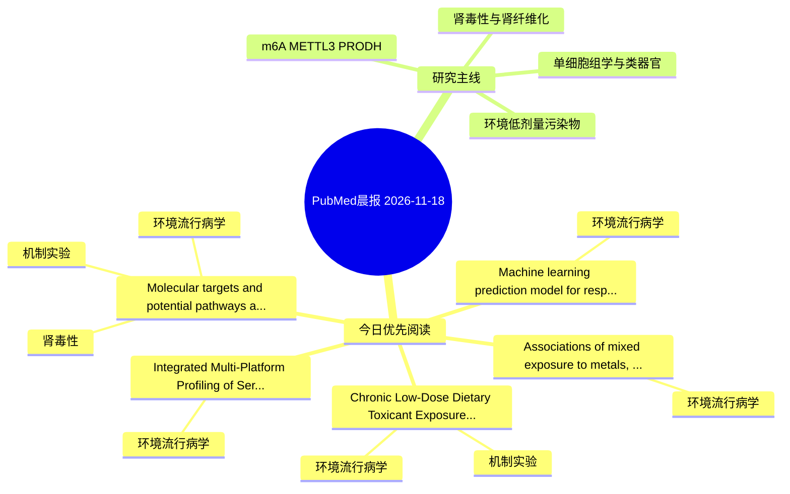

# PubMed 文献晨报｜2026-11-18

- 生成日期：2026-11-18 UTC
- 检索窗口：近 24 小时
- 高质量阈值：规则评分 ≥ 7
- 近 24 小时原始命中数：7

## 今日总体判断

今日筛选出 5 篇优先阅读文献，主要集中在：环境流行病学、机制实验、肾毒性。

## 今日最值得读的 5 篇文章

### 1. Chronic Low-Dose Dietary Toxicant Exposure: An Integrative Review of the Framework Linking Food Contaminants, Inflammation, and Non-Communicable Diseases.

- 题目：Chronic Low-Dose Dietary Toxicant Exposure: An Integrative Review of the Framework Linking Food Contaminants, Inflammation, and Non-Communicable Diseases.
- 期刊：Journal of applied toxicology : JAT
- 年份：2026
- PMID：[43044656](https://pubmed.ncbi.nlm.nih.gov/43044656/)
- DOI：[10.1002/jat.70503](https://doi.org/10.1002/jat.70503)
- 分类：环境流行病学、机制实验
- 规则评分：12
- 研究对象：人群/队列或环境暴露人群
- 核心方法：环境流行病学/队列或人群数据
- 主要发现：摘要提示研究重点涉及环境污染物暴露；结论线索为：The CLDTE framework provides an integrated, system-level perspective on how cumulative and mixture-based dietary exposures may contribute to NCD risk and highlights the need for improved exposure assessment, biomonitoring, and preventive food safety strateg...
- 为什么值得读：同时连接环境暴露与机制线索；关键词匹配度较高

### 2. Associations of mixed exposure to metals, organophosphate metabolites, and glyphosate with amino acid profiles and renal function among solar greenhouse workers.

- 题目：Associations of mixed exposure to metals, organophosphate metabolites, and glyphosate with amino acid profiles and renal function among solar greenhouse workers.
- 期刊：International archives of occupational and environmental health
- 年份：2026
- PMID：[43043524](https://pubmed.ncbi.nlm.nih.gov/43043524/)
- DOI：[10.1007/s00420-026-02245-z](https://doi.org/10.1007/s00420-026-02245-z)
- 分类：环境流行病学
- 规则评分：12
- 研究对象：人群/队列或环境暴露人群
- 核心方法：环境流行病学/队列或人群数据
- 主要发现：摘要提示研究重点涉及环境污染物暴露；结论线索为：CONCLUSION: The findings suggest that amino acid metabolic disturbances, particularly GABA-mediated pathways, may play a role in pollutant-induced renal impairment among greenhouse workers, with notable sex-specific susceptibility in females.
- 为什么值得读：关键词匹配度较高

### 3. Molecular targets and potential pathways associated with DEHP-exacerbated atherosclerosis: A combined bioinformatics and experimental study.

- 题目：Molecular targets and potential pathways associated with DEHP-exacerbated atherosclerosis: A combined bioinformatics and experimental study.
- 期刊：Ecotoxicology and environmental safety
- 年份：2026
- PMID：[43044182](https://pubmed.ncbi.nlm.nih.gov/43044182/)
- DOI：[10.1016/j.ecoenv.2026.121000](https://doi.org/10.1016/j.ecoenv.2026.121000)
- 分类：环境流行病学、机制实验、肾毒性
- 规则评分：11
- 研究对象：人群/队列或环境暴露人群
- 核心方法：细胞与动物机制实验
- 主要发现：摘要提示研究重点涉及肾毒性/肾损伤；结论线索为：Molecular docking revealed strong binding of DEHP to MMP9 (-7.8 kcal/mol), moderate binding to MAPK14 (-6.9 kcal/mol), MAPK8 (-6.4 kcal/mol), BCL2, CASP3, and CTSS (all -5.2 kcal/mol), and weak binding to STAT1 (-4.7 kcal/mol).
- 为什么值得读：同时连接环境暴露与机制线索；与肾毒性/肾损伤主线直接相关

### 4. Machine learning prediction model for respiratory failure in patients with asthma.

- 题目：Machine learning prediction model for respiratory failure in patients with asthma.
- 期刊：Frontiers in artificial intelligence
- 年份：2026
- PMID：[43047782](https://pubmed.ncbi.nlm.nih.gov/43047782/)
- DOI：[10.3389/frai.2026.1966982](https://doi.org/10.3389/frai.2026.1966982)
- 分类：环境流行病学
- 规则评分：10
- 研究对象：人群/队列或环境暴露人群
- 核心方法：环境流行病学/队列或人群数据
- 主要发现：摘要提示研究重点涉及环境污染物暴露；结论线索为：CONCLUSION: The CatBoost machine learning model developed using routinely available clinical data can accurately predict the risk of respiratory failure in hospitalized patients with asthma.
- 为什么值得读：与检索主题有交集，可作为背景或线索文献扫读

### 5. Integrated Multi-Platform Profiling of Serum Bisphenol A and Circulating microRNAs With Comprehensive Biochemical Characterization Across Leukemia Subtypes.

- 题目：Integrated Multi-Platform Profiling of Serum Bisphenol A and Circulating microRNAs With Comprehensive Biochemical Characterization Across Leukemia Subtypes.
- 期刊：Journal of applied toxicology : JAT
- 年份：2026
- PMID：[43049233](https://pubmed.ncbi.nlm.nih.gov/43049233/)
- DOI：[10.1002/jat.70512](https://doi.org/10.1002/jat.70512)
- 分类：环境流行病学
- 规则评分：9
- 研究对象：题名和摘要未明确，建议阅读全文确认
- 核心方法：细胞与动物机制实验
- 主要发现：摘要提示研究重点涉及本方向相关问题；结论线索为：A first cross-subtype, cross-platform analysis of all four leukemia subtypes suggests that a combined bisphenol A and miRNA signature is a promising noninvasive approach to leukemia detection, subtyping, and monitoring.
- 为什么值得读：与检索主题有交集，可作为背景或线索文献扫读

## 分类归档

### 环境流行病学
- [Chronic Low-Dose Dietary Toxicant Exposure: An Integrative Review of the Framework Linking Food Contaminants, Inflammation, and Non-Communicable Diseases.](https://pubmed.ncbi.nlm.nih.gov/43044656/)（PMID: 43044656）
- [Associations of mixed exposure to metals, organophosphate metabolites, and glyphosate with amino acid profiles and renal function among solar greenhouse workers.](https://pubmed.ncbi.nlm.nih.gov/43043524/)（PMID: 43043524）
- [Molecular targets and potential pathways associated with DEHP-exacerbated atherosclerosis: A combined bioinformatics and experimental study.](https://pubmed.ncbi.nlm.nih.gov/43044182/)（PMID: 43044182）
- [Machine learning prediction model for respiratory failure in patients with asthma.](https://pubmed.ncbi.nlm.nih.gov/43047782/)（PMID: 43047782）
- [Integrated Multi-Platform Profiling of Serum Bisphenol A and Circulating microRNAs With Comprehensive Biochemical Characterization Across Leukemia Subtypes.](https://pubmed.ncbi.nlm.nih.gov/43049233/)（PMID: 43049233）

### 机制实验
- [Chronic Low-Dose Dietary Toxicant Exposure: An Integrative Review of the Framework Linking Food Contaminants, Inflammation, and Non-Communicable Diseases.](https://pubmed.ncbi.nlm.nih.gov/43044656/)（PMID: 43044656）
- [Molecular targets and potential pathways associated with DEHP-exacerbated atherosclerosis: A combined bioinformatics and experimental study.](https://pubmed.ncbi.nlm.nih.gov/43044182/)（PMID: 43044182）

### 单细胞组学
- 今日暂无高质量新文献。

### 类器官
- 今日暂无高质量新文献。

### 肾毒性
- [Molecular targets and potential pathways associated with DEHP-exacerbated atherosclerosis: A combined bioinformatics and experimental study.](https://pubmed.ncbi.nlm.nih.gov/43044182/)（PMID: 43044182）

### m6A-METTL3-PRODH
- 今日暂无高质量新文献。

## 今日阅读优先级

1. Chronic Low-Dose Dietary Toxicant Exposure: An Integrative Review of the Framework Linking Food Contaminants, Inflammation, and Non-Communicable Diseases.（优先理由：同时连接环境暴露与机制线索；关键词匹配度较高）
2. Associations of mixed exposure to metals, organophosphate metabolites, and glyphosate with amino acid profiles and renal function among solar greenhouse workers.（优先理由：关键词匹配度较高）
3. Molecular targets and potential pathways associated with DEHP-exacerbated atherosclerosis: A combined bioinformatics and experimental study.（优先理由：同时连接环境暴露与机制线索；与肾毒性/肾损伤主线直接相关）
4. Machine learning prediction model for respiratory failure in patients with asthma.（优先理由：与检索主题有交集，可作为背景或线索文献扫读）
5. Integrated Multi-Platform Profiling of Serum Bisphenol A and Circulating microRNAs With Comprehensive Biochemical Characterization Across Leukemia Subtypes.（优先理由：与检索主题有交集，可作为背景或线索文献扫读）

## Mermaid 思维导图

