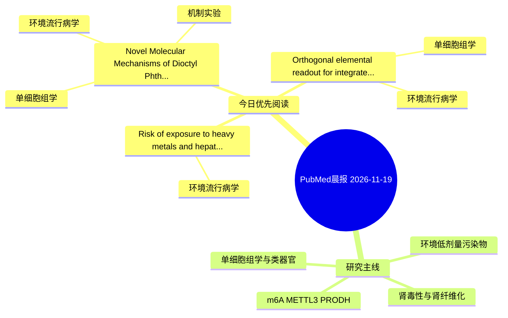

# PubMed 文献晨报｜2026-11-19

- 生成日期：2026-11-19 UTC
- 检索窗口：近 24 小时
- 高质量阈值：规则评分 ≥ 7
- 近 24 小时原始命中数：6

## 今日总体判断

今日筛选出 3 篇优先阅读文献，主要集中在：环境流行病学、单细胞组学、机制实验。

## 今日最值得读的 5 篇文章

### 1. Risk of exposure to heavy metals and hepatic renal profile in children from a rural Peruvian community.

- 题目：Risk of exposure to heavy metals and hepatic renal profile in children from a rural Peruvian community.
- 期刊：Environmental monitoring and assessment
- 年份：2026
- PMID：[43050000](https://pubmed.ncbi.nlm.nih.gov/43050000/)
- DOI：[10.1007/s10661-026-16163-7](https://doi.org/10.1007/s10661-026-16163-7)
- 分类：环境流行病学
- 规则评分：13
- 研究对象：题名和摘要未明确，建议阅读全文确认
- 核心方法：环境流行病学/队列或人群数据
- 主要发现：摘要提示研究重点涉及环境污染物暴露；结论线索为：These findings support strengthening drinking water quality surveillance and implementing longitudinal biomonitoring in vulnerable pediatric populations.
- 为什么值得读：关键词匹配度较高

### 2. Novel Molecular Mechanisms of Dioctyl Phthalate-Induced Pulmonary Fibrosis: Insights From Network Toxicology, Single-Cell RNA Sequencing, and In Vitro Studies.

- 题目：Novel Molecular Mechanisms of Dioctyl Phthalate-Induced Pulmonary Fibrosis: Insights From Network Toxicology, Single-Cell RNA Sequencing, and In Vitro Studies.
- 期刊：FASEB journal : official publication of the Federation of American Societies for Experimental Biology
- 年份：2026
- PMID：[43050294](https://pubmed.ncbi.nlm.nih.gov/43050294/)
- DOI：[10.1096/fj.202602992R](https://doi.org/10.1096/fj.202602992R)
- 分类：环境流行病学、机制实验、单细胞组学
- 规则评分：10
- 研究对象：人群/队列或环境暴露人群
- 核心方法：单细胞或空间组学；细胞与动物机制实验
- 主要发现：摘要提示研究重点涉及肾纤维化、单细胞或空间组学；结论线索为：Single-cell RNA sequencing revealed predominant GPBAR1 expression in macrophages and monocytes, with significant downregulation in IPF samples.
- 为什么值得读：同时连接环境暴露与机制线索；可帮助寻找细胞类型特异性机制

### 3. Orthogonal elemental readout for integrated profiling of metallodrug-protein interactions and protein regulation.

- 题目：Orthogonal elemental readout for integrated profiling of metallodrug-protein interactions and protein regulation.
- 期刊：Chemical science
- 年份：2026
- PMID：[43054445](https://pubmed.ncbi.nlm.nih.gov/43054445/)
- DOI：[10.1039/d6sc06939h](https://doi.org/10.1039/d6sc06939h)
- 分类：环境流行病学、单细胞组学
- 规则评分：10
- 研究对象：题名和摘要未明确，建议阅读全文确认
- 核心方法：单细胞或空间组学
- 主要发现：摘要提示研究重点涉及环境污染物暴露、单细胞或空间组学；结论线索为：Applied to six arsenic-, platinum-, and gold-based metallodrugs across multiple cancer cell lines using a focused heat shock protein (HSP) panel, this integrated workflow revealed drug- and cell-dependent association and regulatory signatures.
- 为什么值得读：可帮助寻找细胞类型特异性机制

## 分类归档

### 环境流行病学
- [Risk of exposure to heavy metals and hepatic renal profile in children from a rural Peruvian community.](https://pubmed.ncbi.nlm.nih.gov/43050000/)（PMID: 43050000）
- [Novel Molecular Mechanisms of Dioctyl Phthalate-Induced Pulmonary Fibrosis: Insights From Network Toxicology, Single-Cell RNA Sequencing, and In Vitro Studies.](https://pubmed.ncbi.nlm.nih.gov/43050294/)（PMID: 43050294）
- [Orthogonal elemental readout for integrated profiling of metallodrug-protein interactions and protein regulation.](https://pubmed.ncbi.nlm.nih.gov/43054445/)（PMID: 43054445）

### 机制实验
- [Novel Molecular Mechanisms of Dioctyl Phthalate-Induced Pulmonary Fibrosis: Insights From Network Toxicology, Single-Cell RNA Sequencing, and In Vitro Studies.](https://pubmed.ncbi.nlm.nih.gov/43050294/)（PMID: 43050294）

### 单细胞组学
- [Novel Molecular Mechanisms of Dioctyl Phthalate-Induced Pulmonary Fibrosis: Insights From Network Toxicology, Single-Cell RNA Sequencing, and In Vitro Studies.](https://pubmed.ncbi.nlm.nih.gov/43050294/)（PMID: 43050294）
- [Orthogonal elemental readout for integrated profiling of metallodrug-protein interactions and protein regulation.](https://pubmed.ncbi.nlm.nih.gov/43054445/)（PMID: 43054445）

### 类器官
- 今日暂无高质量新文献。

### 肾毒性
- 今日暂无高质量新文献。

### m6A-METTL3-PRODH
- 今日暂无高质量新文献。

## 今日阅读优先级

1. Risk of exposure to heavy metals and hepatic renal profile in children from a rural Peruvian community.（优先理由：关键词匹配度较高）
2. Novel Molecular Mechanisms of Dioctyl Phthalate-Induced Pulmonary Fibrosis: Insights From Network Toxicology, Single-Cell RNA Sequencing, and In Vitro Studies.（优先理由：同时连接环境暴露与机制线索；可帮助寻找细胞类型特异性机制）
3. Orthogonal elemental readout for integrated profiling of metallodrug-protein interactions and protein regulation.（优先理由：可帮助寻找细胞类型特异性机制）

## Mermaid 思维导图

