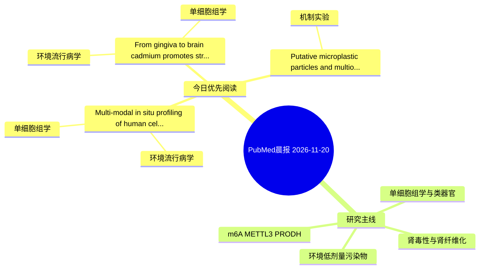

# PubMed 文献晨报｜2026-11-20

- 生成日期：2026-11-20 UTC
- 检索窗口：近 24 小时
- 高质量阈值：规则评分 ≥ 7
- 近 24 小时原始命中数：6

## 今日总体判断

今日筛选出 3 篇优先阅读文献，主要集中在：环境流行病学、单细胞组学、机制实验。

## 今日最值得读的 5 篇文章

### 1. Multi-modal in situ profiling of human cells using the AVITI24 platform characterizes single-cell responses to acute stress.

- 题目：Multi-modal in situ profiling of human cells using the AVITI24 platform characterizes single-cell responses to acute stress.
- 期刊：bioRxiv : the preprint server for biology
- 年份：2026
- PMID：[43060013](https://pubmed.ncbi.nlm.nih.gov/43060013/)
- DOI：[10.64898/2026.10.28.762240](https://doi.org/10.64898/2026.10.28.762240)
- 分类：环境流行病学、单细胞组学
- 规则评分：10
- 研究对象：人群/队列或环境暴露人群
- 核心方法：环境流行病学/队列或人群数据；单细胞或空间组学
- 主要发现：摘要提示研究重点涉及环境污染物暴露、单细胞或空间组学；结论线索为：Overall, the measured regulators respond to stress within 30 minutes through a largely shared program whose magnitude depends more on cell identity than on cell cycle state or neighboring cell type.
- 为什么值得读：可帮助寻找细胞类型特异性机制

### 2. From gingiva to brain: cadmium promotes stroke via vascular mechanisms in periodontitis while vitamin k protects.

- 题目：From gingiva to brain: cadmium promotes stroke via vascular mechanisms in periodontitis while vitamin k protects.
- 期刊：Cell biology and toxicology
- 年份：2026
- PMID：[43056011](https://pubmed.ncbi.nlm.nih.gov/43056011/)
- DOI：[10.1007/s10565-026-10255-3](https://doi.org/10.1007/s10565-026-10255-3)
- 分类：环境流行病学、单细胞组学
- 规则评分：10
- 研究对象：人群/队列或环境暴露人群
- 核心方法：环境流行病学/队列或人群数据；单细胞或空间组学
- 主要发现：摘要提示研究重点涉及环境污染物暴露、单细胞或空间组学；结论线索为：CONCLUSIONS: Periodontitis-related systemic alterations showed differential associations with cadmium (pro‑inflammatory) and vitamin K (pro‑resolving) signatures through immunovascular mechanisms, and these may be jointly associated with stroke susceptibility.
- 为什么值得读：可帮助寻找细胞类型特异性机制

### 3. Putative microplastic particles and multiorgan histopathological alterations in Sparus aurata from the İzmir coastal area of the Aegean Sea.

- 题目：Putative microplastic particles and multiorgan histopathological alterations in Sparus aurata from the İzmir coastal area of the Aegean Sea.
- 期刊：Marine pollution bulletin
- 年份：2026
- PMID：[43057160](https://pubmed.ncbi.nlm.nih.gov/43057160/)
- DOI：[10.1016/j.marpolbul.2026.120603](https://doi.org/10.1016/j.marpolbul.2026.120603)
- 分类：机制实验
- 规则评分：9
- 研究对象：人群/队列或环境暴露人群
- 核心方法：基于题名/摘要的常规实验或文献分析，需阅读全文确认
- 主要发现：摘要提示研究重点涉及本方向相关问题；结论线索为：These observations indicate that microplastic pollution may affect fish health and that particles may be transferred to humans through the food chain; however, human health risks cannot be quantitatively assessed from the present data, and globally unified...
- 为什么值得读：与检索主题有交集，可作为背景或线索文献扫读

## 分类归档

### 环境流行病学
- [Multi-modal in situ profiling of human cells using the AVITI24 platform characterizes single-cell responses to acute stress.](https://pubmed.ncbi.nlm.nih.gov/43060013/)（PMID: 43060013）
- [From gingiva to brain: cadmium promotes stroke via vascular mechanisms in periodontitis while vitamin k protects.](https://pubmed.ncbi.nlm.nih.gov/43056011/)（PMID: 43056011）

### 机制实验
- [Putative microplastic particles and multiorgan histopathological alterations in Sparus aurata from the İzmir coastal area of the Aegean Sea.](https://pubmed.ncbi.nlm.nih.gov/43057160/)（PMID: 43057160）

### 单细胞组学
- [Multi-modal in situ profiling of human cells using the AVITI24 platform characterizes single-cell responses to acute stress.](https://pubmed.ncbi.nlm.nih.gov/43060013/)（PMID: 43060013）
- [From gingiva to brain: cadmium promotes stroke via vascular mechanisms in periodontitis while vitamin k protects.](https://pubmed.ncbi.nlm.nih.gov/43056011/)（PMID: 43056011）

### 类器官
- 今日暂无高质量新文献。

### 肾毒性
- 今日暂无高质量新文献。

### m6A-METTL3-PRODH
- 今日暂无高质量新文献。

## 今日阅读优先级

1. Multi-modal in situ profiling of human cells using the AVITI24 platform characterizes single-cell responses to acute stress.（优先理由：可帮助寻找细胞类型特异性机制）
2. From gingiva to brain: cadmium promotes stroke via vascular mechanisms in periodontitis while vitamin k protects.（优先理由：可帮助寻找细胞类型特异性机制）
3. Putative microplastic particles and multiorgan histopathological alterations in Sparus aurata from the İzmir coastal area of the Aegean Sea.（优先理由：与检索主题有交集，可作为背景或线索文献扫读）

## Mermaid 思维导图

