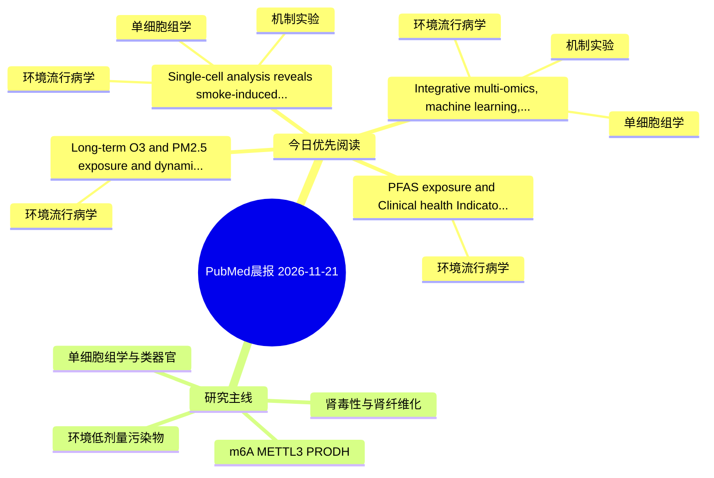

# PubMed 文献晨报｜2026-11-21

- 生成日期：2026-11-21 UTC
- 检索窗口：近 24 小时
- 高质量阈值：规则评分 ≥ 7
- 近 24 小时原始命中数：5

## 今日总体判断

今日筛选出 4 篇优先阅读文献，主要集中在：环境流行病学、机制实验、单细胞组学。

## 今日最值得读的 5 篇文章

### 1. Single-cell analysis reveals smoke-induced neutrophil-macrophage crosstalk as a targetable mechanism in COPD pathogenesis.

- 题目：Single-cell analysis reveals smoke-induced neutrophil-macrophage crosstalk as a targetable mechanism in COPD pathogenesis.
- 期刊：Frontiers in immunology
- 年份：2026
- PMID：[43065558](https://pubmed.ncbi.nlm.nih.gov/43065558/)
- DOI：[10.3389/fimmu.2026.2003457](https://doi.org/10.3389/fimmu.2026.2003457)
- 分类：环境流行病学、机制实验、单细胞组学
- 规则评分：15
- 研究对象：小鼠或大鼠肾损伤模型
- 核心方法：单细胞或空间组学；细胞与动物机制实验
- 主要发现：摘要提示研究重点涉及环境污染物暴露、单细胞或空间组学；结论线索为：CONCLUSION: CS exposure drives chronic pulmonary inflammation through a self-amplifying neutrophil-macrophage circuit mediated by HIF-1α-induced NET formation and dysregulated ANXA1-FPR2 signaling.
- 为什么值得读：同时连接环境暴露与机制线索；可帮助寻找细胞类型特异性机制；关键词匹配度较高

### 2. PFAS exposure and Clinical health Indicators in primary Care: A Registry-Based study.

- 题目：PFAS exposure and Clinical health Indicators in primary Care: A Registry-Based study.
- 期刊：Environment international
- 年份：2026
- PMID：[43063561](https://pubmed.ncbi.nlm.nih.gov/43063561/)
- DOI：[10.1016/j.envint.2026.110612](https://doi.org/10.1016/j.envint.2026.110612)
- 分类：环境流行病学
- 规则评分：12
- 研究对象：人群/队列或环境暴露人群
- 核心方法：环境流行病学/队列或人群数据
- 主要发现：摘要提示研究重点涉及环境污染物暴露；结论线索为：The findings also demonstrate the feasibility of linking biomonitoring and primary care EMR data for environmental health research.
- 为什么值得读：关键词匹配度较高

### 3. Integrative multi-omics, machine learning, computational toxicology, and experimental validation reveal PFAS-associated immune-inflammatory signatures in chronic obstructive pulmonary disease.

- 题目：Integrative multi-omics, machine learning, computational toxicology, and experimental validation reveal PFAS-associated immune-inflammatory signatures in chronic obstructive pulmonary disease.
- 期刊：Frontiers in immunology
- 年份：2026
- PMID：[43065562](https://pubmed.ncbi.nlm.nih.gov/43065562/)
- DOI：[10.3389/fimmu.2026.1965629](https://doi.org/10.3389/fimmu.2026.1965629)
- 分类：环境流行病学、机制实验、单细胞组学
- 规则评分：10
- 研究对象：人群/队列或环境暴露人群
- 核心方法：环境流行病学/队列或人群数据；单细胞或空间组学
- 主要发现：摘要提示研究重点涉及环境污染物暴露、单细胞或空间组学；结论线索为：CONCLUSIONS: This integrative systems-immunology framework delineates immune-inflammatory signatures at the PFAS-COPD interface and identifies HMOX1, JUNB, CXCL12, and PTGS2 as convergent molecular nodes.
- 为什么值得读：同时连接环境暴露与机制线索；可帮助寻找细胞类型特异性机制

### 4. Long-term O3 and PM2.5 exposure and dynamic progression of cardiovascular-kidney-metabolic syndrome: A longitudinal cohort study.

- 题目：Long-term O3 and PM2.5 exposure and dynamic progression of cardiovascular-kidney-metabolic syndrome: A longitudinal cohort study.
- 期刊：Ecotoxicology and environmental safety
- 年份：2026
- PMID：[43063831](https://pubmed.ncbi.nlm.nih.gov/43063831/)
- DOI：[10.1016/j.ecoenv.2026.121085](https://doi.org/10.1016/j.ecoenv.2026.121085)
- 分类：环境流行病学
- 规则评分：9
- 研究对象：人群/队列或环境暴露人群
- 核心方法：环境流行病学/队列或人群数据
- 主要发现：摘要提示研究重点涉及环境污染物暴露；结论线索为：CONCLUSIONS: Long-term O3 and PM2.5 exposures were associated with higher hazards of nonfatal CKM progression in the primary analyses.
- 为什么值得读：与检索主题有交集，可作为背景或线索文献扫读

## 分类归档

### 环境流行病学
- [Single-cell analysis reveals smoke-induced neutrophil-macrophage crosstalk as a targetable mechanism in COPD pathogenesis.](https://pubmed.ncbi.nlm.nih.gov/43065558/)（PMID: 43065558）
- [PFAS exposure and Clinical health Indicators in primary Care: A Registry-Based study.](https://pubmed.ncbi.nlm.nih.gov/43063561/)（PMID: 43063561）
- [Integrative multi-omics, machine learning, computational toxicology, and experimental validation reveal PFAS-associated immune-inflammatory signatures in chronic obstructive pulmonary disease.](https://pubmed.ncbi.nlm.nih.gov/43065562/)（PMID: 43065562）
- [Long-term O3 and PM2.5 exposure and dynamic progression of cardiovascular-kidney-metabolic syndrome: A longitudinal cohort study.](https://pubmed.ncbi.nlm.nih.gov/43063831/)（PMID: 43063831）

### 机制实验
- [Single-cell analysis reveals smoke-induced neutrophil-macrophage crosstalk as a targetable mechanism in COPD pathogenesis.](https://pubmed.ncbi.nlm.nih.gov/43065558/)（PMID: 43065558）
- [Integrative multi-omics, machine learning, computational toxicology, and experimental validation reveal PFAS-associated immune-inflammatory signatures in chronic obstructive pulmonary disease.](https://pubmed.ncbi.nlm.nih.gov/43065562/)（PMID: 43065562）

### 单细胞组学
- [Single-cell analysis reveals smoke-induced neutrophil-macrophage crosstalk as a targetable mechanism in COPD pathogenesis.](https://pubmed.ncbi.nlm.nih.gov/43065558/)（PMID: 43065558）
- [Integrative multi-omics, machine learning, computational toxicology, and experimental validation reveal PFAS-associated immune-inflammatory signatures in chronic obstructive pulmonary disease.](https://pubmed.ncbi.nlm.nih.gov/43065562/)（PMID: 43065562）

### 类器官
- 今日暂无高质量新文献。

### 肾毒性
- 今日暂无高质量新文献。

### m6A-METTL3-PRODH
- 今日暂无高质量新文献。

## 今日阅读优先级

1. Single-cell analysis reveals smoke-induced neutrophil-macrophage crosstalk as a targetable mechanism in COPD pathogenesis.（优先理由：同时连接环境暴露与机制线索；可帮助寻找细胞类型特异性机制；关键词匹配度较高）
2. PFAS exposure and Clinical health Indicators in primary Care: A Registry-Based study.（优先理由：关键词匹配度较高）
3. Integrative multi-omics, machine learning, computational toxicology, and experimental validation reveal PFAS-associated immune-inflammatory signatures in chronic obstructive pulmonary disease.（优先理由：同时连接环境暴露与机制线索；可帮助寻找细胞类型特异性机制）
4. Long-term O3 and PM2.5 exposure and dynamic progression of cardiovascular-kidney-metabolic syndrome: A longitudinal cohort study.（优先理由：与检索主题有交集，可作为背景或线索文献扫读）

## Mermaid 思维导图

