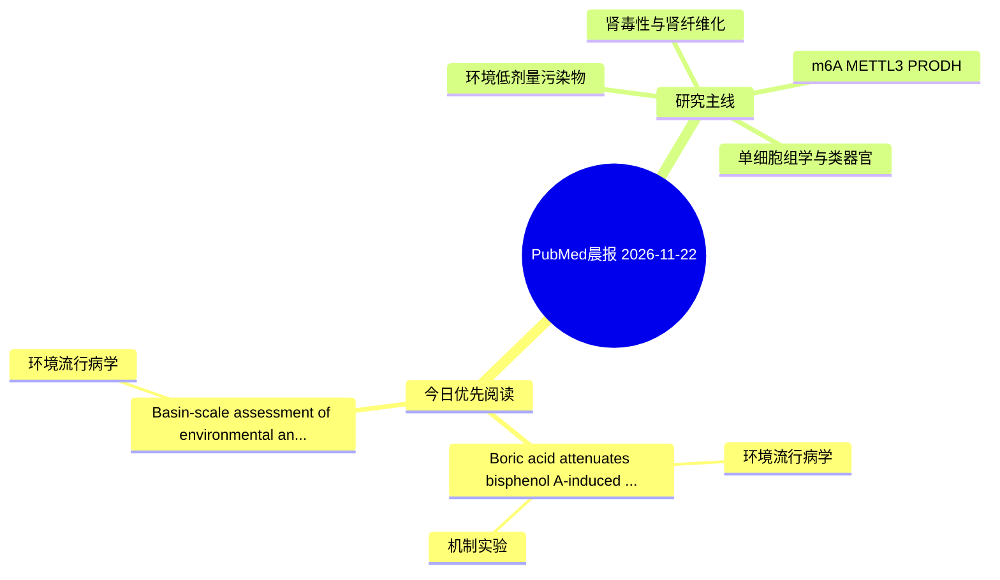

# PubMed 文献晨报｜2026-11-22

- 生成日期：2026-11-22 UTC
- 检索窗口：近 24 小时
- 高质量阈值：规则评分 ≥ 7
- 近 24 小时原始命中数：4

## 今日总体判断

今日筛选出 2 篇优先阅读文献，主要集中在：环境流行病学、机制实验。

## 今日最值得读的 5 篇文章

### 1. Boric acid attenuates bisphenol A-induced hepatorenal damage via modulation of lipid profile, inflammation, oxidative stress, and apoptosis: In vivo, in silico, and network pharmacological analysis.

- 题目：Boric acid attenuates bisphenol A-induced hepatorenal damage via modulation of lipid profile, inflammation, oxidative stress, and apoptosis: In vivo, in silico, and network pharmacological analysis.
- 期刊：Toxicology and applied pharmacology
- 年份：2026
- PMID：[43067440](https://pubmed.ncbi.nlm.nih.gov/43067440/)
- DOI：[10.1016/j.taap.2026.118125](https://doi.org/10.1016/j.taap.2026.118125)
- 分类：环境流行病学、机制实验
- 规则评分：13
- 研究对象：人群/队列或环境暴露人群
- 核心方法：细胞与动物机制实验
- 主要发现：摘要提示研究重点涉及环境污染物暴露；结论线索为：Histopathological examination revealed necrotic changes, oedema, vascular congestion, inflammatory alterations, and changes in apoptosis-related immunoreactivity.
- 为什么值得读：同时连接环境暴露与机制线索；关键词匹配度较高

### 2. Basin-scale assessment of environmental and human health risks of melamine as a persistent, mobile, and toxic substance.

- 题目：Basin-scale assessment of environmental and human health risks of melamine as a persistent, mobile, and toxic substance.
- 期刊：Environment international
- 年份：2026
- PMID：[43067087](https://pubmed.ncbi.nlm.nih.gov/43067087/)
- DOI：[10.1016/j.envint.2026.110610](https://doi.org/10.1016/j.envint.2026.110610)
- 分类：环境流行病学
- 规则评分：10
- 研究对象：人群/队列或环境暴露人群
- 核心方法：基于题名/摘要的常规实验或文献分析，需阅读全文确认
- 主要发现：摘要提示研究重点涉及环境污染物暴露；结论线索为：These findings provide a basis for national-scale environmental and human health risk screening of melamine and the identification of priority river basins for further investigation and risk management.
- 为什么值得读：与检索主题有交集，可作为背景或线索文献扫读

## 分类归档

### 环境流行病学
- [Boric acid attenuates bisphenol A-induced hepatorenal damage via modulation of lipid profile, inflammation, oxidative stress, and apoptosis: In vivo, in silico, and network pharmacological analysis.](https://pubmed.ncbi.nlm.nih.gov/43067440/)（PMID: 43067440）
- [Basin-scale assessment of environmental and human health risks of melamine as a persistent, mobile, and toxic substance.](https://pubmed.ncbi.nlm.nih.gov/43067087/)（PMID: 43067087）

### 机制实验
- [Boric acid attenuates bisphenol A-induced hepatorenal damage via modulation of lipid profile, inflammation, oxidative stress, and apoptosis: In vivo, in silico, and network pharmacological analysis.](https://pubmed.ncbi.nlm.nih.gov/43067440/)（PMID: 43067440）

### 单细胞组学
- 今日暂无高质量新文献。

### 类器官
- 今日暂无高质量新文献。

### 肾毒性
- 今日暂无高质量新文献。

### m6A-METTL3-PRODH
- 今日暂无高质量新文献。

## 今日阅读优先级

1. Boric acid attenuates bisphenol A-induced hepatorenal damage via modulation of lipid profile, inflammation, oxidative stress, and apoptosis: In vivo, in silico, and network pharmacological analysis.（优先理由：同时连接环境暴露与机制线索；关键词匹配度较高）
2. Basin-scale assessment of environmental and human health risks of melamine as a persistent, mobile, and toxic substance.（优先理由：与检索主题有交集，可作为背景或线索文献扫读）

## Mermaid 思维导图

