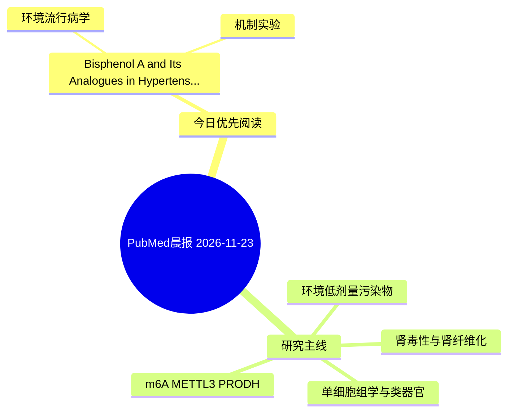

# PubMed 文献晨报｜2026-11-23

- 生成日期：2026-11-23 UTC
- 检索窗口：近 24 小时
- 高质量阈值：规则评分 ≥ 7
- 近 24 小时原始命中数：3

## 今日总体判断

今日筛选出 1 篇优先阅读文献，主要集中在：环境流行病学、机制实验。

## 今日最值得读的 5 篇文章

### 1. Bisphenol A and Its Analogues in Hypertension: Molecular Mechanisms, Epigenetic Regulation, and Therapeutic Perspectives-A Narrative Review.

- 题目：Bisphenol A and Its Analogues in Hypertension: Molecular Mechanisms, Epigenetic Regulation, and Therapeutic Perspectives-A Narrative Review.
- 期刊：Journal of applied toxicology : JAT
- 年份：2026
- PMID：[43069715](https://pubmed.ncbi.nlm.nih.gov/43069715/)
- DOI：[10.1002/jat.70510](https://doi.org/10.1002/jat.70510)
- 分类：环境流行病学、机制实验
- 规则评分：8
- 研究对象：人群/队列或环境暴露人群
- 核心方法：m6A RNA修饰检测
- 主要发现：摘要提示研究重点涉及肾纤维化；结论线索为：Because the human evidence is predominantly cross-sectional and the mechanistic data derive largely from experimental models, the relationships described should be regarded as associations and plausible mechanisms rather than established causal pathways.
- 为什么值得读：同时连接环境暴露与机制线索

## 分类归档

### 环境流行病学
- [Bisphenol A and Its Analogues in Hypertension: Molecular Mechanisms, Epigenetic Regulation, and Therapeutic Perspectives-A Narrative Review.](https://pubmed.ncbi.nlm.nih.gov/43069715/)（PMID: 43069715）

### 机制实验
- [Bisphenol A and Its Analogues in Hypertension: Molecular Mechanisms, Epigenetic Regulation, and Therapeutic Perspectives-A Narrative Review.](https://pubmed.ncbi.nlm.nih.gov/43069715/)（PMID: 43069715）

### 单细胞组学
- 今日暂无高质量新文献。

### 类器官
- 今日暂无高质量新文献。

### 肾毒性
- 今日暂无高质量新文献。

### m6A-METTL3-PRODH
- 今日暂无高质量新文献。

## 今日阅读优先级

1. Bisphenol A and Its Analogues in Hypertension: Molecular Mechanisms, Epigenetic Regulation, and Therapeutic Perspectives-A Narrative Review.（优先理由：同时连接环境暴露与机制线索）

## Mermaid 思维导图

