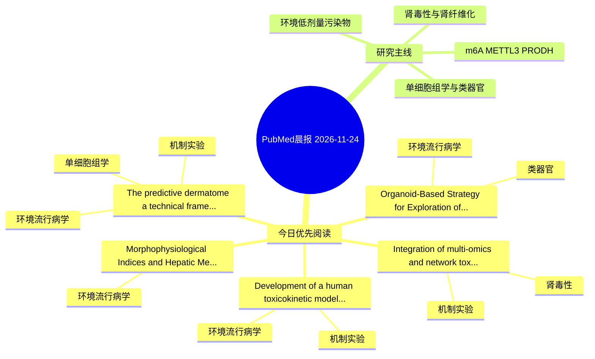

# PubMed 文献晨报｜2026-11-24

- 生成日期：2026-11-24 UTC
- 检索窗口：近 24 小时
- 高质量阈值：规则评分 ≥ 7
- 近 24 小时原始命中数：9

## 今日总体判断

今日筛选出 5 篇优先阅读文献，主要集中在：环境流行病学、机制实验、肾毒性。

## 今日最值得读的 5 篇文章

### 1. Morphophysiological Indices and Hepatic Metal Profiles in the Green Toad (Bufotes sitibundus) Along an Agricultural-Industrial Pollution Gradient.

- 题目：Morphophysiological Indices and Hepatic Metal Profiles in the Green Toad (Bufotes sitibundus) Along an Agricultural-Industrial Pollution Gradient.
- 期刊：Biological trace element research
- 年份：2026
- PMID：[43071286](https://pubmed.ncbi.nlm.nih.gov/43071286/)
- DOI：[10.1007/s12011-026-05362-5](https://doi.org/10.1007/s12011-026-05362-5)
- 分类：环境流行病学
- 规则评分：12
- 研究对象：题名和摘要未明确，建议阅读全文确认
- 核心方法：基于题名/摘要的常规实验或文献分析，需阅读全文确认
- 主要发现：摘要提示研究重点涉及环境污染物暴露；结论线索为：These findings indicate that B.
- 为什么值得读：关键词匹配度较高

### 2. Integration of multi-omics and network toxicology suggests potential mechanisms linking artificial sweeteners to chronic kidney disease.

- 题目：Integration of multi-omics and network toxicology suggests potential mechanisms linking artificial sweeteners to chronic kidney disease.
- 期刊：BMC pharmacology & toxicology
- 年份：2026
- PMID：[43074006](https://pubmed.ncbi.nlm.nih.gov/43074006/)
- DOI：[10.1186/s40360-026-01201-4](https://doi.org/10.1186/s40360-026-01201-4)
- 分类：机制实验、肾毒性
- 规则评分：12
- 研究对象：人群/队列或环境暴露人群
- 核心方法：基于题名/摘要的常规实验或文献分析，需阅读全文确认
- 主要发现：摘要提示研究重点涉及环境污染物暴露、肾毒性/肾损伤；结论线索为：CONCLUSIONS: Our findings propose a multi-layered mechanism wherein artificial sweeteners may exacerbate renal decline, potentially via inflammasome-mediated and innate immune pathways.
- 为什么值得读：与肾毒性/肾损伤主线直接相关；关键词匹配度较高

### 3. Organoid-Based Strategy for Exploration of Cancer-Related Early Signatures of Low-Dose Methylmercury Exposure.

- 题目：Organoid-Based Strategy for Exploration of Cancer-Related Early Signatures of Low-Dose Methylmercury Exposure.
- 期刊：Environmental science & technology
- 年份：2026
- PMID：[43076755](https://pubmed.ncbi.nlm.nih.gov/43076755/)
- DOI：[10.1021/acs.est.6c10253](https://doi.org/10.1021/acs.est.6c10253)
- 分类：环境流行病学、类器官
- 规则评分：11
- 研究对象：人群/队列或环境暴露人群
- 核心方法：环境流行病学/队列或人群数据；类器官/干细胞模型
- 主要发现：摘要提示研究重点涉及类器官模型；结论线索为：These results indicate that low-dose MeHg exposure could trigger early biological responses related to cancer-associated processes before apparent cytotoxicity occurs.
- 为什么值得读：对建立更接近人体的模型有参考价值

### 4. The predictive dermatome: a technical framework for spatial AI mapping of molecular skin aging.

- 题目：The predictive dermatome: a technical framework for spatial AI mapping of molecular skin aging.
- 期刊：Frontiers in digital health
- 年份：2026
- PMID：[43074928](https://pubmed.ncbi.nlm.nih.gov/43074928/)
- DOI：[10.3389/fdgth.2026.1764342](https://doi.org/10.3389/fdgth.2026.1764342)
- 分类：环境流行病学、机制实验、单细胞组学
- 规则评分：11
- 研究对象：人群/队列或环境暴露人群
- 核心方法：环境流行病学/队列或人群数据；单细胞或空间组学
- 主要发现：摘要提示研究重点涉及环境污染物暴露、单细胞或空间组学；结论线索为：Chronological age and most systemic aging clocks provide useful population-level estimates, but they do not explain why adjacent or anatomically distinct skin regions may show different rates of dermal thinning, matrix remodeling, pigmentation change, vascu...
- 为什么值得读：同时连接环境暴露与机制线索；可帮助寻找细胞类型特异性机制

### 5. Development of a human toxicokinetic model of glyphosate for interpreting biomonitoring data.

- 题目：Development of a human toxicokinetic model of glyphosate for interpreting biomonitoring data.
- 期刊：Archives of toxicology
- 年份：2026
- PMID：[43073374](https://pubmed.ncbi.nlm.nih.gov/43073374/)
- DOI：[10.1007/s00204-026-04633-3](https://doi.org/10.1007/s00204-026-04633-3)
- 分类：环境流行病学、机制实验
- 规则评分：10
- 研究对象：人群/队列或环境暴露人群
- 核心方法：环境流行病学/队列或人群数据
- 主要发现：摘要提示研究重点涉及环境污染物暴露；结论线索为：Its quantitative performance is currently best supported for oral exposure; additional controlled human data are needed to optimize the parameterization of the dermal and inhalation exposure pathways.
- 为什么值得读：同时连接环境暴露与机制线索

## 分类归档

### 环境流行病学
- [Morphophysiological Indices and Hepatic Metal Profiles in the Green Toad (Bufotes sitibundus) Along an Agricultural-Industrial Pollution Gradient.](https://pubmed.ncbi.nlm.nih.gov/43071286/)（PMID: 43071286）
- [Organoid-Based Strategy for Exploration of Cancer-Related Early Signatures of Low-Dose Methylmercury Exposure.](https://pubmed.ncbi.nlm.nih.gov/43076755/)（PMID: 43076755）
- [The predictive dermatome: a technical framework for spatial AI mapping of molecular skin aging.](https://pubmed.ncbi.nlm.nih.gov/43074928/)（PMID: 43074928）
- [Development of a human toxicokinetic model of glyphosate for interpreting biomonitoring data.](https://pubmed.ncbi.nlm.nih.gov/43073374/)（PMID: 43073374）

### 机制实验
- [Integration of multi-omics and network toxicology suggests potential mechanisms linking artificial sweeteners to chronic kidney disease.](https://pubmed.ncbi.nlm.nih.gov/43074006/)（PMID: 43074006）
- [The predictive dermatome: a technical framework for spatial AI mapping of molecular skin aging.](https://pubmed.ncbi.nlm.nih.gov/43074928/)（PMID: 43074928）
- [Development of a human toxicokinetic model of glyphosate for interpreting biomonitoring data.](https://pubmed.ncbi.nlm.nih.gov/43073374/)（PMID: 43073374）

### 单细胞组学
- [The predictive dermatome: a technical framework for spatial AI mapping of molecular skin aging.](https://pubmed.ncbi.nlm.nih.gov/43074928/)（PMID: 43074928）

### 类器官
- [Organoid-Based Strategy for Exploration of Cancer-Related Early Signatures of Low-Dose Methylmercury Exposure.](https://pubmed.ncbi.nlm.nih.gov/43076755/)（PMID: 43076755）

### 肾毒性
- [Integration of multi-omics and network toxicology suggests potential mechanisms linking artificial sweeteners to chronic kidney disease.](https://pubmed.ncbi.nlm.nih.gov/43074006/)（PMID: 43074006）

### m6A-METTL3-PRODH
- 今日暂无高质量新文献。

## 今日阅读优先级

1. Morphophysiological Indices and Hepatic Metal Profiles in the Green Toad (Bufotes sitibundus) Along an Agricultural-Industrial Pollution Gradient.（优先理由：关键词匹配度较高）
2. Integration of multi-omics and network toxicology suggests potential mechanisms linking artificial sweeteners to chronic kidney disease.（优先理由：与肾毒性/肾损伤主线直接相关；关键词匹配度较高）
3. Organoid-Based Strategy for Exploration of Cancer-Related Early Signatures of Low-Dose Methylmercury Exposure.（优先理由：对建立更接近人体的模型有参考价值）
4. The predictive dermatome: a technical framework for spatial AI mapping of molecular skin aging.（优先理由：同时连接环境暴露与机制线索；可帮助寻找细胞类型特异性机制）
5. Development of a human toxicokinetic model of glyphosate for interpreting biomonitoring data.（优先理由：同时连接环境暴露与机制线索）

## Mermaid 思维导图

