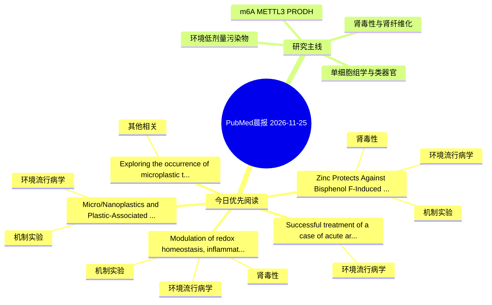

# PubMed 文献晨报｜2026-11-25

- 生成日期：2026-11-25 UTC
- 检索窗口：近 24 小时
- 高质量阈值：规则评分 ≥ 7
- 近 24 小时原始命中数：10

## 今日总体判断

今日筛选出 5 篇优先阅读文献，主要集中在：环境流行病学、机制实验、肾毒性。

## 今日最值得读的 5 篇文章

### 1. Modulation of redox homeostasis, inflammation and endoplasmic reticulum stress mediate the protective effect of nifuroxazide against bisphenol A-induced kidney injury.

- 题目：Modulation of redox homeostasis, inflammation and endoplasmic reticulum stress mediate the protective effect of nifuroxazide against bisphenol A-induced kidney injury.
- 期刊：Life sciences
- 年份：2026
- PMID：[43078337](https://pubmed.ncbi.nlm.nih.gov/43078337/)
- DOI：[10.1016/j.lfs.2026.124806](https://doi.org/10.1016/j.lfs.2026.124806)
- 分类：环境流行病学、机制实验、肾毒性
- 规则评分：20
- 研究对象：小鼠或大鼠肾损伤模型
- 核心方法：基于题名/摘要的常规实验或文献分析，需阅读全文确认
- 主要发现：摘要提示研究重点涉及环境污染物暴露、肾毒性/肾损伤；结论线索为：In conclusion, these data indicate that NFZ affords significant protection against BPA nephrotoxicity by enhancing Nrf2/HO-1 signaling and antioxidants, attenuating inflammatory and ER-stress signaling, and diminishing apoptosis.
- 为什么值得读：同时连接环境暴露与机制线索；与肾毒性/肾损伤主线直接相关；关键词匹配度较高

### 2. Zinc Protects Against Bisphenol F-Induced Renal Dysfunction via Modulation of XO/UA-Nrf2/NF-κB Signaling and Mitochondrial Dysfunction.

- 题目：Zinc Protects Against Bisphenol F-Induced Renal Dysfunction via Modulation of XO/UA-Nrf2/NF-κB Signaling and Mitochondrial Dysfunction.
- 期刊：Biological trace element research
- 年份：2026
- PMID：[43077148](https://pubmed.ncbi.nlm.nih.gov/43077148/)
- DOI：[10.1007/s12011-026-05432-8](https://doi.org/10.1007/s12011-026-05432-8)
- 分类：环境流行病学、机制实验、肾毒性
- 规则评分：17
- 研究对象：小鼠或大鼠肾损伤模型
- 核心方法：基于题名/摘要的常规实验或文献分析，需阅读全文确认
- 主要发现：摘要提示研究重点涉及肾毒性/肾损伤；结论线索为：Notably, Zn supplementation attenuated these effects by restoring antioxidant defenses, suppressing inflammation, preserving mitochondrial integrity, and improving renal structure and function CONCLUSION: These findings highlight Zn as a potential therapeut...
- 为什么值得读：同时连接环境暴露与机制线索；与肾毒性/肾损伤主线直接相关；关键词匹配度较高

### 3. [Successful treatment of a case of acute arsine poisoning via plasma exchange].

- 题目：[Successful treatment of a case of acute arsine poisoning via plasma exchange].
- 期刊：Zhonghua lao dong wei sheng zhi ye bing za zhi = Zhonghua laodong weisheng zhiyebing zazhi = Chinese journal of industrial hygiene and occupational diseases
- 年份：2026
- PMID：[43079817](https://pubmed.ncbi.nlm.nih.gov/43079817/)
- DOI：[10.3760/cma.j.cn121094-20250605-00226](https://doi.org/10.3760/cma.j.cn121094-20250605-00226)
- 分类：环境流行病学
- 规则评分：9
- 研究对象：患者样本或临床数据
- 核心方法：基于题名/摘要的常规实验或文献分析，需阅读全文确认
- 主要发现：摘要提示研究重点涉及环境污染物暴露；结论线索为：The patient was fully recovered and discharged; follow-up examinations at 3 months revealed no abnormalities in renal function.
- 为什么值得读：与检索主题有交集，可作为背景或线索文献扫读

### 4. Exploring the occurrence of microplastic translocation in marine vertebrates with guidelines for harmonisation.

- 题目：Exploring the occurrence of microplastic translocation in marine vertebrates with guidelines for harmonisation.
- 期刊：Environmental pollution (Barking, Essex : 1987)
- 年份：2026
- PMID：[43078186](https://pubmed.ncbi.nlm.nih.gov/43078186/)
- DOI：[10.1016/j.envpol.2026.129613](https://doi.org/10.1016/j.envpol.2026.129613)
- 分类：其他相关
- 规则评分：8
- 研究对象：题名和摘要未明确，建议阅读全文确认
- 核心方法：基于题名/摘要的常规实验或文献分析，需阅读全文确认
- 主要发现：摘要提示研究重点涉及本方向相关问题；结论线索为：We use the term "putative translocation" to recognise that detection of MPs in distal tissues or organs does not necessarily demonstrate movement of particles between compartments, but may provide evidence consistent with translocation.
- 为什么值得读：与检索主题有交集，可作为背景或线索文献扫读

### 5. Micro/Nanoplastics and Plastic-Associated Chemicals as Candidate Developmental Neuroimmune Disruptors in Autism.

- 题目：Micro/Nanoplastics and Plastic-Associated Chemicals as Candidate Developmental Neuroimmune Disruptors in Autism.
- 期刊：Pathophysiology : the official journal of the International Society for Pathophysiology
- 年份：2026
- PMID：[43081296](https://pubmed.ncbi.nlm.nih.gov/43081296/)
- DOI：[10.3390/pathophysiology33040090](https://doi.org/10.3390/pathophysiology33040090)
- 分类：环境流行病学、机制实验
- 规则评分：8
- 研究对象：人群/队列或环境暴露人群
- 核心方法：环境流行病学/队列或人群数据；细胞与动物机制实验
- 主要发现：摘要提示研究重点涉及本方向相关问题；结论线索为：Because most data are preclinical or associational, the framework is hypothesis-generating and does not show that plastic exposure causes ASD in humans.
- 为什么值得读：同时连接环境暴露与机制线索

## 分类归档

### 环境流行病学
- [Modulation of redox homeostasis, inflammation and endoplasmic reticulum stress mediate the protective effect of nifuroxazide against bisphenol A-induced kidney injury.](https://pubmed.ncbi.nlm.nih.gov/43078337/)（PMID: 43078337）
- [Zinc Protects Against Bisphenol F-Induced Renal Dysfunction via Modulation of XO/UA-Nrf2/NF-κB Signaling and Mitochondrial Dysfunction.](https://pubmed.ncbi.nlm.nih.gov/43077148/)（PMID: 43077148）
- [\[Successful treatment of a case of acute arsine poisoning via plasma exchange\].](https://pubmed.ncbi.nlm.nih.gov/43079817/)（PMID: 43079817）
- [Micro/Nanoplastics and Plastic-Associated Chemicals as Candidate Developmental Neuroimmune Disruptors in Autism.](https://pubmed.ncbi.nlm.nih.gov/43081296/)（PMID: 43081296）

### 机制实验
- [Modulation of redox homeostasis, inflammation and endoplasmic reticulum stress mediate the protective effect of nifuroxazide against bisphenol A-induced kidney injury.](https://pubmed.ncbi.nlm.nih.gov/43078337/)（PMID: 43078337）
- [Zinc Protects Against Bisphenol F-Induced Renal Dysfunction via Modulation of XO/UA-Nrf2/NF-κB Signaling and Mitochondrial Dysfunction.](https://pubmed.ncbi.nlm.nih.gov/43077148/)（PMID: 43077148）
- [Micro/Nanoplastics and Plastic-Associated Chemicals as Candidate Developmental Neuroimmune Disruptors in Autism.](https://pubmed.ncbi.nlm.nih.gov/43081296/)（PMID: 43081296）

### 单细胞组学
- 今日暂无高质量新文献。

### 类器官
- 今日暂无高质量新文献。

### 肾毒性
- [Modulation of redox homeostasis, inflammation and endoplasmic reticulum stress mediate the protective effect of nifuroxazide against bisphenol A-induced kidney injury.](https://pubmed.ncbi.nlm.nih.gov/43078337/)（PMID: 43078337）
- [Zinc Protects Against Bisphenol F-Induced Renal Dysfunction via Modulation of XO/UA-Nrf2/NF-κB Signaling and Mitochondrial Dysfunction.](https://pubmed.ncbi.nlm.nih.gov/43077148/)（PMID: 43077148）

### m6A-METTL3-PRODH
- 今日暂无高质量新文献。

## 今日阅读优先级

1. Modulation of redox homeostasis, inflammation and endoplasmic reticulum stress mediate the protective effect of nifuroxazide against bisphenol A-induced kidney injury.（优先理由：同时连接环境暴露与机制线索；与肾毒性/肾损伤主线直接相关；关键词匹配度较高）
2. Zinc Protects Against Bisphenol F-Induced Renal Dysfunction via Modulation of XO/UA-Nrf2/NF-κB Signaling and Mitochondrial Dysfunction.（优先理由：同时连接环境暴露与机制线索；与肾毒性/肾损伤主线直接相关；关键词匹配度较高）
3. [Successful treatment of a case of acute arsine poisoning via plasma exchange].（优先理由：与检索主题有交集，可作为背景或线索文献扫读）
4. Exploring the occurrence of microplastic translocation in marine vertebrates with guidelines for harmonisation.（优先理由：与检索主题有交集，可作为背景或线索文献扫读）
5. Micro/Nanoplastics and Plastic-Associated Chemicals as Candidate Developmental Neuroimmune Disruptors in Autism.（优先理由：同时连接环境暴露与机制线索）

## Mermaid 思维导图

