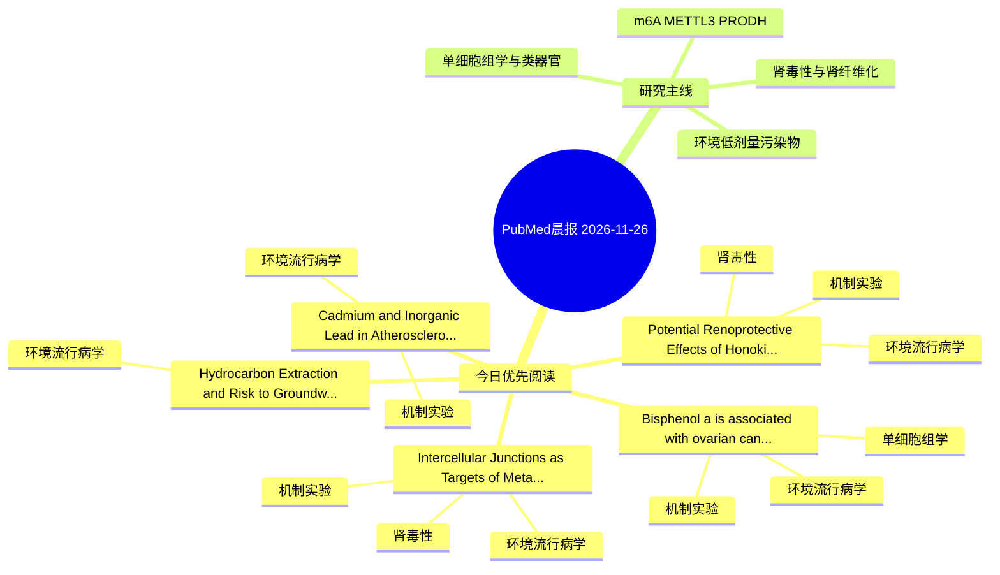

# PubMed 文献晨报｜2026-11-26

- 生成日期：2026-11-26 UTC
- 检索窗口：近 24 小时
- 高质量阈值：规则评分 ≥ 7
- 近 24 小时原始命中数：10

## 今日总体判断

今日筛选出 5 篇优先阅读文献，主要集中在：环境流行病学、机制实验、肾毒性。

## 今日最值得读的 5 篇文章

### 1. Potential Renoprotective Effects of Honokiol.

- 题目：Potential Renoprotective Effects of Honokiol.
- 期刊：Biomolecules
- 年份：2026
- PMID：[43090039](https://pubmed.ncbi.nlm.nih.gov/43090039/)
- DOI：[10.3390/biom16111649](https://doi.org/10.3390/biom16111649)
- 分类：环境流行病学、机制实验、肾毒性
- 规则评分：16
- 研究对象：患者样本或临床数据
- 核心方法：基于题名/摘要的常规实验或文献分析，需阅读全文确认
- 主要发现：摘要提示研究重点涉及环境污染物暴露、肾毒性/肾损伤、肾纤维化；结论线索为：These studies indicate that honokiol demonstrates potential renoprotective effects by modulating multiple pathways, including SIRT3-mediated mitochondrial homeostasis, NLRP3 inflammasome activation, oxidative stress responses, Wnt/β-catenin signaling, and m...
- 为什么值得读：同时连接环境暴露与机制线索；与肾毒性/肾损伤主线直接相关；关键词匹配度较高

### 2. Bisphenol a is associated with ovarian cancer chemoresistance via ecmCAF-mediated stromal remodeling: an integrative multi-omics study.

- 题目：Bisphenol a is associated with ovarian cancer chemoresistance via ecmCAF-mediated stromal remodeling: an integrative multi-omics study.
- 期刊：Frontiers in pharmacology
- 年份：2026
- PMID：[43094954](https://pubmed.ncbi.nlm.nih.gov/43094954/)
- DOI：[10.3389/fphar.2026.1988214](https://doi.org/10.3389/fphar.2026.1988214)
- 分类：环境流行病学、机制实验、单细胞组学
- 规则评分：14
- 研究对象：题名和摘要未明确，建议阅读全文确认
- 核心方法：单细胞或空间组学；细胞与动物机制实验
- 主要发现：摘要提示研究重点涉及环境污染物暴露、单细胞或空间组学；结论线索为：These findings identify ecmCAF effectors as candidate exposure biomarkers and suggest that environmental risk assessment should consider the potential of BPA to compromise cancer treatment outcomes.
- 为什么值得读：同时连接环境暴露与机制线索；可帮助寻找细胞类型特异性机制；关键词匹配度较高

### 3. Intercellular Junctions as Targets of Metal Toxicity: A Narrative Review.

- 题目：Intercellular Junctions as Targets of Metal Toxicity: A Narrative Review.
- 期刊：Molecules (Basel, Switzerland)
- 年份：2026
- PMID：[43093597](https://pubmed.ncbi.nlm.nih.gov/43093597/)
- DOI：[10.3390/molecules31224200](https://doi.org/10.3390/molecules31224200)
- 分类：环境流行病学、机制实验、肾毒性
- 规则评分：13
- 研究对象：HK-2 近端肾小管上皮细胞
- 核心方法：细胞与动物机制实验
- 主要发现：摘要提示研究重点涉及环境污染物暴露；结论线索为：The review concludes that intercellular junctions are primary targets of metal toxicity, suggesting that their compromise represents a plausible mechanistic link to the pathogenesis of neurodegenerative, cardiovascular, and pulmonary pathologies, although d...
- 为什么值得读：同时连接环境暴露与机制线索；与肾毒性/肾损伤主线直接相关；关键词匹配度较高

### 4. Cadmium and Inorganic Lead in Atherosclerotic Vascular Injury: Distinct Upstream Mechanisms and Convergent Vascular Responses.

- 题目：Cadmium and Inorganic Lead in Atherosclerotic Vascular Injury: Distinct Upstream Mechanisms and Convergent Vascular Responses.
- 期刊：Cardiovascular toxicology
- 年份：2026
- PMID：[43084157](https://pubmed.ncbi.nlm.nih.gov/43084157/)
- DOI：[10.1007/s12012-026-10235-3](https://doi.org/10.1007/s12012-026-10235-3)
- 分类：环境流行病学、机制实验
- 规则评分：12
- 研究对象：人群/队列或环境暴露人群
- 核心方法：基于题名/摘要的常规实验或文献分析，需阅读全文确认
- 主要发现：摘要提示研究重点涉及环境污染物暴露；结论线索为：Across these stages, cadmium studies provide evidence of endothelial injury, monocyte adhesion, macrophage lipid accumulation, and increased lesion burden in susceptible animal models, while lead studies demonstrate endothelial signaling that promotes smoot...
- 为什么值得读：同时连接环境暴露与机制线索；关键词匹配度较高

### 5. Hydrocarbon Extraction and Risk to Groundwater in Pennsylvania: Part 2. An Analysis of Water Quality in the Oldest Hydrocarbon Basin in the United States.

- 题目：Hydrocarbon Extraction and Risk to Groundwater in Pennsylvania: Part 2. An Analysis of Water Quality in the Oldest Hydrocarbon Basin in the United States.
- 期刊：Research report (Health Effects Institute)
- 年份：2026
- PMID：[43095924](https://pubmed.ncbi.nlm.nih.gov/43095924/)
- DOI：未提供
- 分类：环境流行病学
- 规则评分：11
- 研究对象：题名和摘要未明确，建议阅读全文确认
- 核心方法：基于题名/摘要的常规实验或文献分析，需阅读全文确认
- 主要发现：摘要提示研究重点涉及环境污染物暴露；结论线索为：We found some analytes increased in concentration near impoundments (strontium) and spills (barium, methane, and sodium).
- 为什么值得读：与检索主题有交集，可作为背景或线索文献扫读

## 分类归档

### 环境流行病学
- [Potential Renoprotective Effects of Honokiol.](https://pubmed.ncbi.nlm.nih.gov/43090039/)（PMID: 43090039）
- [Bisphenol a is associated with ovarian cancer chemoresistance via ecmCAF-mediated stromal remodeling: an integrative multi-omics study.](https://pubmed.ncbi.nlm.nih.gov/43094954/)（PMID: 43094954）
- [Intercellular Junctions as Targets of Metal Toxicity: A Narrative Review.](https://pubmed.ncbi.nlm.nih.gov/43093597/)（PMID: 43093597）
- [Cadmium and Inorganic Lead in Atherosclerotic Vascular Injury: Distinct Upstream Mechanisms and Convergent Vascular Responses.](https://pubmed.ncbi.nlm.nih.gov/43084157/)（PMID: 43084157）
- [Hydrocarbon Extraction and Risk to Groundwater in Pennsylvania: Part 2. An Analysis of Water Quality in the Oldest Hydrocarbon Basin in the United States.](https://pubmed.ncbi.nlm.nih.gov/43095924/)（PMID: 43095924）

### 机制实验
- [Potential Renoprotective Effects of Honokiol.](https://pubmed.ncbi.nlm.nih.gov/43090039/)（PMID: 43090039）
- [Bisphenol a is associated with ovarian cancer chemoresistance via ecmCAF-mediated stromal remodeling: an integrative multi-omics study.](https://pubmed.ncbi.nlm.nih.gov/43094954/)（PMID: 43094954）
- [Intercellular Junctions as Targets of Metal Toxicity: A Narrative Review.](https://pubmed.ncbi.nlm.nih.gov/43093597/)（PMID: 43093597）
- [Cadmium and Inorganic Lead in Atherosclerotic Vascular Injury: Distinct Upstream Mechanisms and Convergent Vascular Responses.](https://pubmed.ncbi.nlm.nih.gov/43084157/)（PMID: 43084157）

### 单细胞组学
- [Bisphenol a is associated with ovarian cancer chemoresistance via ecmCAF-mediated stromal remodeling: an integrative multi-omics study.](https://pubmed.ncbi.nlm.nih.gov/43094954/)（PMID: 43094954）

### 类器官
- 今日暂无高质量新文献。

### 肾毒性
- [Potential Renoprotective Effects of Honokiol.](https://pubmed.ncbi.nlm.nih.gov/43090039/)（PMID: 43090039）
- [Intercellular Junctions as Targets of Metal Toxicity: A Narrative Review.](https://pubmed.ncbi.nlm.nih.gov/43093597/)（PMID: 43093597）

### m6A-METTL3-PRODH
- 今日暂无高质量新文献。

## 今日阅读优先级

1. Potential Renoprotective Effects of Honokiol.（优先理由：同时连接环境暴露与机制线索；与肾毒性/肾损伤主线直接相关；关键词匹配度较高）
2. Bisphenol a is associated with ovarian cancer chemoresistance via ecmCAF-mediated stromal remodeling: an integrative multi-omics study.（优先理由：同时连接环境暴露与机制线索；可帮助寻找细胞类型特异性机制；关键词匹配度较高）
3. Intercellular Junctions as Targets of Metal Toxicity: A Narrative Review.（优先理由：同时连接环境暴露与机制线索；与肾毒性/肾损伤主线直接相关；关键词匹配度较高）
4. Cadmium and Inorganic Lead in Atherosclerotic Vascular Injury: Distinct Upstream Mechanisms and Convergent Vascular Responses.（优先理由：同时连接环境暴露与机制线索；关键词匹配度较高）
5. Hydrocarbon Extraction and Risk to Groundwater in Pennsylvania: Part 2. An Analysis of Water Quality in the Oldest Hydrocarbon Basin in the United States.（优先理由：与检索主题有交集，可作为背景或线索文献扫读）

## Mermaid 思维导图

