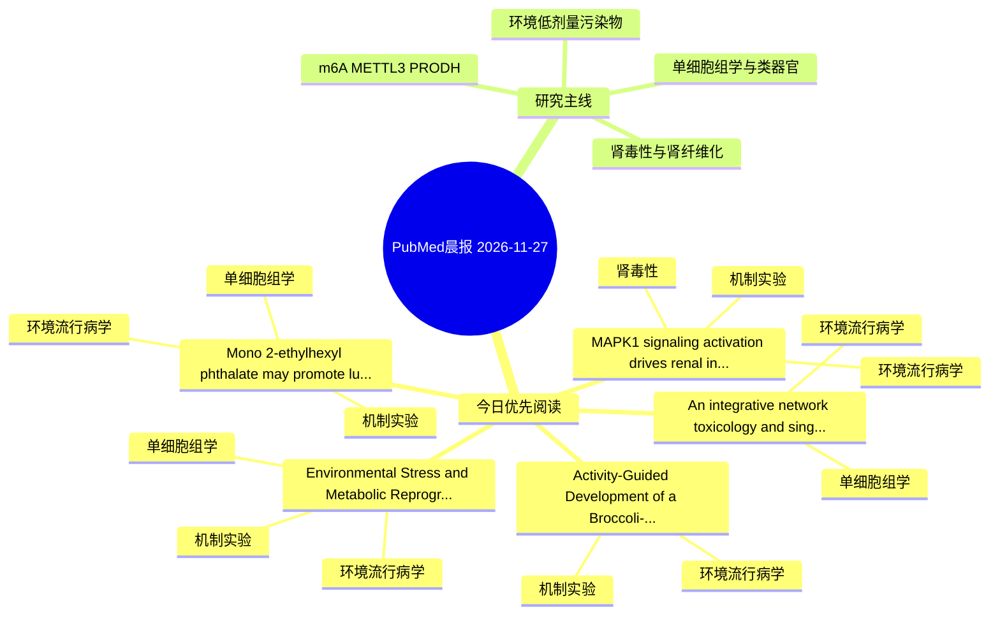

# PubMed 文献晨报｜2026-11-27

- 生成日期：2026-11-27 UTC
- 检索窗口：近 24 小时
- 高质量阈值：规则评分 ≥ 7
- 近 24 小时原始命中数：9

## 今日总体判断

今日筛选出 5 篇优先阅读文献，主要集中在：环境流行病学、机制实验、单细胞组学。

## 今日最值得读的 5 篇文章

### 1. MAPK1 signaling activation drives renal injury and dysfunction following subchronic BPP exposure in mice.

- 题目：MAPK1 signaling activation drives renal injury and dysfunction following subchronic BPP exposure in mice.
- 期刊：Ecotoxicology and environmental safety
- 年份：2026
- PMID：[43098108](https://pubmed.ncbi.nlm.nih.gov/43098108/)
- DOI：[10.1016/j.ecoenv.2026.121106](https://doi.org/10.1016/j.ecoenv.2026.121106)
- 分类：环境流行病学、机制实验、肾毒性
- 规则评分：17
- 研究对象：小鼠或大鼠肾损伤模型
- 核心方法：细胞与动物机制实验
- 主要发现：摘要提示研究重点涉及肾毒性/肾损伤；结论线索为：Furthermore, quantitative real‑time polymerase chain reaction (qPCR) analysis revealed that BPP disrupted renal repair capacity by downregulating pro-repair genes (Egr1; early growth response 1, Egf; epidermal growth factor).
- 为什么值得读：同时连接环境暴露与机制线索；与肾毒性/肾损伤主线直接相关；关键词匹配度较高

### 2. Environmental Stress and Metabolic Reprogramming: Mechanistic Links to Endocrine and Metabolic Disease.

- 题目：Environmental Stress and Metabolic Reprogramming: Mechanistic Links to Endocrine and Metabolic Disease.
- 期刊：Food and chemical toxicology : an international journal published for the British Industrial Biological Research Association
- 年份：2026
- PMID：[43098501](https://pubmed.ncbi.nlm.nih.gov/43098501/)
- DOI：[10.1016/j.fct.2026.116473](https://doi.org/10.1016/j.fct.2026.116473)
- 分类：环境流行病学、机制实验、单细胞组学
- 规则评分：16
- 研究对象：患者样本或临床数据
- 核心方法：单细胞或空间组学；m6A RNA修饰检测
- 主要发现：摘要提示研究重点涉及环境污染物暴露、单细胞或空间组学；结论线索为：This framework positions metabolic reprogramming as a tractable mechanistic target and highlights priorities for mixture toxicology, metabolomics, stable-isotope tracing, single-cell approaches, gene-environment interactions, and early biomarker development.
- 为什么值得读：同时连接环境暴露与机制线索；可帮助寻找细胞类型特异性机制；关键词匹配度较高

### 3. An integrative network toxicology and single-cell analysis implicates a potential myeloid-centered plaque remodeling axis in bisphenol A-related atherosclerosis.

- 题目：An integrative network toxicology and single-cell analysis implicates a potential myeloid-centered plaque remodeling axis in bisphenol A-related atherosclerosis.
- 期刊：Molecular diversity
- 年份：2026
- PMID：[43099228](https://pubmed.ncbi.nlm.nih.gov/43099228/)
- DOI：[10.1007/s11030-026-11790-1](https://doi.org/10.1007/s11030-026-11790-1)
- 分类：环境流行病学、单细胞组学
- 规则评分：14
- 研究对象：人群/队列或环境暴露人群
- 核心方法：环境流行病学/队列或人群数据；单细胞或空间组学
- 主要发现：摘要提示研究重点涉及单细胞或空间组学；结论线索为：Collectively, these findings suggest that predicted BPA-related targets may intersect with AS-associated inflammatory activation, lysosomal lipid metabolism, vascular remodeling, and myeloid-centered communication programs.
- 为什么值得读：可帮助寻找细胞类型特异性机制；关键词匹配度较高

### 4. Mono(2-ethylhexyl) phthalate may promote lung adenocarcinoma stromal remodeling through ADARB1-dependent fibroblast activation: Integrated bioinformatic, biophysical and cellular evidence.

- 题目：Mono(2-ethylhexyl) phthalate may promote lung adenocarcinoma stromal remodeling through ADARB1-dependent fibroblast activation: Integrated bioinformatic, biophysical and cellular evidence.
- 期刊：Ecotoxicology and environmental safety
- 年份：2026
- PMID：[43098111](https://pubmed.ncbi.nlm.nih.gov/43098111/)
- DOI：[10.1016/j.ecoenv.2026.121079](https://doi.org/10.1016/j.ecoenv.2026.121079)
- 分类：环境流行病学、机制实验、单细胞组学
- 规则评分：14
- 研究对象：人群/队列或环境暴露人群
- 核心方法：单细胞或空间组学；细胞与动物机制实验
- 主要发现：摘要提示研究重点涉及肾纤维化、单细胞或空间组学；结论线索为：CONCLUSION: These findings suggest that MEHP may drive LUAD stromal remodeling by activating fibroblasts via an ADARB1-dependent mechanism, providing testable mechanistic hypotheses and candidate biomarkers for phthalate-associated cancer risk assessment.
- 为什么值得读：同时连接环境暴露与机制线索；可帮助寻找细胞类型特异性机制；关键词匹配度较高

### 5. Activity-Guided Development of a Broccoli-Rich Mixed Vegetable Extract: Effects on Cadmium-Associated Oxidative Injury and Tissue Cadmium Concentrations.

- 题目：Activity-Guided Development of a Broccoli-Rich Mixed Vegetable Extract: Effects on Cadmium-Associated Oxidative Injury and Tissue Cadmium Concentrations.
- 期刊：Food science & nutrition
- 年份：2026
- PMID：[43101079](https://pubmed.ncbi.nlm.nih.gov/43101079/)
- DOI：[10.1002/fsn3.72625](https://doi.org/10.1002/fsn3.72625)
- 分类：环境流行病学、机制实验
- 规则评分：9
- 研究对象：小鼠或大鼠肾损伤模型
- 核心方法：细胞与动物机制实验
- 主要发现：摘要提示研究重点涉及环境污染物暴露；结论线索为：These findings support further investigation of the selected MVE as a food-derived candidate with potential protective effects on selected Cd-associated endpoints.
- 为什么值得读：同时连接环境暴露与机制线索

## 分类归档

### 环境流行病学
- [MAPK1 signaling activation drives renal injury and dysfunction following subchronic BPP exposure in mice.](https://pubmed.ncbi.nlm.nih.gov/43098108/)（PMID: 43098108）
- [Environmental Stress and Metabolic Reprogramming: Mechanistic Links to Endocrine and Metabolic Disease.](https://pubmed.ncbi.nlm.nih.gov/43098501/)（PMID: 43098501）
- [An integrative network toxicology and single-cell analysis implicates a potential myeloid-centered plaque remodeling axis in bisphenol A-related atherosclerosis.](https://pubmed.ncbi.nlm.nih.gov/43099228/)（PMID: 43099228）
- [Mono(2-ethylhexyl) phthalate may promote lung adenocarcinoma stromal remodeling through ADARB1-dependent fibroblast activation: Integrated bioinformatic, biophysical and cellular evidence.](https://pubmed.ncbi.nlm.nih.gov/43098111/)（PMID: 43098111）
- [Activity-Guided Development of a Broccoli-Rich Mixed Vegetable Extract: Effects on Cadmium-Associated Oxidative Injury and Tissue Cadmium Concentrations.](https://pubmed.ncbi.nlm.nih.gov/43101079/)（PMID: 43101079）

### 机制实验
- [MAPK1 signaling activation drives renal injury and dysfunction following subchronic BPP exposure in mice.](https://pubmed.ncbi.nlm.nih.gov/43098108/)（PMID: 43098108）
- [Environmental Stress and Metabolic Reprogramming: Mechanistic Links to Endocrine and Metabolic Disease.](https://pubmed.ncbi.nlm.nih.gov/43098501/)（PMID: 43098501）
- [Mono(2-ethylhexyl) phthalate may promote lung adenocarcinoma stromal remodeling through ADARB1-dependent fibroblast activation: Integrated bioinformatic, biophysical and cellular evidence.](https://pubmed.ncbi.nlm.nih.gov/43098111/)（PMID: 43098111）
- [Activity-Guided Development of a Broccoli-Rich Mixed Vegetable Extract: Effects on Cadmium-Associated Oxidative Injury and Tissue Cadmium Concentrations.](https://pubmed.ncbi.nlm.nih.gov/43101079/)（PMID: 43101079）

### 单细胞组学
- [Environmental Stress and Metabolic Reprogramming: Mechanistic Links to Endocrine and Metabolic Disease.](https://pubmed.ncbi.nlm.nih.gov/43098501/)（PMID: 43098501）
- [An integrative network toxicology and single-cell analysis implicates a potential myeloid-centered plaque remodeling axis in bisphenol A-related atherosclerosis.](https://pubmed.ncbi.nlm.nih.gov/43099228/)（PMID: 43099228）
- [Mono(2-ethylhexyl) phthalate may promote lung adenocarcinoma stromal remodeling through ADARB1-dependent fibroblast activation: Integrated bioinformatic, biophysical and cellular evidence.](https://pubmed.ncbi.nlm.nih.gov/43098111/)（PMID: 43098111）

### 类器官
- 今日暂无高质量新文献。

### 肾毒性
- [MAPK1 signaling activation drives renal injury and dysfunction following subchronic BPP exposure in mice.](https://pubmed.ncbi.nlm.nih.gov/43098108/)（PMID: 43098108）

### m6A-METTL3-PRODH
- 今日暂无高质量新文献。

## 今日阅读优先级

1. MAPK1 signaling activation drives renal injury and dysfunction following subchronic BPP exposure in mice.（优先理由：同时连接环境暴露与机制线索；与肾毒性/肾损伤主线直接相关；关键词匹配度较高）
2. Environmental Stress and Metabolic Reprogramming: Mechanistic Links to Endocrine and Metabolic Disease.（优先理由：同时连接环境暴露与机制线索；可帮助寻找细胞类型特异性机制；关键词匹配度较高）
3. An integrative network toxicology and single-cell analysis implicates a potential myeloid-centered plaque remodeling axis in bisphenol A-related atherosclerosis.（优先理由：可帮助寻找细胞类型特异性机制；关键词匹配度较高）
4. Mono(2-ethylhexyl) phthalate may promote lung adenocarcinoma stromal remodeling through ADARB1-dependent fibroblast activation: Integrated bioinformatic, biophysical and cellular evidence.（优先理由：同时连接环境暴露与机制线索；可帮助寻找细胞类型特异性机制；关键词匹配度较高）
5. Activity-Guided Development of a Broccoli-Rich Mixed Vegetable Extract: Effects on Cadmium-Associated Oxidative Injury and Tissue Cadmium Concentrations.（优先理由：同时连接环境暴露与机制线索）

## Mermaid 思维导图

