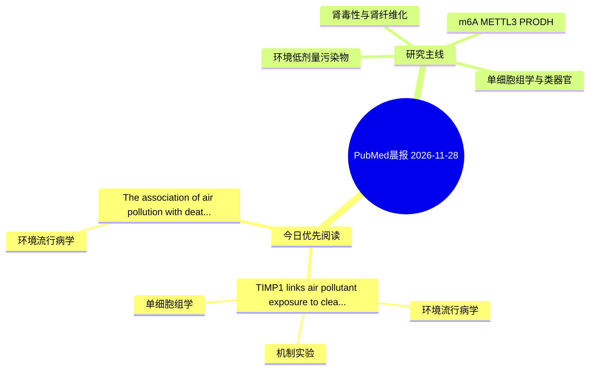

# PubMed 文献晨报｜2026-11-28

- 生成日期：2026-11-28 UTC
- 检索窗口：近 24 小时
- 高质量阈值：规则评分 ≥ 7
- 近 24 小时原始命中数：4

## 今日总体判断

今日筛选出 2 篇优先阅读文献，主要集中在：环境流行病学、机制实验、单细胞组学。

## 今日最值得读的 5 篇文章

### 1. TIMP1 links air pollutant exposure to clear cell renal cell carcinoma progression through pericyte-mediated paracrine signaling.

- 题目：TIMP1 links air pollutant exposure to clear cell renal cell carcinoma progression through pericyte-mediated paracrine signaling.
- 期刊：Ecotoxicology and environmental safety
- 年份：2026
- PMID：[43103345](https://pubmed.ncbi.nlm.nih.gov/43103345/)
- DOI：[10.1016/j.ecoenv.2026.121103](https://doi.org/10.1016/j.ecoenv.2026.121103)
- 分类：环境流行病学、机制实验、单细胞组学
- 规则评分：13
- 研究对象：人群/队列或环境暴露人群
- 核心方法：单细胞或空间组学
- 主要发现：摘要提示研究重点涉及环境污染物暴露、单细胞或空间组学；结论线索为：CONCLUSIONS: This study identifies TIMP1 as a key pollutant-responsive prognostic factor in ccRCC and highlights its potential involvement in stromal-tumor communication.
- 为什么值得读：同时连接环境暴露与机制线索；可帮助寻找细胞类型特异性机制；关键词匹配度较高

### 2. The association of air pollution with death and deterioration on the United States transplant waiting list.

- 题目：The association of air pollution with death and deterioration on the United States transplant waiting list.
- 期刊：American journal of transplantation : official journal of the American Society of Transplantation and the American Society of Transplant Surgeons
- 年份：2026
- PMID：[43103743](https://pubmed.ncbi.nlm.nih.gov/43103743/)
- DOI：[10.1016/j.ajt.2026.11.019](https://doi.org/10.1016/j.ajt.2026.11.019)
- 分类：环境流行病学
- 规则评分：9
- 研究对象：人群/队列或环境暴露人群
- 核心方法：环境流行病学/队列或人群数据
- 主要发现：摘要提示研究重点涉及环境污染物暴露；结论线索为：In this study, air pollution was associated with adverse waitlist outcomes, especially among thoracic organ candidates, supporting evaluation and inclusion of environmental stressors in organ allocation policy.
- 为什么值得读：与检索主题有交集，可作为背景或线索文献扫读

## 分类归档

### 环境流行病学
- [TIMP1 links air pollutant exposure to clear cell renal cell carcinoma progression through pericyte-mediated paracrine signaling.](https://pubmed.ncbi.nlm.nih.gov/43103345/)（PMID: 43103345）
- [The association of air pollution with death and deterioration on the United States transplant waiting list.](https://pubmed.ncbi.nlm.nih.gov/43103743/)（PMID: 43103743）

### 机制实验
- [TIMP1 links air pollutant exposure to clear cell renal cell carcinoma progression through pericyte-mediated paracrine signaling.](https://pubmed.ncbi.nlm.nih.gov/43103345/)（PMID: 43103345）

### 单细胞组学
- [TIMP1 links air pollutant exposure to clear cell renal cell carcinoma progression through pericyte-mediated paracrine signaling.](https://pubmed.ncbi.nlm.nih.gov/43103345/)（PMID: 43103345）

### 类器官
- 今日暂无高质量新文献。

### 肾毒性
- 今日暂无高质量新文献。

### m6A-METTL3-PRODH
- 今日暂无高质量新文献。

## 今日阅读优先级

1. TIMP1 links air pollutant exposure to clear cell renal cell carcinoma progression through pericyte-mediated paracrine signaling.（优先理由：同时连接环境暴露与机制线索；可帮助寻找细胞类型特异性机制；关键词匹配度较高）
2. The association of air pollution with death and deterioration on the United States transplant waiting list.（优先理由：与检索主题有交集，可作为背景或线索文献扫读）

## Mermaid 思维导图

